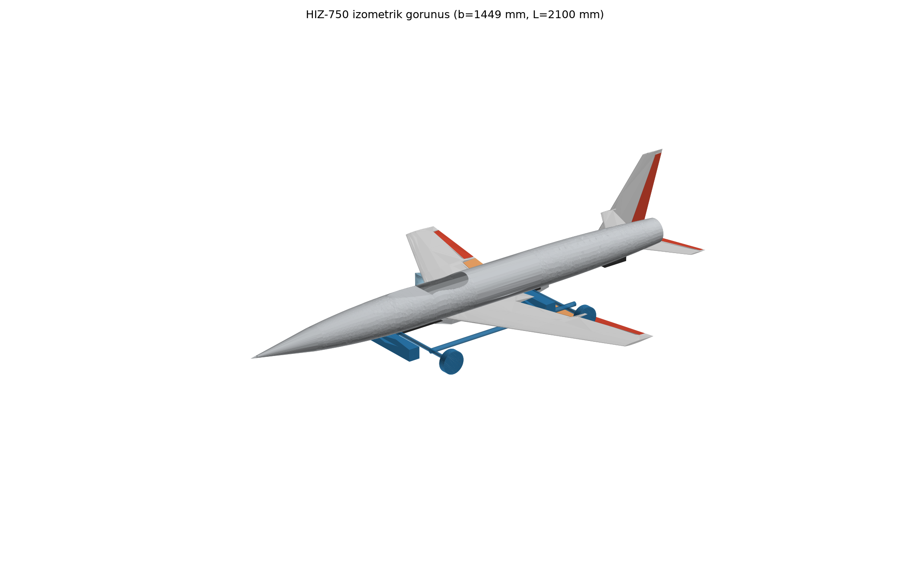
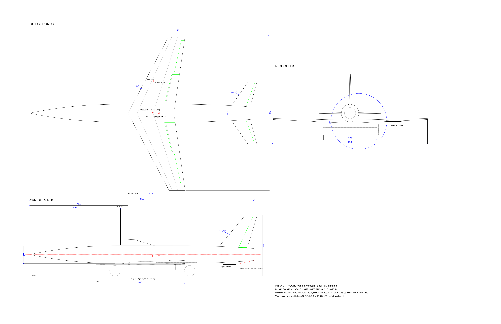
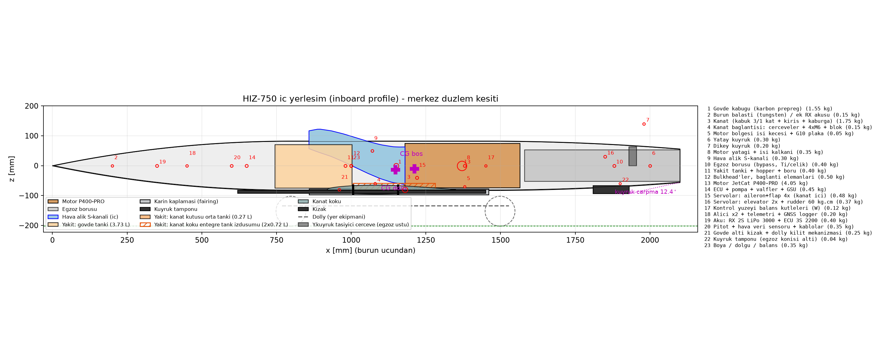

# HIZ-750: 750 km/h RC Jet İHA (Kavramsal + Ön Tasarım Paketi)



Türbinli bir RC hız modelinin tasarımı: **750 km/h'te ölçüm geçişi**, operasyonel limit 800 km/h.
Bu hız, türbinli RC uçaklarda Guinness dünya rekoru seviyesinde: Niels Herbrich, 2017, 749,2 km/h.

> Durum: **v0.5.0: İterasyon 3 tasarımı + iter4 masa başı doğrulamaları** (CAD kütle/atalet, FE modal flutter, uçuş kontrol yasası, alık basınç kazanımı). Sayısal modeller yaklaşık. İmalattan önce yer testleriyle doğrulanması gereken konular §4'te listeli.

## 1. Tasarım özeti

| Parametre | Değer |
|---|---|
| Motor | JetCat P400-PRO, 425 N statik itki, 4,05 kg |
| Kanat açıklığı / alanı / AR | 1,449 m / 0,42 m² / 5,0 |
| Kanat ok açısı / profil | Hücum kenarında 28°; NACA 64A007 kök → 64A006 uç; alçak kanat (z −80 mm), +2° dihedral |
| Gövde | 2,10 m × Ø165 mm, karbon prepreg kabuk |
| Kuyruk | Yatay kuyruk 0,085 m² (iki yarı, egzoz üstü yoke), dikey kuyruk 0,060 m² |
| Hava alığı | Dorsal, yarı gömülü pitot dudak, 60 cm², rampalı; S-kanal ofset/uzunluk 0,27 |
| Kalkış / iniş | Bırakılan dolly ile kalkış (α 3°) / kızak + kuyruk tamponuyla çim iniş, yarıklı flap 35°, temas 87–95 km/h |
| MTOW / yakıtsız | 17,16 kg / 13,16 kg (Türkiye İHA1 sınıfı, < 25 kg) |
| Yakıt | 4,0 kg (5,0 L) yüklenir; kullanılabilir 5,14 L (gövde 3,73 + kanat kutusu ortası 0,27 + kanat kökü 2 × 0,57 L), yakıt CG x 0,940 m (CAD) |
| Azami hız | ~878 km/h kötümser model; alık analiziyle (η_r 0,97) ~897 km/h |
| 750 km/h'te itki payı | %40–90 (sürükleme 154–210 N, kullanılabilir itki ~300 N) |
| Statik marj | Tam yakıtta %32,8, %25 yakıtta %18,7, boşta %12,5 MAC (nötr nokta 1,251 m) |
| Flutter / diverjans | **FE modal: 1307 km/h** (pay %21; 3B–1T modları), 2-DOF 1465 km/h; ok açılı kanatta diverjans yok. Gereksinim ≥ 1080 km/h |
| Kanat kütlesi (kat planından) | 1,74 kg (bütçe 1,75 kg); tek parça, gövde içinden geçen kutu, 4× M6 |
| Yapısal limit | +12 / −8 g, emniyet katsayısı 1,5 |
| Servolar | 6× 45 kg·cm + 1× 60 kg·cm (rudder), HV, boşluksuz; aileron servosu ≤ 60 g ince tip; elevator veteri %22 |
| Uçuş kontrol | n_z komutlu pitch + g-limiter (−6/+10 g), yaw damper (ζ_DR 0,31–0,44), p komutlu roll; 4 hız × 3 yakıt kazanç tablosu; GM ≥ 9,4 dB, PM ≥ 50° |
| Atalet (CAD, 4 kg yakıt) | Ixx 0,378 · Iyy 2,79 · Izz 3,08 · Ixz 0,044 kg·m² |
| Tahmini maliyet | ~€12.500–15.500 |

## 2. Doküman paketi

| # | Doküman | İçerik |
|---|---|---|
| 01 | Bu dosya | Özet, mimari, açık konular |
| 02 | [Aerodinamik ve stabilite](docs/02_aerodinamik_stabilite.md) | Profil polarları (NeuralFoil), AeroBuildup/VLM, nötr nokta, trim, dinamik modlar, kontrol otoritesi, dolly kalkışı, flare |
| 03 | [CAD](docs/03_cad.md) | STEP/STL parçaları, montaj, DXF 3 görünüş, iç yerleşim, çakışma raporu |
| 04 | [Yapı ve flutter](docs/04_yapi_flutter.md) | V-n, Schrenk yükleri, kiriş ve kat planı, GJ, flutter V-g, diverjans, balans kütleleri, menteşe momentleri, servo seçimi, entegre tank, kızak, yatay kuyruk bağlantısı |
| 05 | [Sistemler ve performans](docs/05_sistemler_performans.md) | İtki/sürükleme, kalkış/iniş, görev profili, yakıt bütçesi, yakıt sistemi, alık, elektrik, aviyonik, kontrol modları |
| 06 | [Üretim, test, maliyet](docs/06_uretim_test_maliyet.md) | Kalıp ve laminasyon, malzeme listesi, yer testleri, uçuş zarfı genişletme, ölçüm yöntemi |
| 07 | [Mevzuat ve risk](docs/07_mevzuat_risk.md) | SHGM/EU/AMA, saha güvenliği, FMEA |
| 08 | [**Proje raporu: sonuçlar ve çıkarımlar**](docs/08_sonuclar_cikarimlar.md) | Yönetici özeti, iterasyon evrimi, çıkarımlar, doğrulama durumu, yol haritası, varsayımlar |
| 09 | [Uçuş kontrol](docs/09_ucus_kontrol.md) | Doğrusal modeller, kontrol yasaları, kararlılık payları, simülasyonlar, kazanç tablosu, ayar prosedürü |
| — | [CHANGELOG](CHANGELOG.md) | Sürüm geçmişi v0.1 → v0.5 |
| — | [Kütle/CG tablosu](performance/out/kutle_tablosu.md) | Kalem bazında kütle ve moment |

**Çizimler:**
- [3 görünüş PNG](cad/out/HIZ750_3view.png), aynı çizimin PDF ve DXF'i `cad/out/` içinde
- [İç yerleşim](cad/out/HIZ750_inboard.png)
- Montaj: `cad/out/HIZ750_assembly.step`, dolly ile `cad/out/HIZ750_on_dolly.step`
- Parçalar: `cad/out/step/` ve `cad/out/stl/` (27 parça)




## 3. Hesap mimarisi ve yeniden üretme

Tüm scriptler tek bir kaynaktan, [`params.py`](params.py) dosyasından beslenir. Bir parametreyi değiştirip hepsini tekrar çalıştırmak bütün paketi günceller.

```
params.py  ──►  sizing.py              (itki/sürükleme, Vmax, trade study)        → out/
           ──►  aero/aero_analysis.py  (AeroSandbox: stabilite, trim, modlar)     → aero/out/
           ──►  structures/structures.py (yük, kiriş, flutter, servo, kızak)      → structures/out/
           ──►  cad/build_cad.py       (CadQuery: STEP/STL/DXF + çakışma kontrolü) → cad/out/
           ──►  cad/mass_properties.py (CAD'den kütle, CG, atalet tensörü)       → cad/out/mass_properties.json
           ──►  performance/mission.py, mass_report.py, inlet_analysis.py        → performance/out/
           ──►  aero/flight_control.py (kontrol yasası, paylar, simülasyon)      → aero/out/fc_*
           ──►  structures/fe_modal.py (FE kiriş modları, modal p-k flutter)     → structures/out/fe_*
```

Kurulum için CadQuery'nin OCP DLL'leri uzun Windows yollarında yüklenemediği için venv'i kısa bir yola kurmak gerekir:

```bash
python -m venv C:/Users/Urungu/.hz750
```

```bash
C:/Users/Urungu/.hz750/Scripts/python -m pip install -r requirements.txt
```

Hepsini doğru sırayla çalıştırma (~12 dk; FE flutter ~7 dk):

```bash
bash run_all.sh
```

Tasarım geçmişi:
- `params_iter1.py`: ilk konfigürasyon (kanat 1,00 m'de, iniş takımlı, statik marj %30–40).
- `params_iter2a.py`: iter2 ara adım.
- `params_iter2.py`: iter2 son (orta-alçak kanat, dolly + kızak).
- `params.py`: iter3 + iter4 düzeltmeleri (güncel).

Analiz klasörlerinde de `*_iter1` arşivleri var.

## 4. İterasyonlarda çözülen sorunlar ve açık konular

**İterasyon 1 → 2'de çözülenler:**
- **Statik marj çok büyüktü** (%40). Kanat 80 mm öne alındı ve yakıt CG'ye yaklaştırıldı; marj %12–30'a indi.
- **Motor kanat kirişiyle çakışıyordu.** Arka kiriş 0,62c → 0,55c'ye çekildi, motor 1,18 m'ye alındı.
- **Alık kanalı kanat kutusunu kesiyordu, yatay kuyruk egzozun içinden geçiyordu.** Kanal kutunun üstünden geçirildi, yatay kuyruk iki yarıya bölündü. CAD çakışmaları artık 0.
- **Ana tekerler 25 mm kalınlıktaki kanada sığmıyordu.** Dolly + kızak çözümüne geçildi; bu 1,5 kg kazandırdı.
- **Yakıt 4 geçişlik görev profiline yetmiyordu.** Tank 5,2 L'ye çıkarıldı ve operasyon kuralları eklendi.
- **Cn_β düşüktü.** Dikey kuyruk 0,050 → 0,060 m² yapıldı.
- **Negatif hamle yükü −6 g'yi aşıyordu.** Tasarım limiti −8 g yapıldı.

**İterasyon 2 → 3'te çözülenler:**
- **S-kanal ofset/uzunluk oranı 0,50 → 0,267, kanaldaki en dik duvar açısı 66° → 25,6°.** Kanat alçağa alındı (z −80 mm), dudak yarı gömülü yapıldı ve öne (0,85 m) alındı. Dorsal çıkıntı ~70 → ~43 mm'ye indi.
- **İter2 flutter payı iyimserdi.** Kesit CG'si yeniden hesaplandığında 0,52c çıktı; bu durumda flutter ~1086 km/h, yani pay yok demek. Kabuk kiriş önünde 3, arkasında 1 kat yapıldı → flutter 1465 km/h, pay %36.
- **Kuyruk çarpma açısı 2,6° → 12,4°.** Kızak uzatıldı ve kuyruk tamponu eklendi.
- **Kanat tankı hacmi belirsizdi.** Hacim CAD'de duvar kalınlıkları düşülerek ölçüldü (0,715 L/yarı). Gövde içinden geçen kanat kutusuna 0,27 L orta tank eklendi; toplam 5,33 L.
- **Alçak kanat Cl_β'yı bozuyordu.** DATCOM düzeltmesiyle hesaplanıp +2° dihedral verildi; spiral mod kararlı.
- **İniş hızı yüksekti.** Yarıklı flap ile temas hızı 95–100 → 87–95 km/h'ye indi.
- **Boş yakıtta elevator aşırı güçlüydü.** Veter %28 → %22'ye düşürüldü; bu yetmediği için g-limiter ve yakıta bağlı sapma limiti zorunlu.

**İter4'te (v0.5.0) masa başında doğrulananlar:**
- **Kütle ve atalet CAD'den hesaplandı.** Gövde kabuğunun ağırlık merkezi 100 mm geride çıktı, bu yüzden boş yakıtta statik marj %8,4'e düşüyordu. Kabuğun konumu düzeltildi ve 0,15 kg burun balastı eklendi; marj yeniden %12,5. Ixx, Roskam tahmininin %69'u.
- **Kanat için FE modal flutter analizi yapıldı** (Goland kanadıyla doğrulandı). Flutter hızı 1307 km/h; 2-DOF modeli bunu %11 iyimser veriyordu. Kesit CG'si ve GJ için 24 köşe durumunun hepsi 1080 km/h'nin üstünde. GVT kabul kriteri: f_1T ≥ 230 Hz.
- **Uçuş kontrol yasası tasarlandı.** g-limiter, boş yakıtta tam çubuk çekişte n'yi 10,05 g'de tutuyor; kontrolcü olmasa 28 g çıkıyordu. Yaw damper Dutch roll sönümünü ζ 0,10'dan 0,31–0,44'e çıkarıyor. Tüm zarfta kazanç payı ≥ 9,4 dB.
- **Alığın basınç kazanımı hesaplandı:** η_r = 0,970, eşdeğer k_ram 0,67. Taban model kötümser kalıyor.
- **Kanat tankı hacmi uzlaştırıldı:** kullanılabilir hacim yarı kanat başına 0,57 L. Gövde tankı 3,73 L'ye büyütüldü.

**Açık konular (imalattan önce):**
1. **Kısa ve sert rüzgâr hamlesi:** 15 m/s'lik 7,8 m'lik bir hamle 19–27 g üretiyor; kontrolcü bu kadar hızlı tepki veremiyor. Bu yüzden ölçüm uçuşları **yalnızca sakin havada** yapılmalı (uçuş kartında sınırlama olarak yer alır).
2. **Türbin modeli:** İtkinin hızla düşüşü (`Vj`) ve alık kazanımı ölçülmedi. Yer testinde motor yüzünde basınç taraması, F2–F3 uçuşlarında telemetri ile kalibre edilmeli.
3. **Flutter testi:** Flutter "sert" tipte, yani yaklaşırken uyarı vermiyor. **GVT yapılmadan 600 km/h üstüne çıkılmamalı.** Kat planı ile boya ve dolgu kütle kontrolü şart.
4. **Motor altı kabuk sıcaklığı** ilk yer çalıştırmasında ölçülmeli (motorla kabuk arası 8,5 mm).
5. **Kontrol döngüsü 200 Hz olmalı:** 50 Hz'de 20 ms gecikme yaw payını daraltıyor; 350 km/h altındaki kontrol yasası (kalkış/iniş) da henüz tasarlanmadı.
6. **Pitch FC arızası:** Arıza durumunda yüksek hızda elevator ±0,3° ile sınırlanmalı, yüksek hız modunda pilotun rudder komutu ±0,3–0,5° ile.
7. **Kızakla iniş yalnız çimde** yapılabilir.

## 5. Kullanılan araçlar ve kaynaklar
- CadQuery 2.8 (OpenCascade), ezdxf 1.4, AeroSandbox 4.2.10 (NeuralFoil, AeroBuildup, VLM), NumPy/SciPy/Matplotlib.
- Yöntemler:
  - Raymer: bileşen sürüklemesi ve Korn denklemi
  - Schrenk yük dağılımı
  - Bredt-Batho burulma
  - Theodorsen 2-DOF ve FE modal p-k flutter (ders kitabı ve Goland kanadıyla doğrulandı)
  - DATCOM gövde-kanat girişimi, doğrusal durum-uzay kontrol tasarımı
  - CS-23 tipi V-n
- Veri:
  - JetCat ve Kingtech veri sayfaları
  - Guinness (Herbrich 2017)
  - SHGM SHT-İHA Rev-05
  - EU 2019/947
  - AMA 510-D
