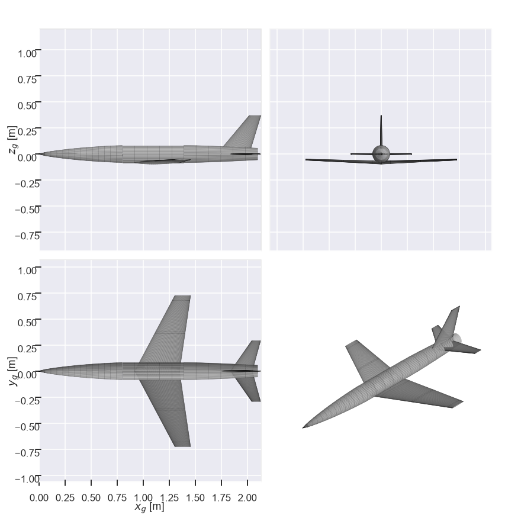
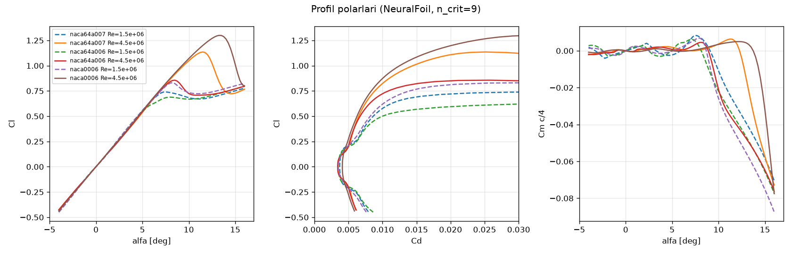
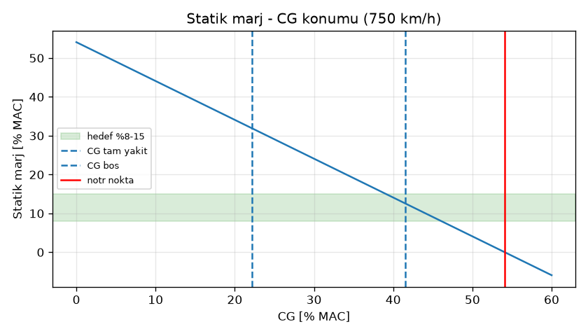

# 02: Aerodinamik ve Stabilite Analizi (İterasyon 3)

> **İter3 kapanış güncellemesi (ana entegrasyon):** Bu analizden sonra params'a işlenen değişiklikler: kanat kökü z −0,065 → **−0,080 m**, dihedral → **+2,0°** (bu analizin tekrarında z −80 mm için önerilen değer), yakıt CG'si 0,955 m (CAD), MTOW 17,01 kg. Script bu değerlerle yeniden çalıştırıldı. **Güncel sonuçlar:** x_np 1,251 m, statik marj tam yakıtta **%31,9**, boşta **%12,6** MAC. Cl_β (750 km/h, DATCOM düzeltmeli) ≈ −0,037 /rad, spiral kararlı. Dutch roll 2,64 Hz, ζ 0,10; yaw damper gerekli. Elevator ±1,5° ile tam yakıtta 7,5 g, boşta 24,7 g; g-limiter zorunlu. İniş temas hızı 87 km/h (nominal) – 95 km/h (muhafazakâr). Metinde bunlardan farklı ara değerler varsa güncel olan `aero/out/ozet.txt`'tir.


**Kaynak script:** `aero/aero_analysis.py`. Tekrar çalıştırmak için:

```bash
C:/Users/Urungu/.hz750/Scripts/python aero/aero_analysis.py
```

**Araçlar:** AeroSandbox 4.2.10.
- AeroBuildup: bileşen bazlı, NeuralFoil profil verisi + gövde.
- VLM: çapraz kontrol.
- DATCOM: gövde-kanat girişimi.
- Raymer: flap modeli (ampirik).
- 4×4 yanal durum matrisi.

**Girdi (`params.py`, iter3):**
- MTOW 16,81 kg.
- CG tam yakıtta x = 1,159 m, boşta x = 1,212 m. Yakıt CG'si geçici olarak 0,987 m; CAD'den sonra güncellenecek.
- MAC 0,312 m, x_MAC_LE = 1,082 m.

**Ham sonuçlar:** `aero/out/ozet.txt`, `aero/out/sonuclar.json`.

## Değişiklik özeti (iter1 → iter3)

| Konu | İter1 | İter2 | İter3 |
|---|---|---|---|
| Kanat kökü x / z | 1,00 / −0,035 | 0,92 / −0,035 | 0,92 / **−0,065 (alçak kanat)** |
| Dihedral | −1° | −1° | 0° → **öneri +1,5°** |
| Flap | Düz, cf 0,22, 30° | Düz, cf 0,22, 30° | **Tek yarıklı, cf 0,25, 35°** |
| Elevator cf / yüksek hız limiti | 0,28 / ±3° | 0,28 / ±1,5° | **0,22 / ±1,5°** |
| Dikey kuyruk | 0,050 m² | 0,060 m² | 0,060 m² |
| Kalkış / iniş | Tekerlek | Dolly + kızak | Dolly + kızak (kızak 1,45 m'ye uzadı) |
| MTOW | 18,30 kg | 16,77 kg | 16,81 kg |
| x_np | 1,318 m | 1,251 m | **1,250 m** |
| SM tam / %25 / boş | %40 / – / %29 | %31 / %21 / %16 | **%29 / %18 / %12** |
| Cl_β @ 750 (girişim dahil) | – | – | Γ = 0'da −0,012 → Γ = +1,5'te **−0,034** |
| Vs iniş (nominal) | 89 km/h | 86 km/h | **79 km/h** |

İter2 notlarındaki açık maddeler birleştirildi:
- **Flap ΔCD:** ampirik değer artık Raymer'in yarıklı flap formülüyle (0,021) hesaplanıyor; önceki 0,05–0,08 aralığının yerini aldı.
- **Boş yakıtta elevator otoritesi:** cf 0,22 ile de 12 g limiti aşılıyor; §6'da çözüm önerisi var.
- **Dutch roll sönümü:** Yaw damper gereksinimi doğrulandı ve 4×4 modelle yeniden hesaplandı.
- **İniş hızı:** Yarıklı flapla düştü.

**SM bilinçli olarak yüksek tutuldu.** Gerekçeler:
- Dolly kalkışında rotasyon gerekmiyor.
- Yüksek SM, yüksek hızda elevator hassasiyetini azaltıyor.



## 1. Profiller

Kanat kökünde NACA 64A007, ucunda 64A006 var (64A010 koordinatları kalınlıkça ölçeklendi). Kuyruklarda NACA 0006 kullanılıyor.

| Profil | Re | Cl_max | α(Cl_max) | Cd0 | Cm0 | Cl_α [/rad] |
|---|---|---|---|---|---|---|
| 64A007 | 1,5e6 | 0,75 | 15° | 0,0037 | 0 | 6,18 |
| 64A007 | 4,5e6 | 1,14 | 11,5° | 0,0035 | 0 | 6,07 |
| 64A006 | 1,5e6 | 0,77 | 15° | 0,0035 | 0 | 6,31 |
| 0006 | 1,5e6 | 0,83 | 8,2° | 0,0035 | 0 | 6,38 |



- **Mach etkisi:** 750 km/h'te M = 0,61. Prandtl-Glauert'e göre Cl_α ×1,27 artar.
- **Sıkışabilirlik:** Korn'a göre ok açılı kanadın M_dd değeri ≈ 0,87; dalga sürüklemesi yok.

## 2. Boylamsal kararlılık

| Büyüklük | Değer |
|---|---|
| CL_α (750 km/h) | 4,92 /rad (VLM, gövdesiz: 4,41) |
| Cm_α (tam yakıt CG) | −1,45 /rad |
| Cm_q | −10,0 /rad |
| CL_δe / Cm_δe (cf 0,22) | 0,62 / −1,60 /rad (iter2'de cf 0,28: 0,75 / −1,94) |
| **x_np** | **1,250 m** (düşük hızda 1,243 m) |

### Yakıt durumuna göre statik marj

| Yakıt | m [kg] | x_cg [m] | CG [%MAC] | SM [%MAC] |
|---|---|---|---|---|
| %100 | 16,81 | 1,159 | 24,6 | **29,4** |
| %75 | 15,81 | 1,169 | 28,1 | 25,9 |
| %50 | 14,81 | 1,182 | 32,0 | 22,0 |
| %25 (iniş) | 13,81 | 1,196 | 36,6 | **17,5** |
| %0 | 12,81 | 1,212 | 41,8 | **12,2** |

İter2'ye göre boş yakıtta SM %16'dan %12'ye düştü (yakıt CG'si 0,987 m'ye öne alındı). Değer hâlâ hedef bandın (%8–15) içinde.



### Yüksek hız trimi

| Durum | α | δe | CL | CD | D |
|---|---|---|---|---|---|
| 750 km/h, tam yakıt | +0,08° | +0,08° | 0,0152 | 0,0142 | 154 N |
| 750 km/h, boş | +0,02° | +0,21° | 0,0116 | 0,0142 | 154 N |

## 3. Tek yarıklı flap (cf 0,25, η 0,12–0,50)

**Model girdileri:**
- Flaplı alan oranı S_flap/S = 0,45; ince profil etkinliği τ = 0,61.
- Kuyruk eğimi (Helmbold) a_t = 3,66 /rad.
- AeroBuildup'ın büyük sapmadaki flap verisi kullanılmadı.

**Ampirik bağıntılar:**
- **ΔCL_max:** 0,9 · Δcl_max · (S_flap/S) · cos Λ_menteşe.
  - Nominal: Raymer tek yarıklı, Δcl_max = 1,3 · c′/c = 1,37.
  - Muhafazakâr: 0,9 · cf/0,25 = 0,90.
- **ΔCL0 (sabit α):** cl_α · τ · η · δ, η = 0,75 → 0,55 (35°'de).
- **ΔCm0:**
  - Kanat katkısı: −0,28·Δcl (yerel veter) + flap yük merkezinin MAC c/4'ün önünde olmasından gelen kol.
  - Kuyruk katkısı: ek downwash → burun yukarı.
- **ΔCD:** Raymer 12.61, yarıklı flap için F = 0,0074.

| Büyüklük | Flap 35° (iniş) | Flap 18° (kalkış) |
|---|---|---|
| ΔCL_max nominal / muhafazakâr | +0,54 / +0,35 | ~+0,32 / +0,21 |
| ΔCL0 | +0,50 | – |
| ΔCm0 kanat / kanat + kuyruk downwash | −0,098 / +0,011 | – |
| ΔCD | +0,021 | – |

| Durum | Nominal | Muhafazakâr |
|---|---|---|
| CL_max temiz | 0,62 | 0,62 |
| CL_max iniş (trimli) | **1,11** | 0,92 |
| Vs iniş (13,8 kg) | **79 km/h** | 86 km/h |
| Temas (1,1 Vs) | **86 km/h** | 95 km/h |
| CL_max kalkış (18°, trimli) | 0,89 | 0,78 |
| Vs kalkış (16,8 kg) | 97 km/h | 103 km/h |

**Yaklaşma** (1,3 Vs = 102 km/h, %25 yakıt):

| Konfigürasyon | α | δe | CD | D |
|---|---|---|---|---|
| Flap 35° | +1,4° | −1,6° | 0,088 | 18 N |
| Flapsız | +8,3° | −3,9° | – | 14 N |

## 4. Yön ve yanal kararlılık: alçak kanat ve dihedral

### 4.1 Gövde-kanat girişimi

AeroBuildup, kanadın gövdeye göre dikey konumunun Cl_β'ya etkisini modellemiyor. Bu yüzden DATCOM 5.2.1.1 düzeltmesi eklendi:

ΔCl_β = 1,2 · √A · (z_w/b) · (2D/b) = **+0,027 /rad**. Hesap z_w = 65 mm (gövde ekseninin altı), D = 165 mm ile yapıldı. Alçak kanatta bu etki destabilize edici.

Dihedral etkinliği:
- AeroBuildup: 750 km/h'te −0,0150 /rad/°, yaklaşmada −0,0086 /rad/°.
- Şerit teorisi: −0,0158 /rad/°.

| Γ | Cl_β @ 750 km/h | Cl_β yaklaşma (102 km/h) |
|---|---|---|
| −1° | +0,004 (kararsız) | −0,020 |
| 0° | −0,012 | −0,029 |
| +1° | −0,027 | −0,038 |
| **+1,5°** | **−0,034** | **−0,042** |
| +2° | −0,042 | −0,046 |
| +3° | −0,057 | −0,055 |

Diğer yanal türevler (750 km/h):
- Cn_β = +0,062 /rad, düşük hızda +0,116 /rad.
- CY_β = −0,32 /rad.
- Cl_p = −0,52, Cn_r = −0,146.
- Kuyruk hacimleri: V_h = 0,52, V_v = 0,075.

### 4.2 Yanal modlar (4×4: [β, p, r, φ], Ixz = 0, Roskam atalet tahminleri)

| Γ | Koşul | Dutch roll ωn / ζ | Roll τ | Spiral |
|---|---|---|---|---|
| 0° | 750 km/h | 16,5 rad/s / 0,098 | 19 ms | Kararsız, T2 = 836 s |
| 0° | Yaklaşma | 3,3 / 0,081 | 181 ms | **Kararsız, T2 = 8 s** |
| +1° | 750 km/h | 16,3 / 0,101 | 19 ms | Kararlı |
| +1° | Yaklaşma | 3,4 / 0,072 | 180 ms | Kararsız, T2 = 10 s |
| **+1,5°** | 750 km/h | 16,3 / 0,103 | 19 ms | Kararlı (yarılanma 169 s) |
| **+1,5°** | Yaklaşma | 3,4 / 0,068 | 179 ms | Kararsız, T2 = 11 s |
| +2° | Yaklaşma | 3,4 / 0,063 | 178 ms | Kararsız, T2 = 12 s |

**Öneri: Γ = +1,5°.** Gerekçeler:
- 750 km/h'te Cl_β = −0,034; hedef bandın (−0,02…−0,04) kararlı yarısında.
- Yüksek hızda spiral kararlı.
- Yaklaşmada spiral ikilenme süresi 11 s. MIL-F-8785C ölçeğinde Level 2 sınırında; gyro ile kabul edilebilir.
- Daha fazla dihedral spirali az iyileştiriyor, ama Dutch roll sönümünü düşürüyor ve 750 km/h'te Cl_β'yı banttan çıkarıyor.

### 4.3 Yaw damper

| Koşul | Kazanç K [° rudder / (°/s) yaw rate] | Sonuç |
|---|---|---|
| 750 km/h, Γ = +1,5° (ζ hedefi 0,30) | **0,0059** | ΔN_r = −6,5 1/s |
| 102 km/h, K = K_hs·(V_hs/V)² = 0,32 | 0,32 | ζ 0,07 → 0,44 |
| 102 km/h, yarım kazanç (0,16) | 0,16 | ζ ≈ 0,66 (spiral de kararlı) |

**Uygulama:**
- Kazanç planlaması (V_hs/V)^1…2 ile yapılmalı, düşük hızda 0,15–0,3 ile sınırlanmalı.
- Washout filtresi τ ≈ 1 s; rudder otoritesi ±2°.
- Düşük hızdaki ζ değerleri kaba modelden. Mod ayrışması kazanca duyarlı; uçuş testinde ayarlanmalı.

## 5. Sürükleme kontrolü

| Kaynak | CD (750 km/h) | D |
|---|---|---|
| AeroBuildup (trim) | 0,0142 | 154 N |
| sizing.py | 0,0183 | 198 N |
| AeroBuildup + %12 pay | – | ~173 N |

P400-PRO 750 km/h'te ~300 N veriyor; **itki payı %50'nin üzerinde**.

## 6. Dinamik modlar ve kontrol otoritesi

| Mod (750 km/h, tam yakıt) | Değer |
|---|---|
| Kısa periyot | 44,5 rad/s (7,1 Hz), ζ = 0,31 |
| Dutch roll / roll / spiral | §4.2 |

Atalet tahminleri: Ixx ≈ 0,55, Iyy ≈ 2,68, Izz ≈ 3,58 kg·m².

| Kontrol (yüksek hız limitleri) | 750 km/h | 800 km/h | Değerlendirme |
|---|---|---|---|
| Aileron ±2° | **351 °/s** (pb/2V 0,021) | 374 °/s | Yeterli |
| Elevator ±1,5°, cf 0,22, tam yakıt | **8,2 g** (0,18°/g) | 9,3 g | Limitin (12 g) altında |
| Elevator ±1,5°, cf 0,22, boş | **25,7 g** (0,058°/g) | 29,2 g | **Limit aşılıyor**, aşağıya bak |
| Rudder ±2° | 8,2° sapma, 3,0 g yanal | – | Pilot girdisi ±0,5–1° olmalı; ±2° damper otoritesi |

**Neden cf düşürmek yetmedi:** Elevator veter oranını 0,28'den 0,22'ye düşürmek Cm_δe'yi yalnız %18 azalttı. Aynı dönemde boş yakıtta SM %16'dan %12'ye indiği için ulaşılabilir g azalmadı, aksine 24 g'den 26 g'ye arttı.

**Elevator limitinin yakıt ve hızla planlanması önerilir:**
- Boş yakıt, yüksek hız: ±0,6°.
- %40 yakıt: ±1,0°.
- Ya da uçuş kontrolcüsünde n ≤ 10 g limitörü (pitch rate komut modu).
- Ölçüm turları ≥ %40 yakıtla bitirilmeli.

### 6.1 Dolly kalkışı (tam yakıt, flap 18°, deniz seviyesi)

| Büyüklük | Değer |
|---|---|
| Vs kalkış (muhafazakâr) | 103 km/h |
| Bırakma hızı (1,2 Vs) | **124 km/h** (34,4 m/s), CL = 0,54 |
| Dolly sabit hücum açısı | **α ≈ +2,0°** (downwash kredisi olmadan +2,4°) |
| Bırakmada trim elevatörü | **δe ≈ −2,7°** (downwash kredisi olmadan −5,8°) |

Flap 18°'nin ΔCL0 katkısı yüksek olduğu için dolly açısı iter2'deki 6°'den 2°'ye düştü. Önerilen ayar:
- Dolly açısı **+3°**, CL payı için.
- Elevator trimi **−4°**; iki model arasında.
- Mandal L/W ≥ 1,0'da açılmalı.

### 6.2 Kızakla iniş flare (%25 yakıt, flap 35°)

**Koşullar:**
- Kütle 13,81 kg, CG x = 1,196 m, SM %17,5.
- Yer etkisi: h/b = 0,071 (McCormick); kuyruktaki downwash %44 azalıyor.
- Kötümser varsayım: kuyruk downwash kredisi kullanılmadı.

| Durum | Temas hızı | CL | α | δe trim | Yer etkisi payı | Toplam δe | Pay (limit −20°) |
|---|---|---|---|---|---|---|---|
| Nominal flap | 86 km/h | 0,91 | +5,6° | −6,9° | −2,5° | **−9,4°** | 10,6° |
| Muhafazakâr flap | 95 km/h | 0,76 | +3,5° | −6,3° | −2,1° | **−8,4°** | 11,6° |

**Flare için elevatör yeterli.** Temas açısı ≈ 4–6°. Kızağın 1,45 m'ye uzatılmasıyla hedeflenen ≥ 9° kuyruk çarpma açısı bu değerin rahatça üstünde.

## 7. Öneriler (params.py)

1. **`WING["dihedral"] = 1.5`** (şu an 0,0). Gerekçe §4.2'de.
2. **Elevator:** cf 0,22 kalabilir; kalkış ve flare'de bol pay var. Asıl çözüm yazılımda: yakıt ve hıza bağlı elevator limiti ya da g-limiter. Gerekirse `HTAIL["elevator"]["defl_max_hs"]` değeri 1,0'a düşürülebilir; boşta 800 km/h'te ~19 g, yine limitör gerekir.
3. **Yaw damper zorunlu.** K_hs ≈ 0,006 °/(°/s), düşük hızda 0,15–0,3, washout 1 s. Damper arızasında ölçüm turu yapılmamalı.
4. **Dolly:** α = +3°, δe trim −4°, bırakma ≥ 124 km/h.
5. **Yakıt CG'si:** CAD'den sonra güncellendiğinde script yeniden çalıştırılmalı. 0,987 m'de boş SM %12,2. Yakıt CG'si boş uçak CG'sini etkilemez; yalnız yakıtlı durumların SM'si değişir.

## Varsayımlar ve sınırlar
- AeroBuildup sonuçları yarı-ampirik. Gövde-kanat girişimi için DATCOM ΔCl_β ayrıca eklendi; diğer girişimler (Cn_β'ya gövde katkısı dışında) yok.
- Flap modeli tamamen ampirik. Nominal ve muhafazakâr ikilisi belirsizlik aralığını gösteriyor.
- Yanal modlar 4×4 modelle hesaplandı; Ixz = 0, atalet momentleri Roskam tahmini. Düşük hızda yaw damperli mod ayrışması kazanca duyarlı.
- Yer etkisi McCormick bağıntısıyla hesaplandı; kızak-kanat yüksekliği yaklaşık 0,09 m varsayıldı.
- Boylamsal dinamikte Cm_α̇ = 0,3·Cm_q varsayıldı.
