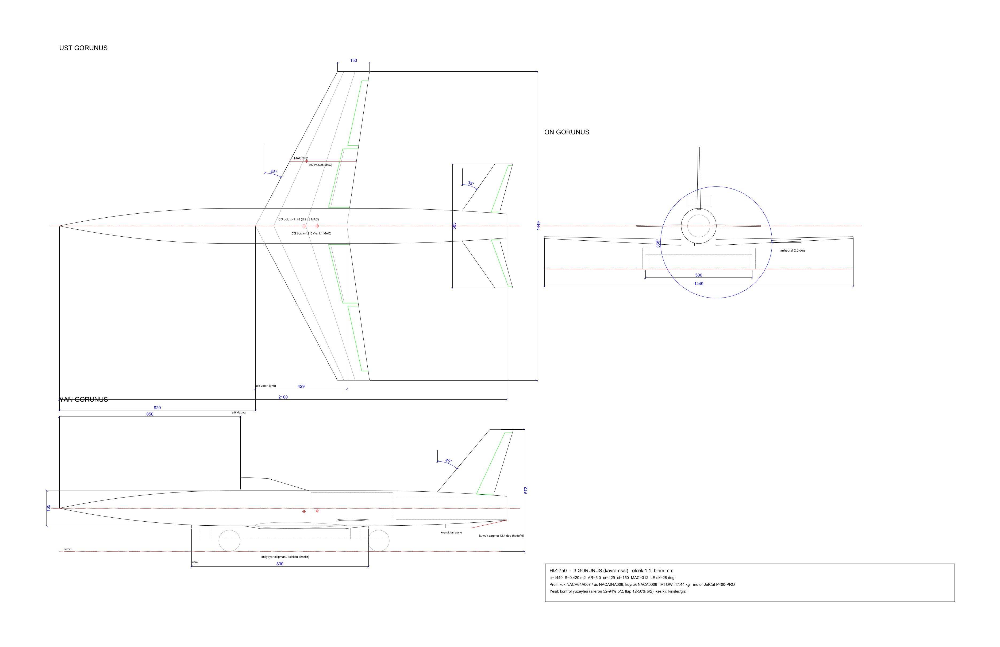
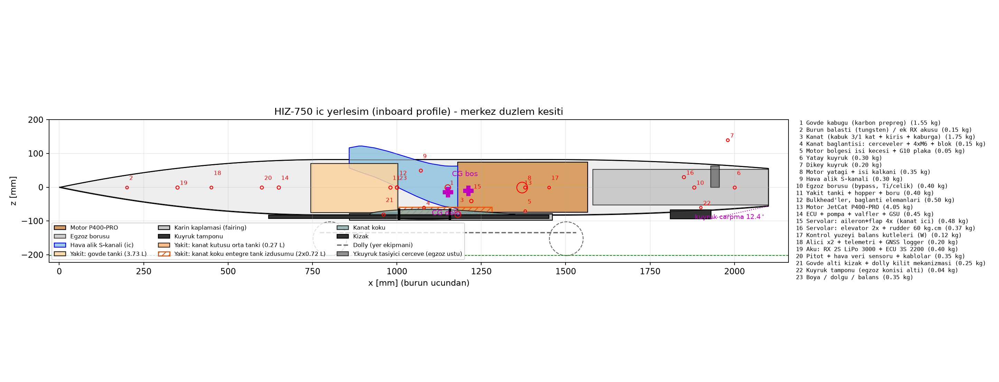
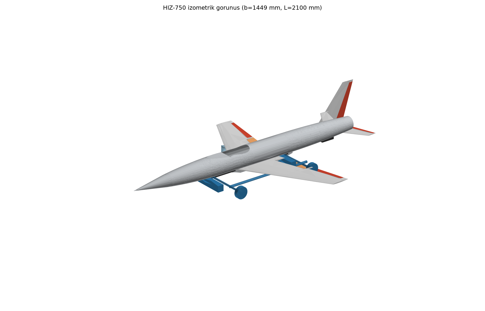

# 03 — CAD modeli ve teknik çizimler (iterasyon 3, kapanış)

Model tamamen parametrik. Bütün ölçüler [`params.py`](../params.py)'den okunuyor; CAD içinde birim **mm**. Koordinatlar: x burundan arkaya, y sağ kanada doğru, z yukarı. Önceki iterasyonların parametreleri [`params_iter1.py`](../params_iter1.py) ve [`params_iter2.py`](../params_iter2.py) dosyalarında. Bütün sayısal sonuçlar [`cad/out/cad_report.json`](../cad/out/cad_report.json)'da.

## Yeniden üretme

```bash
C:/Users/Urungu/.hz750/Scripts/python cad/build_cad.py
```

Script: [`cad/build_cad.py`](../cad/build_cad.py). Çalışması yaklaşık 25 saniye sürüyor; çıktı günlüğü `cad/out/build_log.txt`'e yazılıyor. Dışa aktarma önce `C:/Users/Urungu/.hz750` altındaki kısa yollu geçici bir klasöre yazıyor, sonra dosyayı yerine taşıyor. Sebebi, OCP'nin Windows'taki uzun yol sınırına takılması.

## İterasyon 3 değişiklik özeti

| Konu | İterasyon 2 | İterasyon 3 kapanış (CAD karşılığı) |
|---|---|---|
| Kanat | z_root −35 mm, −1° anhedral | **Alçak kanat**: z_root −80 mm, **+1,5° dihedral**. Kutu üst yüzeyi kökte z = −64,7 mm |
| Kanat bağlantısı | Kanat kutusu ayrı parça; gövde içinde kanat modellenmiyordu | **Tek parça kanat** (`attach`). Kutu gövdenin içinden geçiyor. Gövde içinde kanat yalnız x ≤ 1156 mm'de var (yeni parça `wing_center`); bunun gerisinde 1,5 mm'lik kesintisiz alt kabuk motorun altından geçiyor. Çerçeveler x 1006 ve 1156 mm'de |
| Çerçeveler | – | Yeni parça `frames`, 4 mm kalınlık, 5 mm radyal derinlik. Kanat bağlantı çerçeveleri tam halka; kızak çerçeveleri (x 620 / 810 / 1380) alt yay (±55°). Kanal, kanat kutusu ve kanatla kesiliyor |
| Karın kaplaması | – | `belly_fairing`: x 860–1459 mm, düz taban z = −96,0 mm. **Gövde altından 13,5 mm derin**, 777 cm³ |
| S-kanal | Dudak 0,95, ofset/uzunluk 0,50 | Dudak 0,85, uzunluk 330 mm, **yarı gömülü dudak**: merkez z = 88 mm, dudağın 22 mm'si gövde yüzeyinin altında. Dudak önünde 7°'lik rampa (x 671–850 mm, 22 mm derin, yan duvarlı). Diverter kaldırıldı. 10 kesit; alan doğrusal artıyor |
| Kanal ↔ kabuk | Kabuk kanalın iç hacmiyle kesiliyordu | Kabuk kanalın **dış** hacmiyle kesiliyor; kanal duvarı, deldiği kabuğun yerini alıyor |
| Flap | Düz menteşeli, cf 0,22 | **Tek yarıklı**, cf 0,25; 2,5 mm yarık + ayrı dış menteşe hattı |
| Elevatör | cf 0,28 | cf 0,22 |
| Yakıt | Gövde + 2 kanat tankı | Gövde + 2 kanat tankı + **kanat kutusu orta tankı** (`tank_center`). Bütün değerler **iç hacim**: kanat tankları 2,6 mm kabuk / 1,5 mm web / 3 mm kaburga düşülerek, gövde tankı 1 mm duvar düşülerek |
| Kızak / tampon | Kızak x 620–1300 mm | Kızak x 620–1450 mm. **Kuyruk tamponu** (yeni parça `tail_bumper`): x 1810–1930 mm, gövde altından 22 mm derin |
| Gövde spline'ı | Burnun x 400–800 mm aralığında örnek noktası yoktu; dış yüzey analitik ogive eğrisinden biraz sapıyordu | Örnekleme ogive boyunca sıklaştırıldı; dış yüzey artık analitik eğriye uyuyor |

## Üretilen dosyalar (`cad/out/`)

| Dosya | İçerik |
|---|---|
| `HIZ750_assembly.step` | Uçuş konfigürasyonu montajı (renkli) |
| `HIZ750_on_dolly.step` | Uçak + kalkış arabası |
| `step/*.step`, `stl/*.stl` | 27 parça. Yeni: `wing_center`, `tank_center`, `tail_bumper`, `frames`. Diğerleri: `fuselage`, `inlet_duct`, `wing_panels`, `wing_box`, `belly_fairing`, `tank_wing_L/R`, `aileron_L/R`, `flap_L/R`, `htail`, `elevator_L/R`, `ht_carry_yoke`, `vtail`, `rudder`, `engine`, `exhaust_pipe`, `tank_fuselage`, `skid`, `dolly`. `diverter` artık yok (yarı gömülü dudak) |
| `HIZ750_3view.dxf` / `.png` / `.pdf` | Ölçülendirilmiş 3 görünüş: kızak, tampon, karın kaplaması, flap menteşe hattı, kuyruk çarpma çizgisi |
| `HIZ750_inboard.png` / `.pdf` | İç yerleşim: gerçek kanal kesitleri, bütün tanklar, karın kaplaması, tampon |
| `HIZ750_iso.png` | İzometrik render |
| `cad_report.json` | Bütün sayısal sonuçlar |





## Profiller

- **Kanat: NACA 64A007 (kök) → 64A006 (uç).** Kaynak: Abbott & von Doenhoff tablosundaki NACA 64A010 ordinatları, t/c'ye göre doğrusal ölçekleniyor; ara noktalar √x uzayında PCHIP ile interpole ediliyor. Firar kenarına 0,3 mm kalınlık eklendi.
- **Kuyruklar: NACA 0006.**
- **Tank iç yüzeyi:** aynı kesitlerin kalınlığı her yüzde 2,6 mm azaltılarak üretiliyor (yüzeye dik ofset yaklaşımı).
- **Kabuk kat sayısı:** params'taki `skin_plies = (3, 1)` yapı analizinin girdisi. CAD'de kabuk kalınlığı yalnızca tank iç hacmini hesaplarken kullanılıyor (2,6 mm sandviç).

## 1. S-kanal

| Büyüklük | Değer | Hedef |
|---|---|---|
| Uzunluk (dudak 850 → motor yüzü 1180 mm) | 330 mm | |
| Düşey ofset (dudak merkezi z 88 → 0 mm) | 88 mm | |
| **Ofset / uzunluk** | **0,267** | ≤ 0,30 ✓ |
| Alan: dudak → motor yüzü | 60,5 → 125,0 cm² (oran 2,07) | |
| **Eşdeğer difüzör yarı açısı** | ortalama **3,33°**, en çok **3,95°** | ≤ 7° ✓ |
| **En dik duvar açısı** | **25,6°**: taban, x 974–1015 mm (S-bükümünün ortası) | |
| Son segment (x 1158 → 1180) | taban 11,4°, tavan 0,8° | iterasyon 3a'da 41,7° idi |
| Kanat kutusu bölgesinde kanal iç tabanı | ≥ −58,7 mm | |
| Dudak önü rampa | 7°, 179 mm uzun, 22 mm derin | |

**Kesit tablosu** (merkez düzlem; a = yarı genişlik, b = yarı yükseklik, mm):

| x | Şekil | Merkez z | a | b | Taban | Tavan | Alan (cm²) |
|---|---|---|---|---|---|---|---|
| 850,0 | dikdörtgen | 88,0 | 55,0 | 27,5 | 60,5 | 115,5 | 60,5 |
| 891,2 | elips | 84,2 | 56,0 | 39,0 | 45,3 | 123,2 | 68,6 |
| 932,5 | elips | 74,2 | 57,0 | 42,8 | 31,5 | 117,0 | 76,6 |
| 973,8 | elips | 60,2 | 58,0 | 46,4 | 13,7 | 106,6 | 84,7 |
| 1015,0 | elips | 44,0 | 59,0 | 50,0 | −6,0 | 94,0 | 92,7 |
| 1056,2 | elips | 27,8 | 60,0 | 53,4 | −25,6 | 81,3 | 100,8 |
| 1097,5 | elips | 13,8 | 61,1 | 56,8 | −43,0 | 70,5 | 108,9 |
| 1138,8 | elips | 3,8 | 62,1 | 60,0 | −56,2 | 63,7 | 116,9 |
| 1158,2 | elips (arka kiriş + 2) | 2,1 | 63,2 | 60,7 | −58,7 | 62,8 | 120,7 |
| 1180,0 | daire (motor yüzü) | 0,0 | 63,1 | 63,1 | −63,1 | 63,1 | 125,0 |

Taban kısıtı bu iterasyonda devreye girmedi: kanal, kanat kutusunun üstünden doğal smoothstep eğrisiyle geçiyor. Kalan 18–26°'lik taban eğimi S-bükümünün kendi geometrisinden geliyor: ofset/uzunluk 0,267 için smoothstep'in en dik eğimi 1,5 × 88 / 330 → 21,8° (merkez hattı), tabanda alan artışıyla birlikte 25,6°. Dorsal çıkıntı: kanalın gövde dışında kalan kısmı (ön kirişin gerisinde) 7,0 cm³; çıkıntının en yüksek noktası z = 125 mm, yani gövde üstünden ~43 mm yukarıda (iterasyon 3a'da ~70 mm idi).

## 2. Yakıt tankları (bütün değerler iç hacim)

| Tank | İç hacim | Ağırlık merkezi x | params hedefi |
|---|---|---|---|
| Gövde (x 751–1003 mm) | **3,630 L** | 0,868 m | 3,63 L |
| Kanat, sağ / sol (η 0,06–0,55) | **0,715 L / 0,715 L** | 1,151 m | 0,65 L |
| Kanat kutusu orta tankı (\|y\| ≤ 40,5 mm) | **0,274 L** | 1,082 m | 0,27 L |
| **Toplam** | **5,335 L** | | ≥ 5,2 L ✓ (yakıt 5,0 L) |
| **Yakıt CG'si** | **x = 0,955 m**, **z = −0,029 m** | | params x 0,957 / z −0,02 |

Kanat tankının iç hacmi, tanım farkına göre (yarı kanat başına):

| Tank tanımı | CAD iç hacmi |
|---|---|
| η 0,06–0,55 (params, modellenen) | 0,715 L |
| η 0,06–0,40 | 0,577 L |
| Gövde yanı → η 0,40 (yapı ajanı 0,39 L) | 0,456 L |
| Gövde yanı → η 0,55 | 0,594 L |

Gövde tankı params'taki alt sınır olan 3,63 L'de tutuldu. Kanat tankları params'taki 0,65 L yerine 0,715 L çıktığı için toplam 5,335 L oldu.

## 3. Yer geometrisi

| Büyüklük | Değer | Hedef |
|---|---|---|
| **Kuyruk çarpma açısı (tampon dahil)**: tampon arka-alt köşesi (x 1930, z −93,4) etrafında | **12,4°**. Temas noktası kuyruk konisinin ucu (x 2100, z −56) | ≥ 9° ✓ |
| Kızak sonu → tampon temas açısı | −0,15°. Tampon tabanı kızak taban çizgisiyle neredeyse aynı düzlemde (0,9 mm aşağıda); uçak yerde kızak + tampon üzerinde yatay duruyor | |
| **Dolly üzerinde yer açıklığı, 3°** (`dolly_alpha`; arka teker temas noktası x 1502 etrafında burun yukarı) | **86,5 mm** (en alçak nokta: tampon, x 1930) | |
| Dolly üzerinde, 0° / 6° | 106,5 mm (x 945) / 63,7 mm (x 1930) | |
| **Karın kaplaması derinliği** | **13,5 mm** (taban z −96,0; gövde altı −82,5) | |

## 4. Çakışma kontrolü (mm³)

**Bütün çakışma kontrolleri 0.** Kontrol edilen çiftler:
- **Motor ↔** kabuk, kanat kutusu, kanal, kanadın arka alt kabuğu.
- **Kanal ↔** kanat kutusu, kabuk.
- **Gövde içindeki kanat (`wing_center`) ↔** motor, kanal, gövde tankı.
- **Tanklar:**
  - gövde tankı ↔ kanal, kutu, kabuk, rampa;
  - kanat tankları ↔ kanal, motor;
  - orta tank ↔ kanal, motor.
- **Çerçeveler ↔** motor, tanklar, kanal, kabuk.
- **Kuyruk:**
  - yatay kuyruk + taşıyıcı çerçeve ↔ egzoz;
  - taşıyıcı çerçeve ↔ kabuk (saplama delikleri açık);
  - dikey kuyruk ↔ egzoz.
- **Alt taraf:**
  - kızak ↔ kabuk;
  - tampon ↔ kabuk;
  - karın kaplaması ↔ tank, kızak, kanat;
  - dolly ↔ uçak;
  - flap ↔ panel (yarık açık).

Raporda sıfır olmayan tek kalem 7,0 cm³: dorsal çıkıntıdaki kanal duvarının gövde dışında kalan hacmi. Bu bir çakışma değil, tasarım gereği.

Diğer ölçümler:
- Motor–gövde iç yüzeyi radyal boşluğu: en az 5,97 mm.
- Arka kiriş → motor yüzü: 23,8 mm.
- Islak alan: gövde 0,916, açıkta kalan kanat 0,838, yatay kuyruk 0,122, dikey kuyruk 0,117, kızak ~0,043 m².

## Kalan notlar ve params önerileri (CAD ajanı params.py'yi değiştirmedi)

1. `FUEL["tanks"]["wing_integral_L_each"]`: CAD iç hacmi η 0,06–0,55 için 0,715 L. Params 0,65 L diyor. Bölme payı ve ara bölme dahil edilen değer 0,65 L ise sorun yok; ama kapasite toplamı bu durumda 5,2 L değil 5,33 L'dir.
2. `FUEL["x"] = 0.955`, `FUEL["z"] = -0.029` (ölçülen değerler; params'ta 0,957 / −0,02).
3. Rampa x 671'de başlıyor; ECU (x 0,65) rampanın 21 mm önünde ve merkez düzlemde z = 0'da. Rampa tabanı (z ≥ 60 mm) ile ECU arasında çakışma yok, ama ECU'ya üstten erişim rampa yüzünden kısıtlı.
4. Dorsal çıkıntı yaklaşık 43 mm; sürükleme hesabında ön kesit alanı ≈ 114 × 43 ≈ 49 cm² (gövde kesitinin %23'ü) olarak alınmalı.

## Kütle ve atalet özellikleri (iter4)

Script: [`cad/mass_properties.py`](../cad/mass_properties.py), çıktı [`cad/out/mass_properties.json`](../cad/out/mass_properties.json) (yaklaşık 15 s). `params.MASS_ITEMS`'taki her kalem bir CAD katısına eşlendi. Katının hacim ağırlıklı ağırlık merkezi ve atalet tensörü OCP `BRepGProp` ile birim yoğunlukta hesaplandı, sonra kalem kütlesine ölçeklendi. Katısı olmayan kalemler params'taki (x, z) konumunda küçük homojen kutu olarak eklendi. Tensör CG etrafında, eksenler CAD ekseni (x arkaya, y sağa, z yukarı). Ixz = +∫xz dm. Uçuş gövde ekseninde (x ileri, z aşağı) iki eksen birden döndüğü için Ixz'nin işareti aynı kalıyor.

### Güncel sonuçlar (iter5, `logs/cad_mass_properties.log`)

İter5 kanat rijitleştirmesi (kanat kalemi 2,03 kg, x 1,175 m) ve iter4 kabuk CG düzeltmesi sonrası. Kullanılabilir tank hacmi 5,144 L (= 4,115 kg).

| Durum | m [kg] | x_cg [m] | z_cg [m] | Ixx | Iyy | Izz | Ixz [kg·m²] | params'a göre Δx_cg |
|---|---|---|---|---|---|---|---|---|
| Yakıt %100 (kullanılabilir 4,115 kg) | 17,555 | 1,1456 | −0,0157 | 0,407 | 2,801 | 3,119 | 0,043 | −1,1 mm |
| Params yakıtı (4,0 kg) | 17,440 | 1,1470 | −0,0156 | 0,405 | 2,794 | 3,110 | 0,043 | −1,2 mm |
| Yakıt %25 (1,029 kg) | 14,469 | 1,1896 | −0,0136 | 0,367 | 2,577 | 2,866 | 0,047 | −1,4 mm |
| Yakıt %0 | 13,440 | 1,2087 | −0,0126 | 0,354 | 2,486 | 2,765 | 0,048 | −1,4 mm |

CAD ile `params.mass_summary` arasındaki x_cg farkı artık ±5 mm toleransın içinde (−1,1…−1,4 mm). Kanat kaleminin CAD konumu 1,195 m, params 1,175 m (+19,6 mm; hacim ağırlıklı katı kalın köke doğru kayıyor, aşağıdaki "hacim ağırlıklı yaklaşımın sınırı" notu). CAD/Roskam oranı Ixx 0,71, Iyy 1,01, Izz 0,84. Uçuş kontrol (doküman 09) bu tabloyu kullanır.

Aşağıdaki tablolar ve karşılaştırmalar **iter4 tarihsel kaydıdır** (MTOW 17,01 kg, gövde kabuğu params'ta henüz 1,05 m, kanat 1,75 kg, brüt tank 5,335 L).

### Sonuçlar (iter4, tarihsel)

| Durum | m [kg] | x_cg [m] | y_cg [m] | z_cg [m] | Ixx | Iyy | Izz | Ixz [kg·m²] |
|---|---|---|---|---|---|---|---|---|
| Yakıt %100 (5,335 L = 4,268 kg, tank kapasitesi) | 17,278 | 1,1578 | 0,0001 | −0,0145 | 0,391 | 2,609 | 2,912 | 0,043 |
| Params yakıtı (4,0 kg = kapasitenin %93,7'si) | 17,010 | 1,1610 | 0,0001 | −0,0143 | 0,387 | 2,592 | 2,892 | 0,043 |
| Yakıt %25 (1,067 kg) | 14,077 | 1,2039 | 0,0002 | −0,0113 | 0,343 | 2,376 | 2,643 | 0,045 |
| Yakıt %0 | 13,010 | 1,2243 | 0,0002 | −0,0098 | 0,327 | 2,280 | 2,536 | 0,045 |

Ixy ve Iyz < 0,003 kg·m². Bunlar simetrik modelde sayısal artık.

### params.mass_summary ile kontrol (hedef ±%1 kütle, ±5 mm x_cg)

| Durum | Δm (aynı yakıt kütlesi) | Δm (nominal doluluk) | Δx_cg | Δz_cg |
|---|---|---|---|---|
| %100 | 0 | **+%1,57** (17,278 / 17,01) | **+9,8 mm** (aynı yakıt) / +6,8 mm (nominal) | +0,7 mm |
| Params 4,0 kg | 0 | 0 | **+10,0 mm** | +0,8 mm |
| %25 | 0 | +%0,48 | **+12,0 mm** (aynı yakıt) / +10,9 mm (nominal) | +0,9 mm |
| %0 | 0 | 0 | **+13,0 mm** | +0,9 mm |

**Kütle farkı:** Kuru kütle birebir aynı. Fark yalnız yakıttan geliyor. Params `FUEL["mass"] = 4,0 kg` alıyor, yani 5,0 L. CAD tank iç hacmi ise 5,335 L, yani dolu tankta 4,268 kg. "%100 doluluk" bu yüzden params'tan %1,57 ağır.

**x_cg farkı:** CAD CG'si, aynı yakıtta params'ın 10–13 mm gerisinde, yani ±5 mm toleransın dışında. Kalem kalem katkı (Δx × m):

| Kalem | params x | CAD x | Δx [mm] | Δ(m·x) [g·m] |
|---|---|---|---|---|
| Gövde kabuğu (1,55 kg) | 1,050 | 1,150 | +99,6 | **+154** |
| Motor (4,05 kg) | 1,370 | 1,380 | +9,7 | +39 |
| Kanat (1,75 kg) | 1,180 | 1,195 | +14,6 | +26 |
| Bulkhead'ler (0,50 kg) | 1,000 | 1,036 | +36,1 | +18 |
| Kızak (0,25 kg) | 0,960 | 0,987 | +27,3 | +7 |
| Yakıt tankı duvarı (0,40 kg) | 0,980 | 0,873 | −107,0 | −43 |
| Egzoz (0,40 kg) | 1,880 | 1,843 | −37,5 | −15 |
| S-kanal (0,30 kg) | 1,070 | 1,022 | −47,5 | −14 |
| Diğer | | | | −3 |
| **Toplam / 17,01 kg** | | | | **+169 g·m → +9,9 mm** |

Baskın neden gövde kabuğu. Sabit kalınlıklı kabuğun alan merkezi x = 1,150 m. Ogive burnun alanı küçük, sabit kesit ve kuyruk konisi ise uzun. Params'taki 1,05 m bu yüzden 0,10 m önde. Kabuk burunda ek kat ya da takviye almıyorsa params değeri iyimser. Motor katısının merkezi 1,380 m (params 1,37). Gerçek P400'ün CG'si kompresör tarafında olduğu için motorda params değeri muhtemelen daha doğru. Tank duvarı ve hopper için CAD gövde tankının yüzey merkezini (0,873 m) veriyor. Hopper ve borular daha geride olabilir.

**Etkisi:** x_np = 1,2506 m (aero) ile statik marj tam yakıtta (4,0 kg) %31,9'dan **%28,7**'ye, boş yakıtta %12,6'dan **%8,4**'e iniyor (MAC 0,312 m). Boş yakıt marjının küçülmesi iter4 için izlenecek madde. params.py değiştirilmedi.

### Varsayımlar

- **Eşleme:**
  - Gövde kabuğu → `fuselage` (kabuk katısı). Karın kaplamasının (`belly_fairing`) kütle kalemi yok; dahil edilmedi.
  - Kanat → `wing_panels ∪ wing_center ∪ wing_box` + aileron + flap. `wing_box` panellerle ve tank boşluklarıyla üst üste bindiği için birleşim alındı.
  - Yatay kuyruk → `htail` + elevator ×2 + `ht_carry_yoke`.
  - Dikey kuyruk → `vtail` + `rudder`.
  - Motor ve "motor yatağı + ısı kalkanı" → `engine`.
  - S-kanal → `inlet_duct`; egzoz → `exhaust_pipe`; kızak → `skid`; tampon → `tail_bumper`.
  - Bulkhead'ler → `frames` (5 halka).
  - Kanat bağlantısı → `frames`'in x 960–1200 mm kısmı. Cıvata ve blok merkez hattında değil halkada kabul edildi; z farkı +65 mm.
  - Yakıt tankı + hopper → `tank_fuselage` yüzeyi (alan ağırlıklı).
- **Kutu olarak alınan kalemler** (params x, z; boyutlar JSON'da):
  - Kanat servoları 4 × 0,12 kg: flap y = ±0,22 m, aileron y = ±0,50 m.
  - Kuyruk servoları: elevator y = ±0,035 m, rudder y = 0.
  - Balans kütleleri: aileron orta açıklığı, y = ±0,53 m.
  - ECU, alıcı, akü, pitot/kablo (0,6 m demet) ve ısı keçesi: merkez hattı.
  - Boya/dolgu: gövde boyunca 1,8 m'lik kutu. Gerçekte ıslak alana dağılır.
- **Yakıt:**
  - İç hacimler × 0,80 kg/L. Gövde tankında dış katı hacmi − alan × 1 mm (`build_cad` ile aynı); kanat ve orta tank katıları zaten iç boşluk.
  - Kısmi dolulukta her tank aynı oranda boşalıyor. Yakıt tank hacim merkezinde, tank katısının ölçeklenmiş tensörüyle alındı. Dibe çökme ve serbest yüzey ihmal edildi; z_cg'ye etkisi birkaç mm.
- **Hacim ağırlıklı yaklaşımın sınırı:** Dolu kanat katısı hacmi kalın köke topluyor. Karbon kabuk ise alana göre dağılır. Açıktaki kanat alan ağırlıklı alınırsa kanat x'i 1,195 → 1,238 m, kanadın kendi Ixx'i 0,162 → 0,232 kg·m² oluyor. Bu da toplam Ixx'i yaklaşık %18 artırır (≈ 0,46) ve x_cg'yi +4 mm daha geriye kaydırır. Tablo hacim ağırlıklı değerleri veriyor.

### Roskam tahmini ile karşılaştırma

`aero/aero_analysis.py` bölüm [5]: Ixx = m (b R̄x/2)², Iyy = m (L R̄y/2)², Izz = m ((b+L)/2 · R̄z/2)². Burada R̄x = 0,25, R̄y = 0,38, R̄z = 0,52, b = 1,449 m, L = 2,10 m, m = 17,01 kg (tam yakıt). Ixz = 0 varsayılıyor.

| | Roskam (aero) | CAD, params yakıtı 17,01 kg | CAD/Roskam | CAD eşdeğer R̄ | CAD %100 | CAD %0 (R̄) |
|---|---|---|---|---|---|---|
| Ixx | 0,558 | 0,387 | **0,69** | R̄x 0,208 | 0,391 | 0,327 (0,219) |
| Iyy | 2,708 | 2,592 | **0,96** | R̄y 0,372 | 2,609 | 2,280 (0,399) |
| Izz | 3,621 | 2,892 | **0,80** | R̄z 0,465 | 2,912 | 2,536 (0,498) |
| Ixz | 0 | 0,043 | – | Ixz/Ixx = 0,11 | 0,043 | 0,045 |

Çıkarımlar:
- Iyy, Roskam ile %4 içinde.
- Ixx %31 düşük. Kütlenin %60'tan fazlası (motor, yakıt, sistemler) gövde ekseninde toplanmış; kanat 1,75 kg ve ince. Aero modelindeki yuvarlanma sönümü L_p (∝ 1/Ixx) yaklaşık 1,44 kat büyür. Yuvarlanma zaman sabiti kısalır, aileron etkinliği (p/δa başlangıç ivmesi) artar.
- Izz %20 düşük. N_β ve N_r yaklaşık 1,25 kat büyür, Hollanda yuvarlanması frekansı yaklaşık %12 artar.
- Ixz ≠ 0. Dikey kuyruk yukarıda ve arkada, alçak kanat aşağıda. Yanal mod matrisi Ixz = 0 varsaymış; Ixz/Ixx = 0,11 ile yuvarlanma–sapma bağlaşımı küçük ama ihmal edilemez.
- Aero'ya önerilen girdiler: Ixx 0,39 (alan ağırlıklı kanatla 0,46), Iyy 2,59, Izz 2,89, Ixz 0,043 kg·m². aero_analysis.py değiştirilmedi.
