# 04 – Yapı, Flutter ve Kontrol Yüzeyleri (İterasyon 3 + iter4 masa başı doğrulama)

**Kaynaklar:**
- Script: [`structures/structures.py`](../structures/structures.py). Girdi `params.py`; çıktılar `structures/out/`; tüm sayılar `structures/out/sonuclar.json`.
- İter4: [`structures/fe_modal.py`](../structures/fe_modal.py) (FE modal + modal flutter, §14). Çıktılar `structures/out/fe_*`; sayılar `structures/out/fe_sonuclar.json`.
- Arşiv: `structures/structures_iter1.py`, `structures/structures_iter2.py`, `structures/out_iter1/`, `structures/out_iter2/`, `structures/04_yapi_flutter_iter{1,2}.md`.

**Tasarım durumu (params, iter3 kapanış):** MTOW **17,01 kg**, W/S = 397 Pa, alçak kanat (z_root = −80 mm, dihedral +2°), tek parça kanat, kızakla iniş. Kanat bağlantısı (0,15 kg) ve motor bölgesi ısı keçesi kalemleri kütle bütçesinde; yakıt CG'si x = 0,955 m.

## 0. Değişiklik özeti

| Konu | İter 1 | İter 2 | **İter 3** |
|---|---|---|---|
| MTOW | 18,30 kg | 16,77 kg | 17,01 kg |
| Kanat konumu | orta-alçak, z = −35 mm | aynı | **alçak, z = −80 mm**, dihedral +2° |
| Gövde yanı / açıkta kalan kanat kökü y₀ | 82,5 mm | 82,5 mm | **20,2 mm** (kanat orta düzlemi gövde alt kabuğuna çok yakın; bağlantı cıvataları y = ±35 mm) |
| Kanat bağlantısı | 2 bıçak + pim | aynı | **Tek parça kanat, gövde içinden geçen kutu, kiriş çerçevelerine 4 × M6** |
| Burulma hücresi | tüm profil | hücum kenarı → arka kiriş (0,55c) | aynı |
| Kesit ağırlık merkezi x_cg | 0,43c varsayım | 0,42c varsayım | **hesaplanıyor: 0,45c** (3/1 kat; 2/2 katta 0,52c) |
| Kabuk kat planı (yüz başına; kiriş önü / kiriş arkası) | 2/2 | 2/2 | **3/1** |
| Kanat kütlesi | 1,49 kg | 1,47 kg | **1,74 kg** (bütçe 1,75) |
| Flutter (2-DOF tipik kesit) | 1495 km/h | 1383 km/h | **1465 km/h** (kritik: tank dolu, η 0,70) |
| Flutter (iter4 FE modal, §14) | – | – | **1307 km/h** (tank dolu; 3B–1T eşleşmesi) |
| Diverjans | 1973 km/h | 2840 km/h | 3290 km/h (oksuz, muhafazakâr); ok açısıyla yok (§14) |
| Kanat tankı (yarı) | – | 0,39 L (η ≤ 0,40) | **0,58 L** (structures, η 0,06–0,55); CAD brüt 0,715 L; **kullanılabilir 0,57 L** (§14.8) + merkez tank 0,27 L (CAD) |
| Flap | düz, c_f 0,22 / 30° | aynı | **tek yarıklı, c_f 0,25 / 35°**, dış menteşe |
| Elevator | c_f 0,28, ±3° | aynı | **c_f 0,22, ±1,5°**: servo 9 kg·cm, balans 18 g |
| Kızak | x 0,62–1,30 | aynı | **x 0,62–1,45**, 5 çerçeve, σ 466 → 391 MPa |
| Kuyruk çarpma açısı | – | 2,6° | Kızakla **3,2°** (hedef 9° sağlanamıyor) → **kuyruk tamponu** (x = 1,87 m, params): CAD'de 12,4° |

> **İter 2 düzeltmesi (önemli):** İter 2'de kesit ağırlık merkezi 0,42c varsayılmıştı. İter 3'te kesit kütle bileşenlerinden hesaplandı: kabuk çevresi, kapaklar, web'ler, kaburgalar ve hinge hattındaki aileron balans kütlesi. 2/2 kat planında sonuç **0,52c**. Bu durumda iter 2 tasarımının flutter hızı 1383 değil **~1075 km/h** çıkıyor (gereksinim 1080; karşılanmıyor).
>
> Çözüm, kütleyi elastik eksenin önüne kaydırmak: **kiriş önü kabuk 3 kat/yüz, kiriş arkası (firar kenarı bölgesi) 1 kat/yüz**. Sonuç: x_cg = 0,45c, flutter 1465 km/h; kanat 2/2'ye göre yalnız +0,05 kg (1,69 → 1,74 kg), 3/3'ün 2,12 kg'ından çok daha hafif.

## 1. Tasarım kriterleri

| Kriter | Değer |
|---|---|
| Limit yük faktörü | +12 / −8 g |
| Nihai emniyet katsayısı | 1,5 (nihai +18 / −12 g) |
| V_C (ECU limiti) / V_D | 800 / 900 km/h |
| V_FE (flap açık azami hız) | 150 km/h |
| Flutter / diverjans | ≥ 1,2·V_D = 1080 km/h; kat seçiminde ek ×1,25 model payı (≥ 1350 km/h) |

## 2. Malzeme ve izin değerleri

| Malzeme | Kullanım | Özellikler |
|---|---|---|
| T700S/epoksi UD 200 g/m² | Kapaklar, longeronlar | E₁ 125 GPa, Xt/Xc 2100/1200 MPa, kat kalınlığı 0,20 mm |
| T300 dokuma 160 g/m², ±45 | Kabuk, web | E 55 GPa, G₄₅ 25 GPa, kat kalınlığı 0,178 mm |
| 200 g/m² dokuma (quasi-izotrop) | Gövde, çerçeveler | E 45 GPa, kat kalınlığı 0,22 mm |
| Rohacell 51 IG-F | Çekirdek | 2 mm (tank kaburgası 3 mm) |
| Cam 48 g/m² + yakıta dayanıklı epoksi | Tank iç kaplaması | ≈ 0,15 kg/m² |

**İzin değerleri:**
- Düşürme faktörü 0,544.
- UD kapak 500 MPa (4000 µε birim şekil değiştirme limiti).
- Gövde 180 MPa.
- Boru 400 MPa.

**Sıcaklık sınırı (iter 3, motor bölgesi):**
- Oda sıcaklığında kürlenmiş epoksinin Tg değeri yaklaşık 60–80 °C; 80 °C'de sonradan kürlenmiş olanınki ~100–120 °C.
- **Kullanım sıcaklığı ≤ Tg − 30 °C** olmalı.
- x = 1,18–1,57 m arası (motor) ve arka gövde için **Tg ≥ 150 °C** reçine gerekli. Seçenekler:
  - 120–180 °C'de kürlenen havacılık prepregi;
  - yüksek Tg'li epoksi sistemi (ör. 150 °C'de son kürlü);
  - egzoz borusu yakını için BMI veya siyanat ester.

## 3. V-n diyagramı

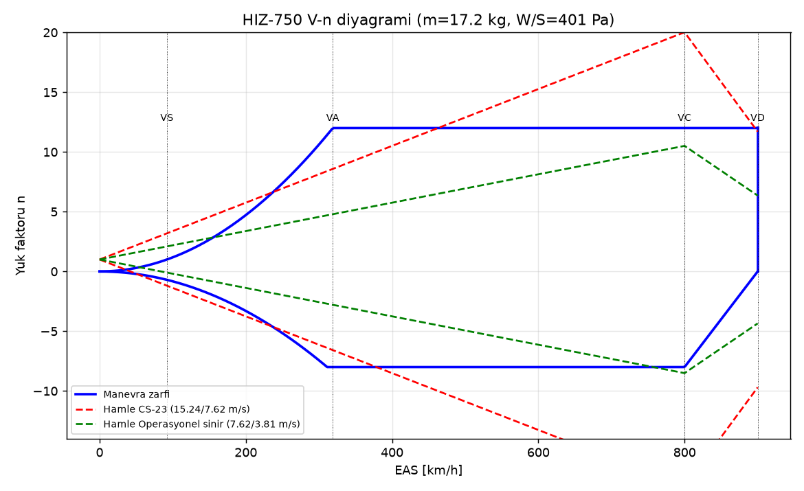

| Büyüklük | Değer |
|---|---|
| V_S / V_A | 92 / 318 km/h |
| CLα / K_g | 4,62 /rad / 0,79 |
| CS-23 hamlesi @ V_C | n = 20,2: 12 g'yi aşar → **operasyonel sınır: sadece sakin havada yüksek hız** |
| Operasyonel hamle @ V_C | 7,62 m/s → +10,6 / −8,6 g. −8,6 g, −8 g limitinin %7 üstünde; nihai −13 g simetrik kiriş kapasitesi içinde. Uçuş kartına not edilmeli. |

## 4. Kanat yükleri (nihai, n = 18)

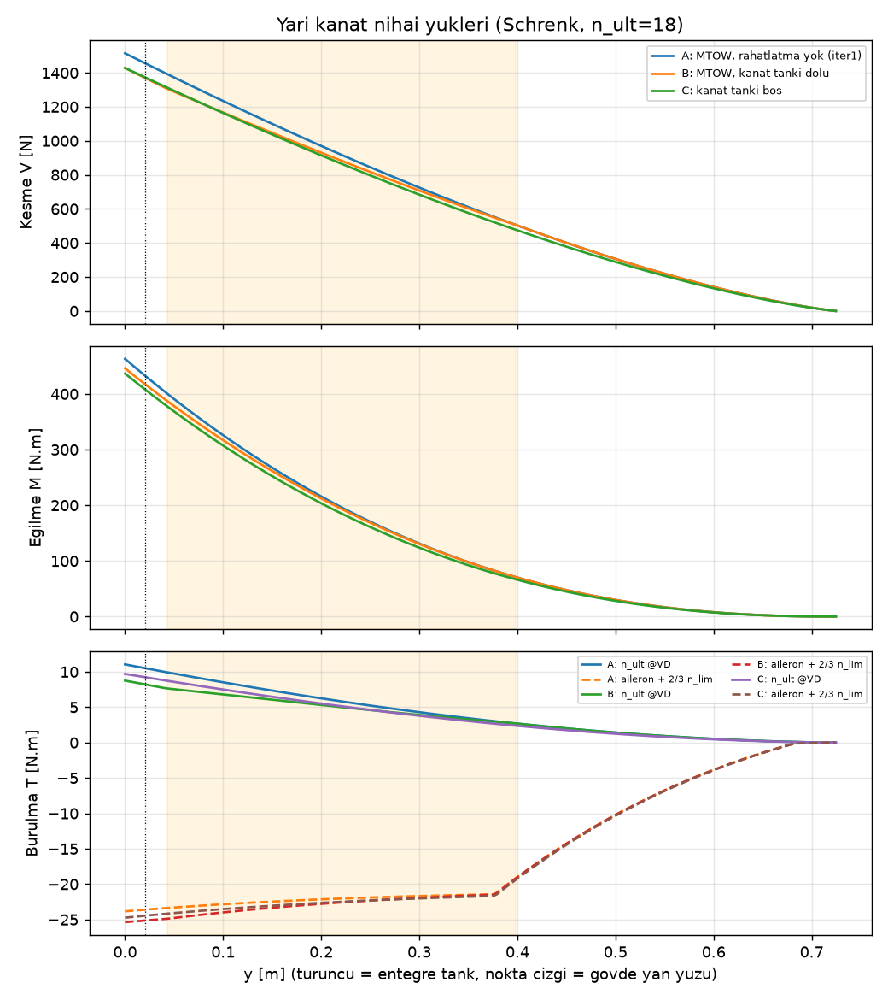

| Durum | M(y = 0) [N·m] | M(y₀ = 20 mm) [N·m] | V(y = 0) [N] | T_kök [N·m] |
|---|---|---|---|---|
| A: rahatlatma yok (referans) | 459 | 427 | 1501 | 24,0 |
| **B: MTOW, kanat tankı dolu (2 × 0,49 kg)** | **442** | **412** | **1415** | 25,5 |
| C: kanat tankı boş | 433 | 402 | 1415 | 24,9 |

- Yakıt rahatlatması %4; B durumu belirleyici.
- Alçak kanatta (z = −80 mm) kanat orta düzlemi gövde alt kabuğuna çok yaklaştığından açıkta kalan kök iç tarafa kaydı (y₀ 82 → 20 mm). Bu yüzden gövde yanındaki moment 333 → 412 N·m oldu. Tek parça kanatta bu kesit bir bağlantı değil; yük taşıyan kesit kiriş çerçevelerindeki cıvata hattıdır (y = ±35 mm, §7).

## 5. Kanat yapısı

### 5.1 Kat planı: kiriş önü 3, kiriş arkası 1 kat/yüz

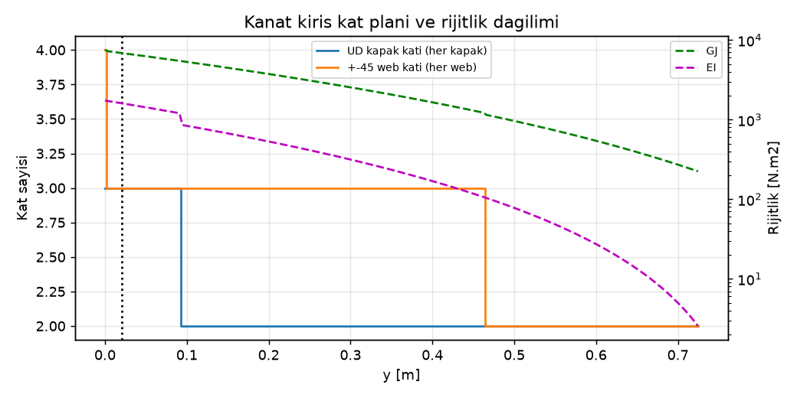

| y [m] | Veter [m] | Kutu yüksekliği [mm] | M_ult [N·m] | Kapak genişliği [mm] | UD kat | Web katı | GJ [N·m²] |
|---|---|---|---|---|---|---|---|
| 0,000 (merkez kutu) | 0,429 | 20,9 | 442 | 50 | 3 | 3 | 7324 |
| 0,022 (gövde yanı) | 0,421 | 20,2 | 412 | 49 | 3 | 3 | 6846 |
| 0,153 | 0,370 | 16,5 | 256 | 43 | 2 | 3 | 4441 |
| 0,251 | 0,333 | 13,7 | 166 | 39 | 2 | 3 | 3093 |
| 0,353 | 0,293 | 11,0 | 95 | 34 | 2 | 3 | 2038 |
| 0,451 | 0,255 | 8,5 | 47 | 30 | 2 | 3 | 1294 |
| 0,553 | 0,216 | 6,0 | 16 | 25 | 2 | 2 | 718 |
| 0,652 | 0,178 | 3,6 | 2 | 21 | 2 | 2 | 387 |

- **Kabuk, kiriş önü (hücum kenarı → 0,55c):** her yüzde 3 kat ±45 karbon (dış ve iç yüz) + 2 mm Rohacell. Burulma hücresi budur.
- **Kabuk, kiriş arkası (0,55c → firar kenarı, flap/aileron dahil):** her yüzde 1 kat ±45 + 2 mm Rohacell. Bu bölge burulma taşımaz.
- Kiriş kapakları kademeli kesilir (ply drop), her kat 15–20 mm kaydırılır.
- **Kanat kütlesi:** 1,74 kg; merkez kutu, tank kaburgaları ve sızdırmazlık dahil.

### 5.2 Entegre yakıt tankı

| Tankın dış sınırı η₁ | 0,40 | 0,50 | **0,55 (params)** | 0,60 | 0,70 |
|---|---|---|---|---|---|
| İç hacim / yarı kanat [L] (structures, ön boyutlandırma) | 0,49 | 0,58 | **0,58–0,61** | 0,64 | 0,69 |

- structures tanımıyla yarı kanat başına **0,58 L** (3/1 kat; ön boyutlandırmada 0,61 L). params'taki 0,715 L CAD'in **brüt** iç boşluğudur. İki tanımın uzlaşması ve önerilen **kullanılabilir 0,57 L (0,46 kg)** değeri için bkz. §14.8.
- Yük ve 2-DOF flutter hesabında kanat tankı yakıtı 0,49 kg/yarı alındı (ön boyutlandırma kapasitesi); FE hesabında önerilen kullanılabilir 0,46 kg/yarı.
- **Merkez tank:** Gövde içinden geçen kutu da tank olabilir: **+0,27 L (0,22 kg)** (CAD, |y| ≤ 40 mm; structures yalnız |y| ≤ y₀ = 20 mm'yi saydığı için 0,11 L veriyor).
  - Avantaj: tek parça kanatta sol, merkez ve sağ tek bir tank olur; bir tarafın boşalmasından doğan dengesizlik ortadan kalkar.
  - Gereksinim: merkez kutuda kanat bağlantı cıvataları için sızdırmaz burçlar (Al burç + O-ring), çıkış nipeli merkezde.
  - Toplam kanat yakıtı 2 × 0,57 + 0,27 = **1,41 L (1,13 kg)**. Gövde tankı 2,87 kg olur.
- **Yapı kontrolleri:**
  - Tasarım basıncı limit 10 kPa, nihai 15 kPa.
  - Kabuk paneli: yüz 26,4 MPa, çekirdek 0,36 MPa. Uygun.
  - Sızdırmazlık ve test (iter 2'den aynen): cam + yakıta dayanıklı epoksi kaplama, fileto köşeler, 15 kPa'da 30 dk test (**20 kPa'yı aşmayın**).

## 6. Flutter ve diverjans

**Yöntem:**
- Theodorsen 2 serbestlik dereceli tipik kesit, k-yöntemi; Prandtl–Glauert düzeltmesi.
- Doğrulama: U_F = 2,184 (referans ≈ 2,17).
- Frekanslar Rayleigh yöntemiyle; kanat y₀ = 20 mm'de ankastre.
- **İter 3 değişiklikleri:**
  - kesit ağırlık merkezi ve ataleti, bileşenlerden her istasyonda ayrı hesaplanıyor;
  - y₀ = 20 mm, yani daha uzun açıkta kalan yarı açıklık (muhafazakâr).
- Bu bölüm kat planı seçimi için kullanılan hızlı yöntemdir. Daha gerçekçi FE modal + modal flutter sonucu §14'te: **1307 km/h** (tank dolu).

| Kat (ön/arka) | Kanat [kg] | x_cg (η 0,7) | f_h [Hz] | f_α [Hz] | V_F (tank dolu, η 0,70) | V_div [km/h] |
|---|---|---|---|---|---|---|
| 1/1 | 1,26 | 0,53c | 39 | 192 | 904 ✗ | 1966 |
| 2/1 | 1,50 | 0,48c | 36 | 255 | 1150 (pay %6) | 2732 |
| 2/2 (iter 2) | 1,69 | 0,52c | 33 | 221 | 1075 ✗ | 2732 |
| **3/1 (seçilen)** | **1,74** | **0,45c** | **33** | **291** | **1465** | **3290** |
| 3/3 | 2,12 | 0,52c | 30 | 233 | 1231 | 3290 |
| 4/4 | 2,56 | 0,52c | 27 | 239 | 1396 | 3749 |

**Seçilen 3/1 kat planında dört durum:**

| Durum | V_F [km/h] | x_α |
|---|---|---|
| Tank dolu, η 0,70 | 1465 | 0,30 |
| Tank boş, η 0,70 | 1523 | 0,30 |
| Tank dolu, η 0,25 | 2311 | 0,19 |
| Tank boş, η 0,25 | 2116 | 0,23 |

Bu durumlarda μ = 15,7, a = −0,40 (elastik eksen 0,30c), r_α² = 0,43, f_h/f_α = 0,11.

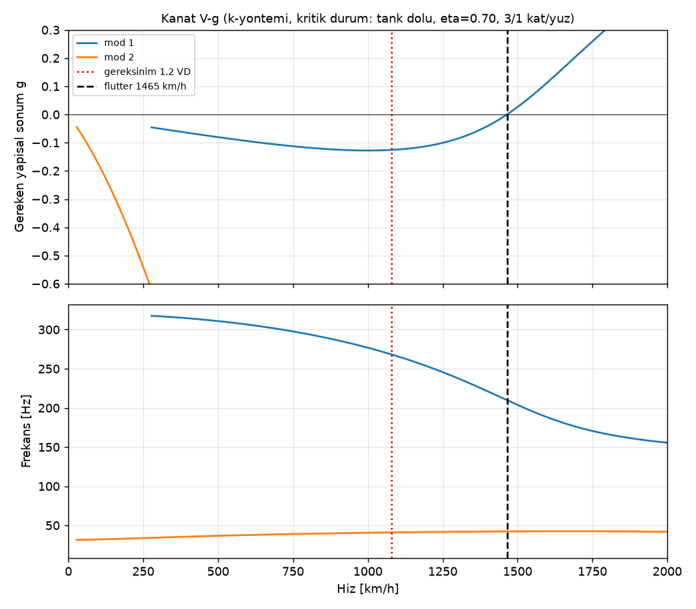
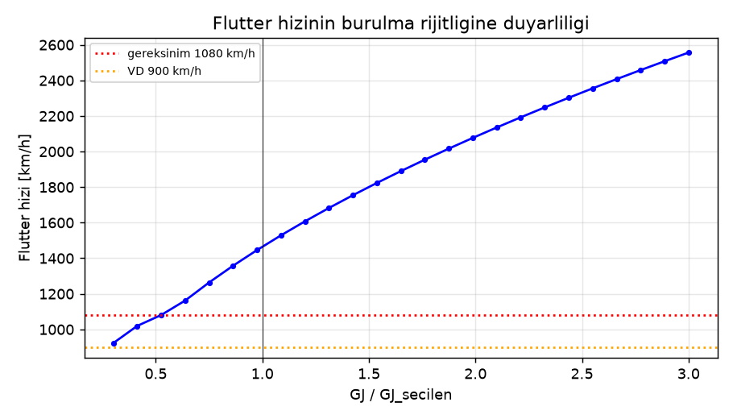

**Sonuçlar:**
- 2-DOF flutter hızı **1465 km/h**; gereksinim 1080 km/h, pay %36. Diverjans 3290 km/h.
- **İter4 FE modal sonucu daha düşük: 1307 km/h (pay %21).** 2-DOF modeli 3. eğilme–1. burulma eşleşmesini, ok açısının eğilme-eğimi etkisini ve kanat içi servoları göremiyor (§14.5).
- Bulgu: flutter'ı belirleyen etken kütle dağılımı (x_α), burulma rijitliği daha az belirleyici. Kat eklemek her zaman işe yaramıyor: 3/3 ve 4/4, 3/1'den kötü.
- **İmalat gereksinimi:**
  - Firar kenarı bölgesine gereksiz kütle eklenmemeli (dolgu, boya birikmesi, kablo).
  - Aileron balans kütleleri **zorunlu**. Hinge hattındaki 23 g bu hesaba dahil.
  - Servolar mümkün olduğunca kiriş önüne (0,2–0,35c) yerleştirilmeli. Tank bölgesinde (η ≤ 0,55) kirişler arası dolu olduğundan aileron servosu ya arka kirişin gerisine (FE temel durumu, 0,60c) ya da köke (tork çubuğuyla) konur; köke almak flutter'ı ~%11 artırır (§14.6).

## 7. Alçak kanat bağlantısı (iter 3)

**Geometri:**
- Kanat orta düzlemi z = −80 mm (iter3 kapanış; ilk iter3 analizi −65 mm ile yapılmıştı).
- Kök kutu bölgesinde üst yüzey z = −66 mm, alt yüzey z = −94 mm (gövde alt kabuğu −82,5 mm; kanat alt yüzeyi gövdenin ~11 mm altında, karın kaplamasıyla örtülür).
- Gövde yan yüzü y = ±20 mm (orta düzlemde); üst yüzey hizasında ±49 mm.

### 7.1 Seçenek karşılaştırması

| | **A: tek parça kanat, gövde içinden geçen kutu (önerilen)** | B: iki yarı + karbon bıçak + yan çerçeve |
|---|---|---|
| Yük yolu | Kiriş kapakları süreklidir; kök momenti (442 N·m) kanat içinde kalır. Gövdeye yalnız kesme ve yunuslama kuvvetleri aktarılır. | 412 N·m bıçaklarla yan çerçevelere aktarılır. Alçak kanatta gövde yan duvarı sığ ve eğik (y = 20–49 mm), çerçeve tabanı dar. |
| Kütle (bağlantı + merkez) | ~0,22 kg | ~0,28 kg |
| Taşıma | 1,45 m tek parça: araca sığar | Sökülebilir |
| Ek fayda | Merkez tank +0,27 L; dengesizlik yok | – |
| Risk | Gövde altında 236 mm kesik: longeron önerilir | Bıçak kutusu kök kaburgası ve tank duvarıyla çakışır |

**Karar: A.** Kanat kutusu gövdenin içinden yalnız **hücum kenarı → arka kiriş** (x = 0,92–1,156 m) arasında geçer.

Kanadın arka kiriş gerisi (0,55c → firar kenarı) gövde yanında (y = ±51 mm) kök kaburgasıyla biter. Sebebi: x > 1,18 m'de motor alt kenarı (z ≈ −74 mm) ile kanat firar kenarı bölgesi çakışırdı. **CAD notu:** gövde alt kabuğu x > 1,156 m'de süreklidir.

### 7.2 Bağlantı yükleri (nihai)

Gövdenin kanattan taşıdığı kütle 14,13 kg (kanat ve kanat yakıtı hariç), ağırlık merkezi x = 1,147 m. Kuyruk yükü ±976 N nihai (V_D).

| Bağlantı düzeni | Durum | Ön bağlantı [N] | Arka bağlantı [N] |
|---|---|---|---|
| **A1:** kiriş çerçeveleri, x = 1,006 / 1,156 (aralık 150 mm) | kuyruk aşağı | −5111 (çekme) | 8581 |
| | kuyruk yukarı | 5412 | −3894 |
| A2: hücum kenarı pimi 0,96 + firar kenarı cıvatası 1,32 (aralık 360 mm) | kuyruk aşağı | −554 | 4025 |
| | kuyruk yukarı | 2950 | −1432 |

**A2 yükleri yarıya indirir**, ancak x = 1,32 m'deki çerçeve motorun etrafından geçmek zorunda. Orada motor ile kabuk arasında yalnız 8,5 mm radyal derinlik var; çerçeve gerekli rijitliği taşıyamaz. **Bu nedenle A1 önerilir.** Motor ≥ 0,15 m arkaya alınırsa A2 yeniden değerlendirilir.

**A1 boyutlandırması:**

| Eleman | Gereksinim / seçim |
|---|---|
| Cıvatalar | **4 × M6 12.9** (her çerçevede 2, y = ±35 mm). En kötü çekme 5,6 kN (yunuslama + −12 g + dikey kuyruk yuvarlanma momenti 188 N·m); M6 kapasitesi 17,2 kN. Alttan takılır, gövde içinde Al barrel-nut. |
| Kanat hard point'leri | Cıvata başına yatak kalınlığı ≥ 4,3 mm. Kutu içinde kapaklar arası G10/Al blok (20 × 30 mm) + kiriş web'inde lokal ±45 takviye (≥ 4 mm, kesme 5,2 kN). |
| Kiriş çerçeveleri (x = 1,006 ve 1,156) | Halka momenti 0,08·F·R = 57 N·m. **25 mm radyal derinlik, 3,1 mm karbon** (veya 6 mm sandviç). Üstteki S-kanal geçişi için çerçeve üst yarısında kanal kesiği + çevresel takviye. |
| Hücum kenarı yataklama | x ≈ 0,94 m'de 2 × Ø5 çelik pim, gövde tankı arka duvar çerçevesine. Konumlama ve sürtünme yükü için. |
| Gövde alt kesiği (x 0,92–1,156) | Kesikte M = 1205 N·m. z = −80 mm'de kesik daha sığ: longeronsuz 3510 µε (izin 4000 µε, pay küçük). **2 × 20 mm² UD longeron önerilir** (2 × 10 mm şerit, kesik kenarlarında, z = −66 mm, kesiğin ±60 mm ötesine uzanan) → ≈ 1900 µε. |
| Karın kaplaması | Kanatla birlikte sökülen ince kabuk (1 kat 160 g/m² + 1 mm köpük). Yük taşımaz. Kızağın kanat altı bölümü bu kaplama yerine kanat merkez kutusuna cıvatalanır. |

## 8. Tek yarıklı flap (iter 3)

**Geometri ve yükler:**
- c_f = 0,25c = 86 mm, S_f = 236 cm²/flap, 35° açık, V_FE = 150 km/h.
- Normal kuvvet katsayısı C_n = 1,6 (flap alanına göre; tek yarıklı flap 35°, hamle payı dahil).
- N = 40 N limit, 60 N nihai (flap başına).

**Yatak düzeni:**
- Dış menteşe (drop-hinge), flap başına 2 braket.
- Pivot noktası flap hücum kenarının 0,10 c_f önünde, profil alt yüzeyinin 0,06c altında; bu da 35°'de yarık oluşturur.

| Büyüklük | Değer |
|---|---|
| Braket yükü (nihai, ±%25 eşitsizlik) | 38 N/braket. Pim Ø3 çelik, çift kesme kapasitesi 6,8 kN. Braket 7075-T6 Al 2 mm veya 3 mm karbon; kirişe değil **arka kirişe cıvatalı kaburga ayağına** bağlanır. |
| Menteşe momenti (açık, V_FE) | 1,55 N·m → servo **24 kg·cm** |
| Kapalı tutma momenti, 800 km/h / 900 km/h | 1,09 / 0,63 N·m → 17,1 / 9,8 kg·cm |
| Önerilen mekanizma | **Ölü nokta (over-center) kol**: flap kapalıyken servo yük görmez. Flap mekanik dayanağa ön yüklü durur (yüksek hızda boşluk = 0). |
| Servo | Ortak 45 kg·cm tip yeterli (gereken 25 kg·cm sınıfı) |
| Kontrol yüzeyi flutter'ı | Flaplar yüksek hızda dayanakta ön yüklü olduğu için balans gerekmez (tablodaki 39 g uygulanmaz). Ön yük ≥ 2 × 1,09 N·m. |
| Braket kaporta (fairing) | Dış menteşeler sürüklemenin kaynağı. Bkz. aero dokümanı. |

## 9. Kontrol yüzeyleri: menteşe momentleri, servolar, balans

| Yüzey | c_f [mm] | S_f [cm²] | M_h @800 km/h [N·m] | M_h @V_D [N·m] | M_h @V_A [N·m] | Gereken servo [kg·cm] | Servo | Balans kütlesi |
|---|---|---|---|---|---|---|---|---|
| Aileron | 41 | 124 | 1,12 | 1,39 | 0,67 | 21,9 | 45 (ortak) | 23 g |
| **Elevator (c_f 0,22, ±1,5°)** | **34** | **89** | **0,40** | **0,57** | **0,44** | **8,9** | 45 (ortak) | **18 g** |
| Rudder | 62 | 179 | 2,40 | 3,39 | 1,70 | 53,2 | **60** | 31 g |
| Flap (yarıklı) | 86 | 236 | 1,09 (tutma) | 0,63 | 1,55 (V_FE) | 24,3 | 45 (ortak) | – |

**Elevator flutter (iter 3):**
- %100 statik balans → 18 g tungsten, hücum kenarına 7 mm kolla. Yüzey kütlesi 9 g.
- Yatay kuyruk yarısının eğilme frekansı tahmini **~154 Hz** (boru soketinde ankastre kiriş).
- Gereken elevator dönme frekansı ≥ 1,5 × min(f_kuyruk, 3·f_kanat) ≈ **150 Hz** → bağlantı rijitliği ≥ 2,4 N·m/rad.
  - 3 mm karbon itme çubuğu, 10 mm kol: ~1700 N·m/rad. **Yeter, yeter ki boşluk ≤ 0,1° olsun.**
- c_f'nin 0,28 → 0,22'ye inmesi balans kütlesini ve menteşe momentini azalttı; flutter açısından olumlu.
- Elevator **ses altı titreşim (buzz)**: M < 0,8'de risk düşük. Ancak menteşe boşluğu sızdırmaz (sealed gap) olmalı ve firar kenarı keskin.

## 10. Gövde altı kızak (iter 3: x 0,62–1,45 m)

**Enerji ve yük:**
- İniş kütlesi 13,41 kg, batma hızı 1,5 m/s → E = 15,1 J.
- Tasarım durumu kısa çim (25 mm strok): **9,2 g limit**, F_ult = 1810 N.
- Sert pistte 22,9 g → **yalnız çim pist**.
- Kayma mesafesi ≈ 71 m.

| Kontrol | İter 2 | **İter 3** |
|---|---|---|
| Çerçeveler | 0,62 / 0,96 / 1,30 | **0,62 / 0,81 / 1,006 / 1,156 / 1,38** (kiriş çerçeveleri + motor yatağı çerçevesi) |
| En büyük açıklık / arka konsol | 0,34 m / – | 0,224 m / 0,07 m |
| Kızak kirişi σ (40 × 10 mm, 1 mm UD kapaklar) | 466 MPa | **391 MPa** (izin 500) |
| Çerçeve halka gerilmesi | 104 MPa | 106 MPa (izin 180) |
| Kızak kütlesi | 205 g | 246 g (params 0,25 kg ile uyumlu) |
| Kuyruk çarpma açısı | 2,6° | **3,2°** (yalnız kızak); tamponla 12,4° (CAD) |

**Kuyruk çarpması:** Hedeflenen 9° yalnız kızakla **sağlanamıyor**. Kızak arka ucu (x = 1,45) ile egzoz konisi alt kenarı arasındaki düşey fark yalnız 36 mm, yatay mesafe 0,65 m. 9° için ~100 mm düşey fark gerekir.

Bu nedenle **kuyruk tamponu zorunlu** (params: x = 1,87 m, 22 mm derinlik, 0,12 m boy, 0,04 kg; CAD'de çarpma açısı 12,4°):
- değiştirilebilir Kevlar/UHMW blok;
- limit yükü ~475 N;
- yatay kuyruk boru çerçevesini paylaşır.

Teker koyma için ~5–8° gerekiyor; uçak önce tampona, sonra kızağa oturur.

**Motor altı ısı (x 1,18–1,45):**
- Motor alt kenarı ile gövde kabuğu arasında ~8,5 mm boşluk var.
- Motor gövdesinin yanma odası bölgesinde dış yüzey sıcaklığı ~150–250 °C olabilir. **Doğrulanmadı;** ilk motor çalıştırmada termokupl ile ölçülmeli.

**Gereksinimler:**
1. Gövde iç yüzüne x 1,15–1,60 bölgesinde alüminize cam keçe (1,5–2 mm) + alüminyum folyo.
2. Kızak ve gövde alt kabuğu bu bölgede **Tg ≥ 150 °C** reçine. Kızak aramid sarımı 150 °C'ye dayanır; reçine sınırlar.
3. Aşınma plakası UHMW-PE (sınır ~80 °C) bu bölgede **kullanılmamalı** → x > 1,15'te **G10/FR4** (≤ 130 °C) ya da 0,5 mm paslanmaz çelik plaka.
4. Bypass soğutma havası motor altından akmalı (egzoz borusu bypass'ı).
5. Kontrol için sıcaklık gösterge etiketleri (60/80/100/120 °C), ilk uçuşlarda motor altı kabuğa yapıştırılır.

## 11. Gövde, motor yatağı, yatay kuyruk kökü

| Kontrol | Sonuç |
|---|---|
| Arka gövde eğilmesi | 1205 N·m @ x 1,16. Kabuk en fazla 3 kat 200 g/m² (x 1,15–1,6), kesik bölgesinde longeron (§7). |
| Motor yatağı | 4 × M4 12.9; her cıvata kesme 350 N, çekme 173 N |
| Yatay kuyruk kökü (iki yarı) | M = 48 N·m, T = 32 N·m (her yarı, nihai) |
| Yatay kuyruk boru ve pim | **D14 × 2 karbon boru (241 MPa)**, yüksek Tg. Ø4 insidans pimi (341 N). Yatak kuvveti 687 N, 100 mm geçme boyu. |
| Kuyruk tamponu çerçevesi | Yatay kuyruk boru çerçevesiyle ortak (x ≈ 1,87–1,90) |

## 12. Test planı

1. **Kupon testleri:**
   - UD ve ±45 laminelerin E ve kopma birim uzaması.
   - Tank kaplamasının kerosene uyumu: 2 hafta daldırma sonrası ILSS kaybı < %10.
   - **Yüksek Tg reçine numunelerinde 150 °C'de basma testi.**
2. **Tank sızdırmazlık testi:** 15 kPa, 30 dk. Ardından 24 saat yakıtla bekletme.
3. **Kanat statik yük testi:** %67 → %100 → %150. Nihai yükte toplam 3,00 kN, yarım kanat başına ~153 kg kum. Kanat **bağlantı cıvatalarından** (A1 çerçeve düzeni ile aynı bağlantı noktalarından) mesnetlenir.
4. **Bağlantı testi:** Yunuslama kuvvet çifti ön/arka çerçevede 5,4 / 8,6 kN nihai. Cıvata yatağında kalıcı deformasyon olmamalı.
5. **Burulma testi:** Kök GJ ≥ %80 × 7324 N·m².
6. **GVT (tank dolu/boş):** hedef frekanslar ve kabul aralıkları §14.7'de (FE: 1B ≈ 27–28 Hz, 3B ≈ 195–211 Hz, 1T ≈ 306–317 Hz; **1T ≥ 230 Hz** kabul sınırı).
   - Kontrol yüzeyi dönme frekansı: aileron ≥ 51 Hz, elevator ≥ 150 Hz.
7. **Kızak düşürme testi:** 115 mm yükseklikten çime; n ≤ 9 g. Ayrıca **kuyruk-önce** düşürme ile tampon yükü ölçülür.
8. **Motor bölgesi sıcaklık ölçümü:** Yer çalıştırmasında tam gazda 3 dk; kabuk iç ve dış sıcaklığı ≤ Tg − 30 °C olmalı.
9. **Uçuş zarfı genişletme:** 400 → 800 km/h, her adımda +50 km/h. Kanat ucu ivmeölçeri ve darbe girişi ile sönüm izlenir. **GVT yapılmadan 600 km/h üstü yasak.**

## 13. Açık sorunlar ve params.py önerileri

Durum sütunu iter3 kapanışından sonraki hali gösterir (params'a işlendi / açık).

| # | Konu | Öneri | Durum |
|---|---|---|---|
| 1 | Kat planı / kesit ağırlık merkezi | `WING["skin_plies"]=(3, 1)` (kiriş önü/arkası, yüz başına). `MASS_ITEMS` kanat 1,75 kg kalabilir (hesap 1,74 kg). | işlendi |
| 2 | Kanat tankı | params `wing_integral_L_each = 0.715` CAD brüt hacmidir. Kullanılabilir **0,57 L** (§14.8): ayrı anahtar önerisi `wing_integral_usable_L_each = 0.57`; toplam kullanılabilir yakıt kontrolü §14.9. | **açık (iter4)** |
| 3 | Kanat bağlantısı | Tek parça kanat + gövde içinden geçen kutu, 4 × M6 12.9 kiriş çerçevelerinde, HK pimleri x = 0,94. Kütle kalemi 0,15 kg, x ≈ 1,08. | işlendi |
| 4 | Kanat firar kenarı / motor çakışması | Gövde içinde kanat yalnız arka kirişe kadar (x ≤ 1,156); CAD'de gövde alt kabuğu x > 1,156 sürekli | işlendi |
| 5 | Kuyruk çarpma açısı 3,2° (hedef 9° yalnız kızakla mümkün değil) | `GEAR["tail_bumper"]` (x = 1,87, 22 mm), kütle 0,04 kg | işlendi |
| 6 | Kızak çerçeveleri | `GEAR["skid_frames"]=(0.62, 0.81, 1.006, 1.156, 1.38)` | işlendi |
| 7 | Motor bölgesi ısı | Malzeme notu: x 1,15–1,60 bölgesinde Tg ≥ 150 °C reçine, G10/çelik aşınma plakası, ısı keçesi (+0,05 kg) | işlendi |
| 8 | Flap mekanizması | Ölü nokta kollu servo, dayanak ön yükü ≥ 2,2 N·m | açık (detay tasarım) |
| 9 | Servolar | Aileron/elevator/flap 45 kg·cm (elevator için 15 kg·cm bile yeterli), rudder 60 kg·cm | açık (detay tasarım) |
| 10 | Operasyonel −8,6 g hamle | Uçuş kartı notu | açık |
| 11 | Aileron servosu yeri (iter4) | Tank bölgesinde servo kiriş önüne giremez. Servo köke (y ≈ 0,10 m) + tork çubuğu ya da ≤ 60 g ince kanat servosu; 0,12 kg servo 0,60c'de flutter'ı ~%10 düşürür (§14.6). | **açık (iter4)** |
| 12 | Flutter model payı (iter4) | FE modal sonucuyla ×1,25 ek model payı (1350 km/h) sağlanmıyor (1307). GVT ile güncellenmiş modelde ×1,15 pay (≥ 1242 km/h) önerilir; GVT kabulü §14.7. | **açık (iter4)** |

## 14. FE modal analizi ve modal flutter (iter4)

Script: [`structures/fe_modal.py`](../structures/fe_modal.py). Kesit özellikleri `structures.wing_section_model()` ile alınır; bu yardımcı fonksiyon `main()` akışındaki yük ve boyutlandırma adımlarını grafik/json yazmadan tekrarlar (geriye uyumlu ek). Sayılar: `structures/out/fe_sonuclar.json`.

### 14.1 Model

| Konu | Varsayım |
|---|---|
| Sınır koşulu | Yarı kanat **y = 35 mm'de ankastre**. Burası tek parça kanadın kiriş çerçevelerine 4 × M6 ile bağlandığı cıvata hattıdır (2-DOF modeli y₀ = 20 mm kullanıyordu). Gövde rijit kabul edildi. |
| Kiriş ekseni | Elastik eksen 0,30c, ok açısı **Λ_EA = 22,6°** (hücum kenarı 28°). Kiriş boyu (b/2 − 0,035)/cos Λ = 0,747 m. |
| Elemanlar | 40 eleman, düğüm başına 3 serbestlik: eğilme w, w′ (Hermite, Euler-Bernoulli) ve burulma φ (lineer, St-Venant). 4 noktalı Gauss integrasyonu. |
| Kesit verisi | structures 3/1 kat planı: EI(y), GJ(y), m′(y), kesit CG(y) (η 0,7'de 0,451c), kesit ataleti (yarıçap c/√12 + ofset). Akış yönündeki şerit değerleri elastik eksene dik kesite çevrildi: m·cos Λ, S·cos² Λ, I·cos³ Λ, GJ·cos Λ; EI aynı (kapaklar kiriş boyunca). |
| Kütle eşleşmesi | CG–EA ofseti tutarlı kütle matrisinde (−S terimleri). |
| Kütleler (yarı kanat) | Yapı 0,65 kg (aileron + 23 g balans kütlesi dahil). Servolar MASS_ITEMS 0,48 kg / 4 = **0,12 kg**: aileron servosu y = 0,34 m, 0,60c (tank bölgesi kirişler arasını doldurduğu için arka kirişin gerisinde); flap servosu y = 0,10 m, 0,65c. Tank yakıtı: dolu **0,456 kg** (önerilen kullanılabilir 0,57 L, §14.8), c²'ye orantılı dağılım, 0,375c'de rijit kütle. |
| Aerodinamik | Şerit teorisi + Theodorsen, dik kesitte (V_n = V cos Λ, b_n = b cos Λ, a = −0,40). Ok açısının eğilme-eğimi terimi: α_etkin = φ − tan Λ · w′ (Barmby/Bisplinghoff). Prandtl–Glauert 1/β, M_n = M cos Λ, M_n ≤ 0,9 ile sınırlı. |
| Çözüm | İlk 4 mod (1B, 2B, 3B, 1T), **p-k yöntemi** (k-yöntemiyle çapraz kontrol), Mach eşleştirmeli (match-point). Diverjans: FE statik aeroelastik özdeğer problemi. |
| Modellenmeyen | Kiriş düzlemi içi (chordwise) modlar, aileron dönme serbestliği (%100 statik balans + rijit bağlantı varsayımı), yakıt çalkantısı, uç kaybı, transonik etkiler. |

### 14.2 Doğrulama

| Durum | FE | Referans | Fark |
|---|---|---|---|
| Ankastre üniform kiriş, eğilme 1/2/3 (20 eleman) | 3,5160 / 22,0345 / 61,698 | 3,5160 / 22,0345 / 61,697 (β_nL)² | < %0,002 |
| Ankastre üniform kiriş, burulma 1/2 | 1,5712 / 4,7233 | π/2 / 3π/2 | %0,03 / %0,23 |
| Goland kanadı, frekanslar [rad/s] | 48,2 / 95,7 / 243,9 | 49,6 / 97,0 / 248,9 | −%1,5…−%3 |
| **Goland kanadı, flutter (4 mod, p-k)** | **136,9 m/s, 70,0 rad/s** | **137,2 m/s, 70,7 rad/s** | **−%0,2 / −%1** |
| Goland, k-yöntemi (aynı model) | 137,0 m/s, 70,0 rad/s | | |
| Goland, 2 / 6 mod | 137,3 / 137,0 m/s | | mod sayısına duyarsız |

Goland verisi: L = 6,096 m, c = 1,829 m, EA %33c, CG %43c, m = 35,71 kg/m, I_EA = 8,64 kg·m, EI = 9,77·10⁶, GJ = 0,987·10⁶ N·m². FE frekanslarının literatürden %2 kadar düşük olması atalet tanımından (I'nın EA mı CG mi etrafında verildiği) kaynaklanıyor; flutter sonucu yine de referansla örtüşüyor.

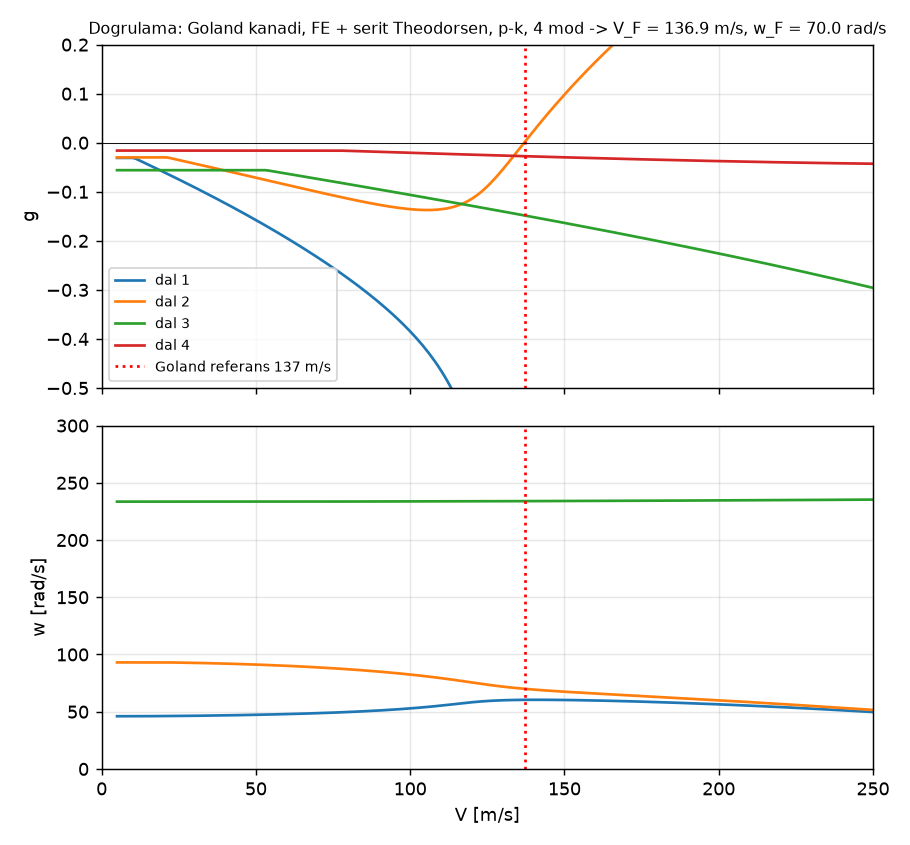

### 14.3 Mod frekansları

| Mod | Tank dolu [Hz] | Tank boş [Hz] | 2-DOF / Rayleigh (iter3) [Hz] |
|---|---|---|---|
| 1B: 1. eğilme | **27,5** | **28,0** | 33,5 (dolu) / 34,8 (boş) |
| 2B: 2. eğilme | 84,3 | 92,8 | – |
| 3B: 3. eğilme | 195,4 | 211,1 | – |
| 1T: 1. burulma | **305,7** | **316,6** | 291 (dolu) / 303 (boş) |
| 4B: 4. eğilme | 374,7 | 422,5 | – |

- Rayleigh 1B'yi %22 yüksek veriyordu. Sebepleri: Rayleigh üst sınırdır; ok açısı kirişi 1/cos Λ kadar uzatır (f ∝ cos^1,5 Λ ≈ 0,89); kanat içi servolar hesapta yoktu.
- 1T/1B oranı ≈ 11. Bu yüzden 1B–1T eşleşmesi zayıf: 1T'ye en yakın eğilme modu **3B** (~195 Hz) ve flutter mekanizması **3B–1T**. 2-DOF tipik kesit bu modu hiç içermiyor.
- Tank yakıtı daha çok 2B–4B'yi düşürüyor (yakıt kök–orta açıklıkta), 1B ve 1T'yi az etkiliyor.

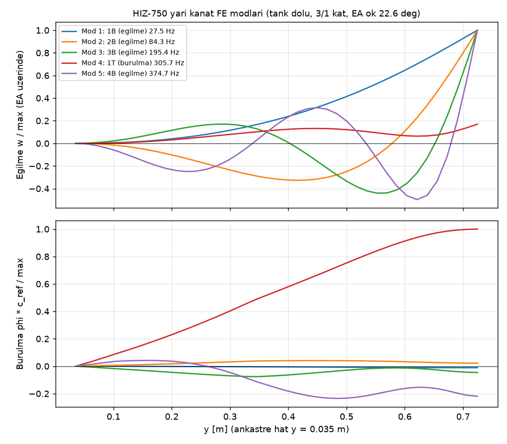
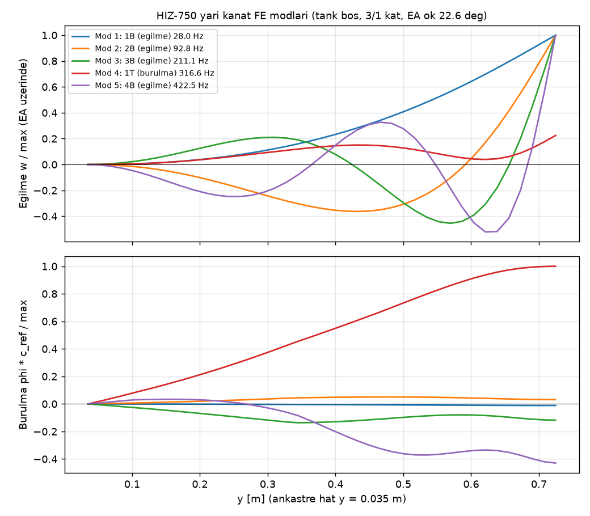

### 14.4 Modal flutter ve diverjans

| | Tank dolu | Tank boş |
|---|---|---|
| **V_F (p-k, Mach eşleştirmeli, g = 0)** | **1307 km/h** (189 Hz, 3B dalı) | **1329 km/h** (194 Hz) |
| V_F, yapısal sönüm g = 0,02 | 1318 km/h | 1340 km/h |
| V_F, sabit M = 0,88 (1080 km/h noktası) | 1466 km/h | 1492 km/h |
| Pay (gereksinim 1080 km/h) | **%21** | %23 |
| Diverjans | yok (ok açısının eğilme-eğimi terimi burulmayı bastırır); terim kapalıyken 2961 km/h | yok |
| Mod sayısı yakınsaması (dolu) | 3 mod: flutter yok (1T dışarıda); 4 / 5 / 6 mod: 1307 / 1300 / 1297 km/h | |

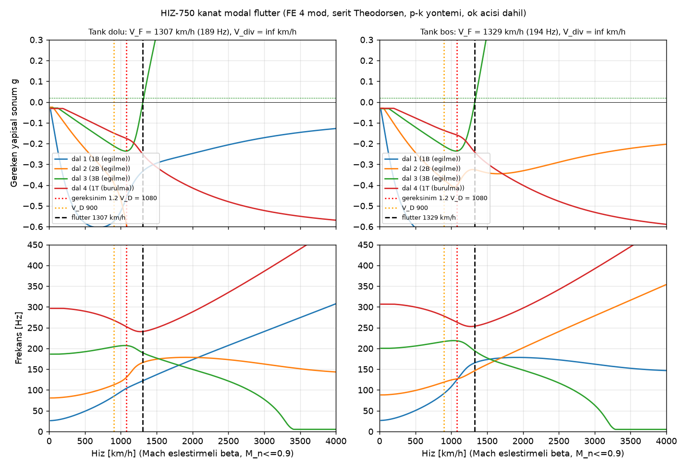

- Flutter **sert** tiptedir: g, 1200 km/h'ye kadar ≤ −0,2'de kalıyor, 1300 km/h civarında hızla pozitife geçiyor. Bu nedenle g = 0,02 sönüm sınırı yalnız +11 km/h kazandırıyor. **Uçuş testinde sönüm eğilimi, flutter'a yaklaşıldığını erken göstermeyebilir.**
- Sonuç tank dolu/boş durumuna az duyarlı (%2). Kritik durum: tank dolu.
- **Mach geçerliliği:** V_F > 1194 km/h için M_n tavanı (0,9) devrede; Prandtl–Glauert bu bölgede geçerli değil. Gereksinim noktasında (1080 km/h, M = 0,88, M_n = 0,81) sabit Mach çözümü 1466 km/h veriyor, yani 1080 km/h'ye kadar sistem kararlı. Transonik düşüş (transonic dip) bu modelle değerlendirilemez.

### 14.5 2-DOF sonucuyla karşılaştırma (tank dolu)

| Adım | Değişiklik | V_F [km/h] | V_div [km/h] | f 1. / 2. / 3. mod [Hz] |
|---|---|---|---|---|
| A | 2-DOF tipik kesit (structures, η 0,70, Rayleigh) | 1465 | 3290 | 33,8 / – / 291 |
| B | FE, structures'la aynı varsayımlar (ok yok, y₀ = 20 mm, servo yok, yakıt 0,49 kg) | 1508 | 2816 | 30,9 / 100,1 / 223,9 |
| C | + ankastre cıvata hattında (y = 35 mm) | 1515 | 2845 | 31,4 / 102,6 / 229,1 |
| D | + ok açısı: dik kesit kütle/GJ, V_n, M_n | 1575 | 2961 | 27,9 / 91,1 / 203,7 |
| E | + ok açısının eğilme-eğimi terimi (α = φ − tan Λ · w′) | 1417 | yok | aynı |
| F | + aileron ve flap servoları (2 × 0,12 kg/yarı) | 1307 | yok | 27,4 / 83,7 / 194,5 |
| **G** | **+ önerilen kullanılabilir yakıt 0,456 kg/yarı (temel)** | **1307** | **yok** | **27,5 / 84,3 / 195,4** |

**Farkın açıklaması:**
1. Aynı varsayımlarla FE (B) 2-DOF'tan %3 yüksek. Yani tipik kesit (η 0,7, Rayleigh) bu kanat için tesadüfen makul bir temsil.
2. Ok açısının dik kesit dönüşümü (D) tek başına V_F'yi artırır (normal hız bileşeni). Eğilme-eğimi terimi (E) ise eğilme ile burulmayı aerodinamik olarak eşleştirir: geri ok açılı kanatta yukarı eğilme veteri burnu aşağı çevirir. Bu terim diverjansı ortadan kaldırır, ama V_F'yi **−%10** düşürür.
3. **İkinci büyük etken servolar (−%8):** 0,12 kg'lık aileron servosu y = 0,34 m'de EA'nın 0,30c gerisinde. Yerel kesit kütlesine göre büyük bir kütle ve 3B/1T modlarında büyük genliğe sahip.
4. Kesit CG'si 2-DOF'ta yalnız η 0,7'de kullanılıyordu; FE tüm açıklıktaki CG dağılımını ve 3B–1T mekanizmasını içeriyor.
5. Toplam: 1465 → 1307 km/h (**−%11**). 2-DOF sonucu iyimserdi; gereksinim yine de %21 payla sağlanıyor.

### 14.6 Duyarlılık

Kesit CG'si tüm açıklıkta aynı miktarda kaydırıldı (η 0,7'deki değer tabloda); GJ tüm açıklıkta ölçeklendi.

| x_cg (η 0,7) | GJ | FE dolu | FE boş | 2-DOF dolu | 2-DOF boş |
|---|---|---|---|---|---|
| 0,42c | ×0,8 | 1.219 | 1.237 | 1.423 | 1.485 |
| 0,42c | ×1,0 | 1.361 | 1.393 | 1.596 | 1.664 |
| 0,42c | ×1,2 | 1.493 | 1.540 | 1.751 | 1.827 |
| 0,45c | ×0,8 | 1.185 | 1.189 | 1.311 | 1.364 |
| 0,45c | ×1,0 | **1.310** | **1.332** | **1.470** | **1.529** |
| 0,45c | ×1,2 | 1.443 | 1.477 | 1.614 | 1.678 |
| 0,48c | ×0,8 | 1.168 | 1.170 | 1.221 | 1.266 |
| 0,48c | ×1,0 | 1.266 | 1.281 | 1.369 | 1.420 |
| 0,48c | ×1,2 | 1.400 | 1.425 | 1.503 | 1.558 |
| 0,52c | ×0,8 | 1.146 | 1.147 | 1.122 | 1.159 |
| 0,52c | ×1,0 | 1.217 | 1.225 | 1.258 | 1.299 |
| 0,52c | ×1,2 | 1.354 | 1.370 | 1.381 | 1.426 |

(km/h. Temel durum 0,451c'dir; 0,45c satırı onun yuvarlanmışıdır.)

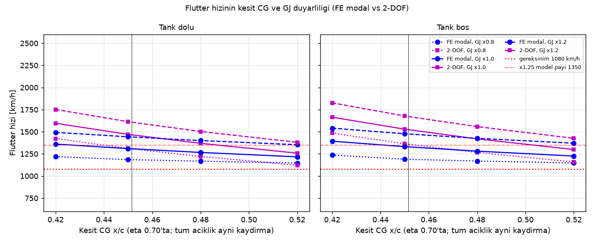

- **FE, kesit CG'sine 2-DOF'tan çok daha az duyarlı:** 0,42 → 0,52c aralığında FE −%11, 2-DOF −%21 (GJ ×1). Sebebi: 3B–1T mekanizmasında servo ve yakıt gibi noktasal/yerel kütleler de belirleyici; tipik kesitteki tek x_α'ya bağımlılık azalıyor. "Sonuç kesit CG'sine çok duyarlı" zayıflığı FE ile büyük ölçüde gideriliyor.
- **GJ ±%20 → V_F ≈ ±%10** (V_F ∝ √GJ'ye yakın). Burulma rijitliği artık birincil kaldıraç.
- **En kötü köşe (0,52c ve GJ ×0,8): 1146 km/h**, gereksinimin hâlâ %6 üstünde. Tüm 24 kombinasyonda V_F ≥ 1080 km/h.

**Servo yeri duyarlılığı (FE, km/h):**

| Aileron servosu | Dolu | Boş |
|---|---|---|
| Temel: 0,12 kg, y = 0,34 m, 0,60c | 1.307 | 1.329 |
| 0,06 kg ince kanat servosu, aynı yer | 1.353 | 1.410 |
| Köke (y = 0,10 m, 0,65c) + tork çubuğu | 1.447 | 1.346 |
| Aileron ortasında (y = 0,53 m, 0,65c) | 1.310 | 1.284 |

**Öneri:** Aileron servosunu ya köke alıp tork çubuğu kullanın ya da ≤ 60 g ince kanat servosu seçin. Servo kiriş önüne alınamıyorsa (tank) kütlesini küçük tutmak en etkili önlem.

### 14.7 GVT hedef tablosu ve kabul kriteri

**Test düzeni:** Kanat 4 cıvata noktasından rijit bir test tezgâhına bağlanır (FE sınır koşuluyla aynı). Darbe çekici veya küçük sarsıcı kullanılır, ivmeölçerler hücum ve firar kenarına (en az 6 istasyon × 2) yerleştirilir. Tank dolu (kerosen, 0,57 L/yarı) ve boş durumda ölçülür. Servolar ve balans kütleleri takılıdır.

| Mod | FE tank dolu [Hz] | FE tank boş [Hz] | Beklenen sapma (model) | Kabul aralığı (V_F ≥ 1080 km/h) |
|---|---|---|---|---|
| 1B: 1. eğilme | 27,5 | 28,0 | ±%10 | 19–42 Hz (×0,7–1,5 aralığında V_F 1296–1363 km/h; flutter'a duyarsız) |
| 2B: 2. eğilme | 84,3 | 92,8 | ±%12 | 59–139 Hz (1B ile birlikte ölçeklendi) |
| 3B: 3. eğilme (flutter eşi) | 195,4 | 211,1 | ±%15 | 137–317 Hz; ancak **1T/3B ≥ 1,15** olmalı (aksi halde modlar çakışır, mekanizma değişir) |
| **1T: 1. burulma** | **305,7** | **316,6** | ±%15 | **≥ 221 Hz (dolu) / ≥ 222 Hz (boş)** |
| 4B: 4. eğilme | 374,7 | 422,5 | ±%15 | bilgi amaçlı |

Kabul sınırları, ölçülen frekansların FE modal tabanında ölçeklenmesiyle bulundu: eğilme modları (1B–3B) birlikte f_B çarpanıyla, 1T ayrıca f_T çarpanıyla ölçeklenip her (f_B, f_T) çifti için V_F yeniden hesaplandı (mod şekilleri FE'den).

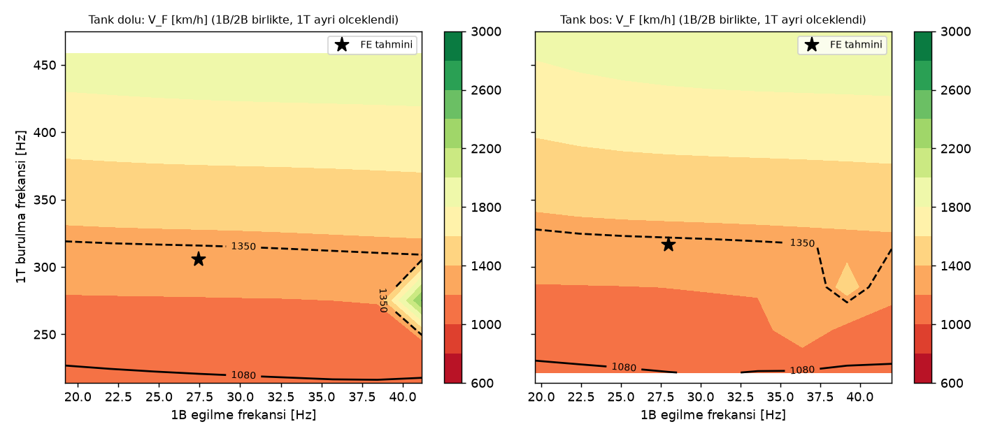

V_F'nin 1T çarpanına bağımlılığı (f_B = 1): dolu 0.7→1.064, 0.8→1.135, 0.9→1.190, 1.0→1.307, 1.1→1.435, 1.2→1.562, 1.3→1.689, 1.4→1.815, 1.5→1.940; boş 0.7→1.079, 0.8→1.145, 0.9→1.201, 1.0→1.329, 1.1→1.458, 1.2→1.585, 1.3→1.711, 1.4→1.834, 1.5→1.954 (km/h). Eğilme çarpanı 0,7–1,5 aralığında V_F'yi yalnız ±%2 değiştiriyor.

**Kabul kriteri (önerilen):**
1. **f_1T ≥ 230 Hz** (dolu ve boş). Bu, en az ~1100 km/h flutter hızı demektir (gereksinim 1080 km/h). Matematiksel alt sınır 221/222 Hz; 230 Hz yuvarlanmış ve küçük bir pay içeriyor.
2. **f_1T ≥ 290 Hz (dolu) / 295 Hz (boş)** ise V_F ≥ 1242 km/h, yani ×1,15 model payıyla da uygun. Bu durumda zarf genişletme planı (§12-9) değişmeden uygulanır. 230–290 Hz arasında V_D sınırı korunur; ancak test planı model GVT ile güncellendikten sonra yeniden değerlendirilmelidir.
3. ×1,25 payı (1350 km/h) için f_1T ≥ 316/322 Hz gerekir; FE nominal değeri bunu karşılamıyor (§13-12).
4. f_1B 19–42 Hz ve f_1T/f_3B ≥ 1,15 olmalı. Mod şekilleri FE ile MAC ≥ 0,8 uyumlu olmalı.
5. Ölçülen 1T sönümü g ≥ 0,01 olmalı. Kontrol yüzeyi dönme frekansları: aileron ≥ 51 Hz.
6. Herhangi biri sağlanmazsa: önce aileron servosunu köke alın (+%11), sonra kiriş önü kabuk katı veya ±45 web katı ekleyerek GJ'yi artırın.

### 14.8 Kanat entegre tank hacmi uzlaşması

| Adım | Hacim / yarı [L] | Not |
|---|---|---|
| CAD raporu (cad_report.json, η 0,06–0,55) | 0,715 | brüt kalıp boşluğu |
| CAD tanımı bu scriptte yeniden kuruldu (64A0xx, CAD loft t/c) | 0,706 | CAD'i %1 içinde tekrar üretir |
| + t/c doğrusal %7 → %6 (params/structures) | 0,706 | net etki ≈ 0 |
| + gerçek duvarlar: kabuk 3,22 mm (3 kat × 2 + 2 mm köpük + kaplama), web 0,68 mm, kaburga 3,86 mm | 0,660 |  |
| + kiriş kapakları (UD 2–3 kat, kutu genişliğinin ~%65'i) | 0,636 |  |
| + 1 orta bölme kaburgası + klunk/boru/nipel 10 cm³ = **fiziksel iç hacim** | 0,619 | en iyi tahmin |
| structures tanımı, kesin 64A ordinatlarıyla (dikdörtgen kutu, ×0,95) – karşılaştırma | 0,548 | structures json: 0,583 L (yt64 profili) |
| **Kullanılabilir:** fiziksel − %5 kullanılamaz − %2 dolum payı | 0,576 | **ÖNERİLEN → 0,57 L** |

**Tanım farkları:**
- **CAD (0,715 L):** Gerçek 64A0xx dış profili 2,6 mm içeri kaydırılmış; web 1,5 mm, uç kaburgalar 3 mm; kiriş kapakları, orta bölme kaburgası ve iç donanım yok. Yani **brüt boşluk**. Bu scriptte aynı tanım yeniden kurulduğunda 0,706 L çıkıyor (%1 fark: CAD loft/spline). CAD loft kesitleri t/c'yi 7, 7, 6, 6, 6 olarak yuvarlıyor; tank bölgesinde bu, doğrusal 7 → 6 dağılımıyla neredeyse aynı hacmi veriyor.
- **structures (0,58 L; doküman 0,57 L):** Kutu dikdörtgen kabul ediliyor (yükseklik, iki kiriş yüksekliğinin ortalaması; profilin 0,4c'deki kalınlık tepesi kayboluyor). Kabuk 3 kat × 2 yüz + 2 mm köpük = 3,07 mm. Kapaklar ve web'ler düşülüyor, %5 kayıp payı uygulanıyor. Kullandığı yt64 yaklaşık profili kiriş konumlarında 64A tablosundan %3–4 kalın; kesin 64A ordinatlarıyla aynı tanım 0,55 L verir. Ön boyutlandırmada (2 kat) 0,61 L.
- **Fiziksel iç hacim (en iyi tahmin) 0,62 L:** gerçek profil, gerçek 3/1 duvarlar, kapaklar, bir orta bölme kaburgası ve donanım.
- **Kullanılabilir:** −%5 kullanılamaz (13–15 mm derinlikte düz tank; klunk/ince film; 2° dihedral kökte toplamaya yardım eder) ve −%2 dolum/kabarcık payı.

**Önerilen tek değer: yarı kanat başına 0,57 L kullanılabilir (0,46 kg).** CAD'in 0,715 L'si brüt kalıp hacmi olarak kalabilir; kütle, CG ve menzil hesaplarında 0,57 L kullanılmalı. FE flutter hesabı bu değerle yapıldı.

### 14.9 Sonuç ve params önerileri

| Büyüklük | Değer |
|---|---|
| Mod frekansları (dolu / boş) | 1B 27,5/28,0, 2B 84,3/92,8, 3B 195,4/211,1, 1T 305,7/316,6 Hz |
| Modal flutter (dolu / boş) | **1307 / 1329 km/h**, 3B–1T, 189–194 Hz; pay %21 / %23 |
| Diverjans | Ok açılı modelde yok; oksuz 2961 km/h |
| 2-DOF ile fark | 1465 → 1307 km/h (−%11): ok açısı eğilme-eğimi terimi −%10, servolar −%8; dik kesit dönüşümü +%4 |
| Duyarlılık | CG 0,42 → 0,52c: −%11 (2-DOF −%21); GJ ±%20 → ±%10; en kötü köşe 1146 km/h |
| Tank | Kullanılabilir 0,57 L/yarı (fiziksel 0,62 L; CAD brüt 0,715 L) |

**params önerileri (params.py bu iterasyonda değiştirilmedi):**
1. `FUEL["tanks"]`: `wing_integral_L_each = 0.715` brüt değer olarak kalabilir; yeni anahtar `wing_integral_usable_L_each = 0.57` önerilir. Kullanılabilir toplam kontrolü: 2 × 0,57 + merkez 0,27 × 0,93 + gövde 3,63 × 0,97 ≈ 4,91 L < 5,0 L (4,0 kg). Ya `fuselage_L` +0,1 L (3,73 L), ya da `FUEL["mass"]` 3,93 kg.
2. `MASS_ITEMS` "Servolar: aileron+flap 4x": aileron servoları için köke yerleşim (tork çubuğu) veya ≤ 0,06 kg servo tercihi not edilmeli. Kütle butçesindeki x = 1,22 m, y bilgisi taşımıyor; FE için aileron servosu y = 0,34 m, 0,60c kabul edildi.
3. Kat planı `skin_plies = (3, 1)` yeterli; değişiklik gerekmiyor.

**Sınırlamalar:** Şerit teorisi uç kaybını içermez; Prandtl–Glauert M_n > 0,8'de güvenilmez; aileron dönme serbestliği ve yakıt çalkantısı modellenmedi; gövde rijit (serbest-serbest uçak modları yok). Kesin sonuç için GVT ile güncellenmiş model + (mümkünse) doublet-lattice analizi önerilir.
