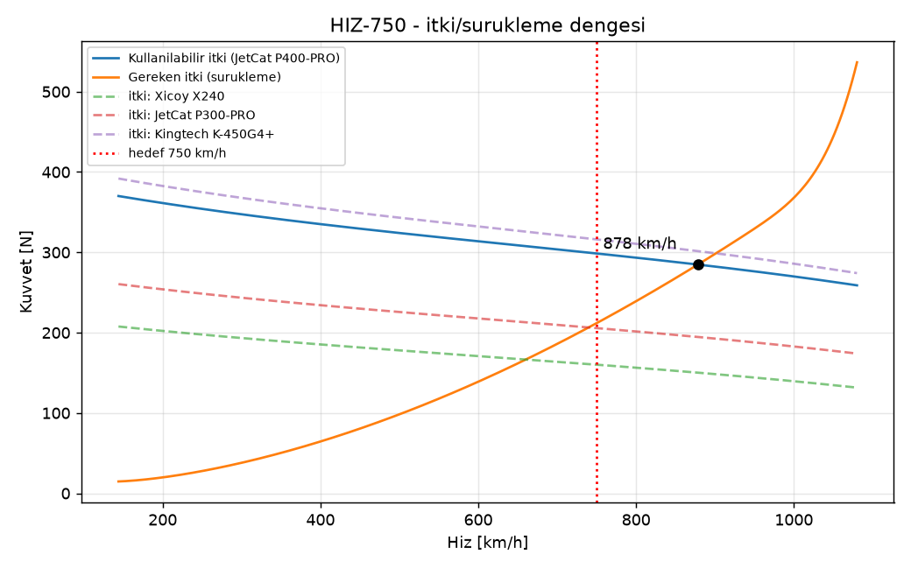
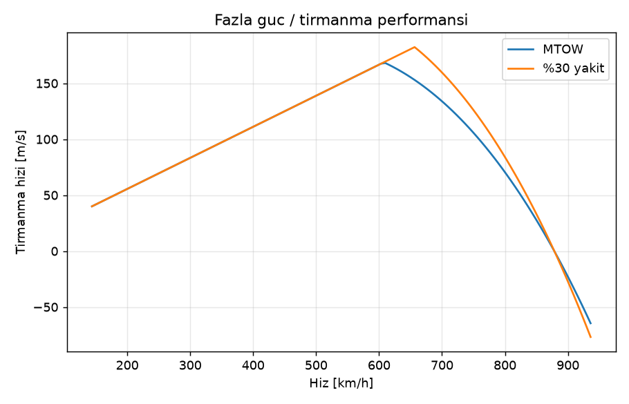
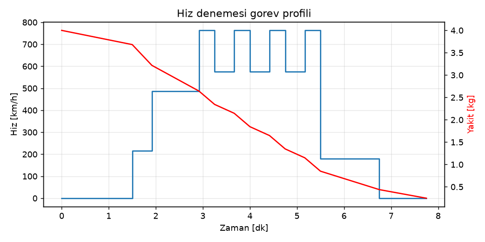
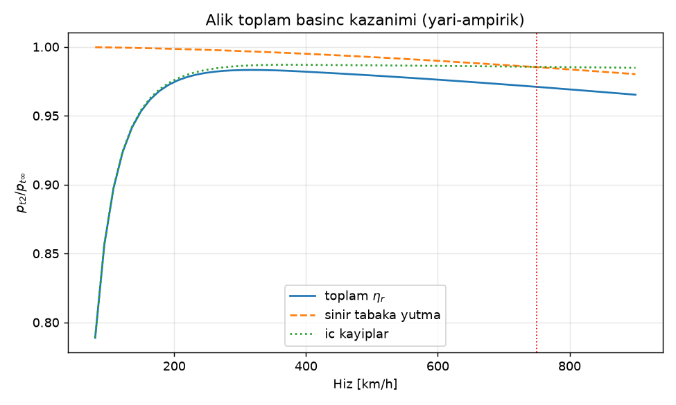

# 05 · Sistemler ve Performans (iterasyon 3, iter5 kütlesiyle güncellendi)

Kaynak scriptler: [`performance/mission.py`](../performance/mission.py), [`performance/mass_report.py`](../performance/mass_report.py), [`sizing.py`](../sizing.py). Parametreler: [`params.py`](../params.py).

**İterasyon 3 değişiklikleri:**
- Kanat alçağa alındı (z = −80 mm) ve +2° dihedral verildi.
- Hava alığı yarı gömülü yapıldı; S-kanalın ofset/uzunluk oranı 0,50'den 0,27'ye indi.
- Kanat kutusu gövdenin içinden geçiyor ve orta tank içeriyor; karın tankı kaldırıldı.
- Flap tek yarıklı (35°) yapıldı.
- Elevator veteri %22'ye düşürüldü.
- Kuyruk tamponu eklendi.

**İter5 güncellemesi:** Kanat rijitleştirmesi (kanat 1,75 → 2,03 kg) MTOW'yi 17,44 kg yaptı. Bu dokümandaki sayılar `run_all.sh` çıktılarından (`logs/sizing.log`, `logs/performance_*.log`, `logs/aero_aero_analysis.log`) yeniden alındı. `sizing.py` kütlesi artık `params.py`'den okunuyor (önceden sabit 17,01 kg).

## 5.1 İtki–sürükleme ve azami hız

| Büyüklük | Değer |
|---|---|
| MTOW / yakıtsız | 17,44 kg / 13,44 kg |
| Kanat yüklemesi | 41,5 kg/m² |
| Statik itki/ağırlık (T/W) | 2,48 |
| Azami yatay hız (tam gaz, 300 m ISA, kötümser `sizing.py`) | **~878 km/h (M 0,72)** |
| 750 km/h'te sürükleme | 154 N (AeroBuildup) – ~212 N (`sizing.py`, kötümser) |
| 750 km/h'te kullanılabilir itki | ~300 N → **%40–90 itki payı** |
| Operasyonel limit (ECU gaz sınırı) | 800 km/h |

Trade study: [trade_S_motor.png](../out/trade_S_motor.png).

## 5.2 Kalkış, iniş, tırmanma, dönüş

| | Değer |
|---|---|
| Kalkış | Dolly üzerinde α = 3°, flap 18°, elevator trim −4° (aero analizi önerisi) |
| Dolly bırakma (L/W ≥ 1) | ~126 km/h (1,2 Vs; dolly açısında CL ≈ 0,54–0,56, `mission.py` ve docs/02 §6.1 ile tutarlı) |
| Kalkış yer koşusu (dolly 2 kg dahil) | ~33 m |
| 10 m engele toplam mesafe | ~140 m |
| Dolly üzerinde 3°'de yer açıklığı | 86 mm (en alçak nokta kuyruk tamponu) |
| İniş ağırlığı | 14,4 kg (%25 yakıt) |
| İniş stall (yarıklı flap 35°) | 80 km/h nominal – 88 km/h muhafazakâr |
| Temas hızı | 88–97 km/h (iter2'de 95–100) |
| Kuyruk çarpma açısı (tampon dahil) | 12,4° (flare'de α 3,5–5,6° için yeterli) |
| Kızakla kayma mesafesi (çim, μ ≈ 0,4) | ~125 m (1 s serbest kayma dahil, `mission.py`); 10 m'den toplam ~314 m |
| Tırmanma (MTOW, kararlı) | 144–603 km/h arasında T − D ≥ W, yani dikey tırmanış mümkün; azami düşey hız ~168 m/s @ ~610 km/h (γ 83°). Önceki "183 m/s @ 490 km/h" değeri (T−D)V/W formülünden geliyordu ve düşey hız toplam hızı aşıyordu; iter5 incelemesinde düzeltildi |
| Dönüş | Yapısal limit 12 g belirleyici; **g-limiter şart** |

> **Saha:** Kalkış için düz asfalt (dolly), iniş için **çim** şerit (≥ 300 m). Sert pistte kızakla iniş kabul edilemez (bkz. 04).

## 5.3 Görev profili ve yakıt bütçesi

4 geçişli profil ~7,8 dk sürer ve ~3,75 kg (4,7 L) yakıt harcar. Yüklenen yakıt 4,0 kg (5,0 L); tank kapasitesi kullanılabilir 5,14 L (brüt 5,43 L).

**Operasyon kuralları:**
1. Standart sorti **2 ölçüm geçişidir**. Rezerv ~%31 (1,25 kg) kalır; 4 geçişte %6.
2. 3. ve 4. geçiş yalnızca yakıt ≥ %45 iken yapılır. Ölçüm geçişleri **≥ %40 yakıtla** bitirilmelidir; boş yakıtta elevator otoritesi aşırıdır.
3. %20 yakıt alarmında iniş paternine girilir.

## 5.4 Yakıt sistemi

İç hacimler, CAD duvar kalınlıkları düşülerek hesaplandı:

| Tank | İç hacim | x ağırlık merkezi |
|---|---|---|
| Gövde ana tankı (x 0,75–1,00 m) | 3,73 L (iter4: +0,10 L) | ~0,87 m |
| Kanat kutusu orta tankı (gövde içinde) | 0,27 L | 1,082 m |
| Kanat kökü entegre tanklar (2×, η 0,06–0,55) | 2 × 0,715 L brüt; **kullanılabilir 2 × 0,57 L** | 1,151 m |
| **Toplam** | **5,43 L brüt / 5,14 L kullanılabilir** (≥ 5,0 L gereken) | **0,940 m** (CAD, 4,0 kg yakıt) |

Notlar:
- Yapı analizi kanat tankı için %5 bölme payı ve ara bölmeyle ~0,57–0,65 L/yarı veriyor (iter4, 3/1 kabuk). **İter5 açık maddesi:** 4/1 kabuk + web +1 kat ile `structures/fe_modal.py` kullanılabilir hacmi **0,547 L/yarı** buluyor (params hâlâ 0,57 L). Bu hesap tankta yalnız bir orta kaburga düşüyor; 43 mm aralıkla tank bölgesine (η 0,06–0,55, ~355 mm) ~8 kaburga düşer ve kabaca 0,05 L/yarı daha kaybettirir (kaburga delik oranına bağlı). Toplam kullanılabilir hacim bu durumda **~5,0 L**, yani 4,0 kg (5,0 L) yük için pay sıfıra iner. Gerçek iç geometriyle (kaburga sayısı, delikler) yeniden hesaplanıp `params.FUEL` ve yakıt CG'si güncellenmeli; gerekirse yakıt yükü veya gövde tankı gözden geçirilmeli.
- **Hopper:** 250 ml, Kevlar keçeli, gövde tankının arkasında. Kanat ve orta tank gövde tankına boşalır; pompa yalnız hopper'dan emer.
- **Hat:** Festo 4 mm, 2 kademeli filtre, ECU solenoid valfi; loop havalandırma.
- **Yakıt:** Jet A-1 veya kerosen + %5 türbin yağı.
- **Kanat tankı sızdırmazlığı:** İç yüzey cam + yakıta dayanıklı epoksi ile kaplanır; 15 kPa'da 30 dk testten geçmelidir.
- **CG ve statik marj:** Tam yakıtta %21,3 MAC (SM %32,8), boşken %41,1 MAC (SM %13,0).

## 5.5 Hava alığı ve egzoz

| | Değer |
|---|---|
| Tip | Dorsal, **yarı gömülü** pitot dudak (x 0,85 m, merkez z = 88 mm), 7°'lik ön rampa (sınır tabakayı ayırır) |
| Kanal | S-kanal, uzunluk 330 mm, ofset/uzunluk **0,267**, en dik duvar 25,6°, eşdeğer difüzör yarı açısı ≤ 3,95° |
| Capture alanı / motor yüzü | 60,5 cm² / 125 cm² |
| Dorsal çıkıntı | Gövdenin ~43 mm üstünde (iter2'de ~70 mm) |
| Kütle akış oranı (MFR) | 750 km/h'te 0,50, kalkışta 1,74 → yan emiş kapakları (~25 cm²) |

- **Yarı gömülü dudak notu:** Rampalı yarı gömülü alıklar sınır tabakanın bir kısmını yutar ve ram kazancını azaltabilir. Yer testinde motor yüzünde basınç taraması yapılmalı. `k_ram` duyarlılığı için bkz. `sizing.py`; k_ram 0,3'te Vmax ~−45 km/h.
- **Egzoz:** Ø105 bypass boru. Yatay kuyruk iki yarı halinde, taşıyıcı yay (yoke) egzozun üstünden geçer.

### 5.5.1 Toplam basınç kazanımı (iter4, yarı-ampirik)

Script: [`performance/inlet_analysis.py`](../performance/inlet_analysis.py). CFD yapılmadı; aşağıdaki yöntemlerle tahmin edildi:
- **Sınır tabaka:** Turbülanslı sınır tabaka 1/7 güç profiliyle modellendi. 7°'lik rampa sınır tabakayı ×1,5 kalınlaştırıyor; yarı gömülü dudak bu tabakanın 22 mm'lik kısmını yutuyor.
- **İç kayıplar:** Dudak, sürtünme, S-büküm (Wellborn/ESDU veri aralığı) ve difüzör (η_d = 0,90) kayıpları dudak içindeki dinamik basınçla ölçeklendi.

| Hız [km/h] | MFR | Sınır tabaka η | İç η | **Toplam η_r** | Eşdeğer k_ram |
|---|---|---|---|---|---|
| 150 (kalkış) | 2,45 | 0,999 | 0,954 | **0,954** | — |
| 450 | 0,88 | 0,994 | 0,987 | 0,981 | 0,57 |
| 750 | 0,60 | 0,985 | 0,986 | **0,971** | **0,67** |
| 800 | 0,57 | 0,984 | 0,985 | 0,969 | 0,68 |

750 km/h'teki iç kayıplar, dudak içindeki dinamik basınca göre:

| Kayıp | Katsayı |
|---|---|
| Dudak | 0,020 |
| Sürtünme | 0,056 |
| S-büküm | 0,047 |
| Difüzör | 0,077 |

Toplam basınç kazanımı ~%97. Bu, `sizing.py`'deki k_ram = 0,60 + %4 kayıp varsayımından iyi:

| Durum | Vmax | 750 km/h'te itki |
|---|---|---|
| Taban (`sizing.py`) | 878 km/h | 299 N |
| Alık analizi | 898 km/h | 311 N |
| Alık analizi + %2 ek kayıp | 887 km/h | 305 N |

Taban değerler bilerek değiştirilmedi; kötümser kalıyorlar. Kalkışta (MFR > 2) dudakta akış ayrılması kazanımı 0,95'e düşürüyor. Bu sonuç yan emiş kapaklarının (~25 cm²) gerekliliğini doğruluyor.

> Doğrulama: Yer testinde motor yüzüne 6–8 noktalı pitot tarağı takılmalı. Ölçülen η_r değerleri `inlet_analysis.py` içindeki `RAMP_THICKENING` ve `K_s` ile kalibre edilir.

## 5.6 Elektrik, aviyonik ve uçuş kontrol yazılımı

| Sistem | Seçim |
|---|---|
| Alıcı | 2× 2,4 GHz (diversity) + telemetri (EGT, RPM, yakıt, hava hızı, aküler, g) |
| Güç | Yedekli güç dağıtıcı, 2× 2S LiPo 3000 mAh (HV). Ortalama 2,3 A, tepe ~20 A (iter5: iniş takımı servo/retract kalemleri bütçeden çıkarıldı) |
| ECU | Ayrı 3S LiPo 2200 |
| Servolar | Aileron/flap/elevator: 45 kg·cm HV, boşluksuz. **Rudder: 60 kg·cm** |
| Flap bağlantısı | Ölü nokta (over-center) kolu: kapalıyken servo yük taşımaz |
| Stabilizasyon | 3 eksen gyro + hız programlı kazanç: **pitch g-limiter (n ≤ 10 g)**, **yaw damper** (750 km/h'te Kr ≈ 0,010–0,011 °/(°/s), 20 ms gecikme dahil kazanç programı doküman 09 §5.2; gecikmesiz kaba hesap 0,006; ~1 s washout, ±2° otorite) |
| Hava verisi / kayıt | Pitot-statik tüp (burun), 10–25 Hz GNSS + IMU |

**Hız modları:**

| Yüzey | Normal | Hız modu (> 450 km/h) |
|---|---|---|
| Aileron | ±18° | **±2°** (352 °/s @ 750 km/h) |
| Elevator | ±20° | **±1,5°**. Tam yakıtta 7,1 g, boşta g-limiter keser; yakıta bağlı ek limit: boşta ±0,6°, %40'ta ±1,0° |
| Rudder | ±20° | pilot ±0,5–1°, damper ±2° |

**Fail-safe:** Sinyal kaybında gaz rölantiye, kanatçıklar nötr, elevator hafif tırmanış. Kayıp 1 s'yi aşarsa motor kapatılır.

## 5.7 Yer destek ekipmanı
- **Dolly:** iz 500 mm, aks arası 700 mm, ~2 kg, uçağı α = 3°'de tutar. Mandal L/W ≥ 1'de açılır. CAD: `cad/out/step/dolly.step`.
- ECU GSU, yakıt istasyonu, CO₂ söndürücü, radar tabancası, 2 zaman kapısı kamerası (200 m baz).
- **Taşıma:** Kanat tek parça; 4× M6 civata + ön pimlerle gövdeye bağlanır. Yatay kuyruk iki yarı halinde sökülür.
