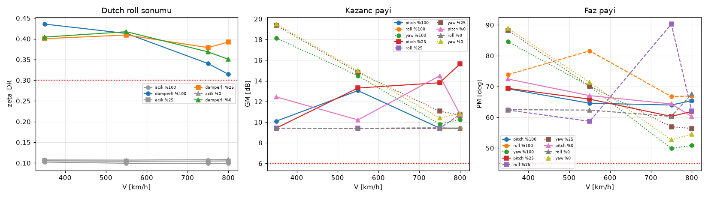
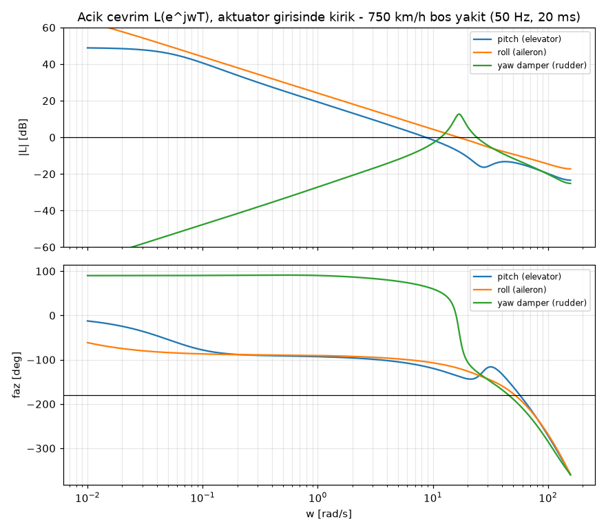
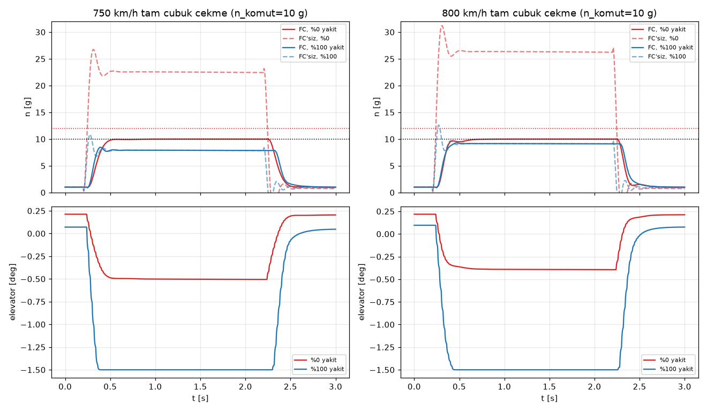
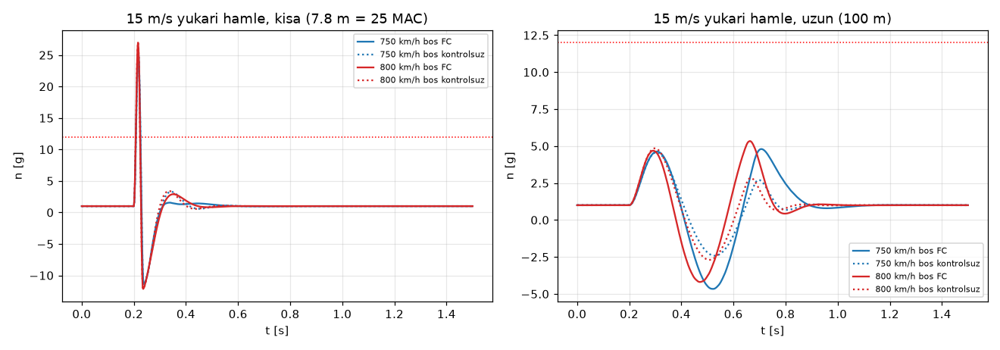
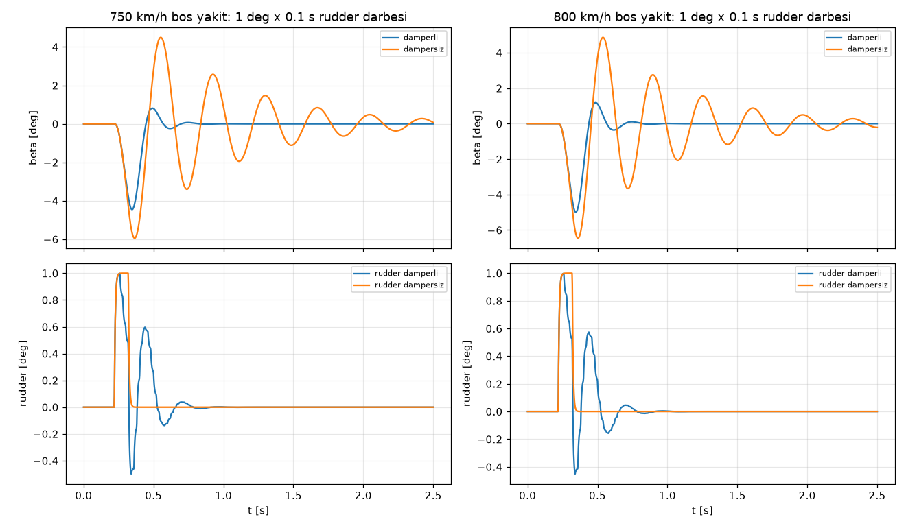
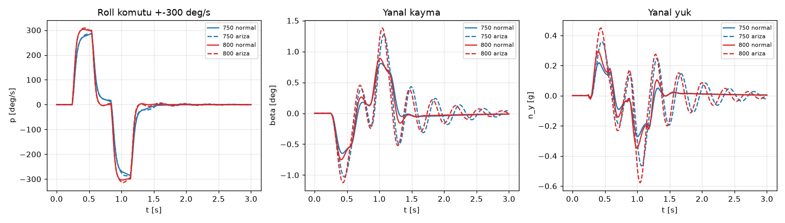

# 09: Uçuş Kontrol Ön Tasarımı (g-limiter, yaw damper, roll rate komutu)

**Kaynak script:** `aero/flight_control.py`. Tekrar çalıştırmak için:

```bash
C:/Users/Urungu/.hz750/Scripts/python aero/flight_control.py
```

**Çıktılar:** `aero/out/fc_ozet.txt` (tam log), `aero/out/fc_sonuclar.json` (türevler, A/B matrisleri, paylar, simülasyonlar), `aero/out/fc_kazanc_tablosu.csv` (kazanç programı), `aero/out/fc_*.png`.

**Neden gerekli:**
- Boş yakıtta ±1,5° elevator 750 km/h'te ~25 g üretiyor (limit 12 g).
- Dutch roll sönümü tüm zarfta ζ ≈ 0,10 (2,6–3,0 Hz).

Bu doküman, bu iki sorunu kapatan üç döngüyü tanımlıyor ve gecikme dahil kararlılık paylarını gösteriyor:
- **Pitch:** n_z komutlu döngü + g-limiter.
- **Yaw damper.**
- **Roll:** p komutu.

## 1. Yöntem

### 1.1 Uçuş noktaları ve kütle verisi

- **Hızlar:** 350, 550, 750, 800 km/h. Her biri yakıt %100 / %25 / %0 ile; toplam 12 nokta. İrtifa 300 m.
- **Kütle ve atalet:** `cad/out/mass_properties.json` (iter5 CAD, kanat 2,03 kg, MTOW 17,44 kg, Ixz dahil). Script dosya yoksa Roskam tahminine (params + R_x/R_y/R_z = 0,25/0,38/0,52) kendiliğinden döner.
- **Yakıt oranı tanımı:** params yakıt kütlesine (4,0 kg) göre. CAD'in "%100" durumu kullanılabilir tank kapasitesi (5,144 L = 4,115 kg); bu yüzden kullanılmadı, params'a karşılık gelen 4,0 kg durumu kullanıldı. %25 değeri CAD durumları arasında doğrusal ara değerlemeyle bulundu.

| Yakıt | m [kg] | x_cg [m] | Ixx | Iyy | Izz | Ixz [kg·m²] |
|---|---|---|---|---|---|---|
| %100 (4,0 kg) | 17,44 | 1,147 | 0,405 | 2,794 | 3,110 | +0,043 |
| %25 (1,0 kg) | 14,44 | 1,190 | 0,367 | 2,574 | 2,863 | +0,047 |
| %0 | 13,44 | 1,209 | 0,354 | 2,486 | 2,765 | +0,048 |

CAD ataletleri Roskam tahminine göre şöyle:
- Ixx ~%29 düşük.
- Izz ~%16 düşük.
- Iyy aynı (%1).

Sonuç olarak roll modu hızlanıyor (τ 20 → 12–14 ms). Dutch roll frekansı %7 artıyor (750 km/h: 16,5 → 17,7 rad/s).

### 1.2 Aerodinamik türevler

Türevler AeroSandbox AeroBuildup ile hesaplandı. Uçak modeli `aero_analysis.py`'deki `airplane()`, `ab()` ve `opp()` fonksiyonlarının kendisi.

- Her noktada trim (α, δe) için 2×2 Newton çözümü yapıldı.
- Trim noktasında `run_with_stability_derivatives` ile CLα, CDα, Cmα, CLq, Cmq ve tüm yanal α, β, p, r türevleri alındı.
- Kontrol türevleri ±1° sonlu farkla hesaplandı: δe → CL, CD, Cm; δa, δr → CY, Cl, Cn.
- Cl_β'ya DATCOM gövde-kanat düzeltmesi eklendi: **+0,0337 /rad** (alçak kanat, z_w = 80 mm). Doküman 02 §4.1 ile aynı.
- Cm_α̇ = 0,3·Cm_q alındı (doküman 02 ile aynı).
- Mach etkisi AeroBuildup'ın kendi sıkışabilirlik düzeltmesinden geliyor (M 0,29–0,65).

### 1.3 Durum-uzay modelleri

Modeller kararlılık eksenlerinde, düz uçuş etrafında küçük pertürbasyonla kuruldu. İtki hıza bağlı alınmadı.

**Boylamsal** x = [u, α, q, θ], giriş δe, bozucu w_g (yukarı +, α_hava = α + w_g/V):
- u̇ = −ΔD/m − g(θ − α)
- α̇ = q − ΔL/(mV)
- Iyy·q̇ = ΔM, ΔM içinde Cm_α̇ terimi var.
- θ̇ = q

Normal ivme çıkışı Δn = ΔL/(mg). Bu çıkış CL_δe·δe doğrudan geçişini ve hamle terimini içerir.

**Yanal-yön** x = [β, p, r, φ], girişler δa, δr:
- β̇ = Y/(mV) − r + (g/V)φ
- [Ixx −Ixz; −Ixz Izz]·[ṗ; ṙ] = [L; N]. Ataletler trim α ile kararlılık eksenine döndürüldü.
- φ̇ = p

Yanal ivme çıkışı n_y = Y/(mg).

**Servo ve döngü:**
- Servo: 1. derece, 25 Hz (τ = 6,4 ms), hız limiti 600 °/s.
- Yüzey konum limitleri (§3.4).
- Kontrolcü 50 Hz ayrık, 1 örnek (20 ms) hesap gecikmesi + ZOH.

**Kararlılık payları:**
- Tesis + servo tam (matris üstel) ZOH ile ayrıklaştırıldı.
- Döngü ilgili aktüatör girişinde kırıldı; diğer döngüler kapalı.
- Açık çevrim L(e^{jωT}) Nyquist frekansına (157 rad/s) kadar hesaplandı.
- GM, faz geçişlerindeki |20 log|L||'nin en küçüğü. Yani hem üst hem alt kazanç payı hesaba katıldı.

### 1.4 Açık çevrim modlar (CAD ataletleri)

| V [km/h] | Yakıt | SM [%MAC] | Kısa periyot ωn [rad/s] / ζ | Fugoid ωn / ζ | Dutch roll ωn / ζ | Roll τ | Spiral T½ | Manevra gradyanı [°/g] |
|---|---|---|---|---|---|---|---|---|
| 350 | %100 | 32,8 | 21,7 / 0,29 | 0,14 / 0,15 | 9,5 / 0,102 | 32 ms | 105 s | 1,14 |
| 350 | %0 | 13,0 | 16,3 / 0,45 | 0,13 / 0,21 | 9,1 / 0,106 | 28 ms | 78 s | 0,44 |
| 550 | %100 | 32,8 | 34,2 / 0,29 | 0,09 / 0,36 | 13,7 / 0,099 | 20 ms | 129 s | 0,46 |
| 550 | %0 | 13,0 | 25,1 / 0,45 | 0,08 / 0,49 | 13,0 / 0,105 | 18 ms | 100 s | 0,17 |
| 750 | %100 | 32,8 | 45,9 / 0,29 | 0,07 / 0,66 | 17,7 / 0,098 | 14 ms | 158 s | 0,23 |
| 750 | %25 | 19,0 | 37,7 / 0,39 | 0,06 / 0,82 | 16,9 / 0,103 | 13 ms | 133 s | 0,12 |
| 750 | %0 | 13,0 | 33,0 / 0,47 | 0,06 / 0,90 | 16,5 / 0,106 | 12 ms | 123 s | **0,081** |
| 800 | %100 | 32,8 | 48,8 / 0,29 | 0,06 / 0,75 | 18,6 / 0,098 | 13 ms | 165 s | 0,20 |
| 800 | %0 | 13,0 | 35,0 / 0,47 | iki gerçel kök | 17,3 / 0,106 | 12 ms | 129 s | **0,069** |

Spiral tüm noktalarda kararlı (Γ = +2°, DATCOM düzeltmesi dahil Cl_β ≈ −0,036…−0,041). %25 satırlarının tamamı `fc_ozet.txt`'te.

Tablodaki manevra gradyanı kısa periyot statik kazancından geliyor:
- 750 km/h boşta **0,081 °/g**. ±1,5° elevator, sayısal olarak ~19 g kararlı hal (geçici tepe 26 g, §4.1) demek.
- 800 km/h boşta 0,069 °/g.

Bu yüzden komut doyumu (g-limiter) olmadan uçuş mümkün değil.

## 2. Kontrol yasaları

Tüm açılar derece, hızlar °/s, ivme g cinsinden. İşaret kuralları §5.1'de.

### 2.1 Pitch: n_z komutu + g-limiter

```
s_e ∈ [−1, +1]                                  (pilot elevator çubuğu, çekme +)
n_cmd = 1 + 9·s_e   (s_e ≥ 0)   ;   1 + 7·s_e   (s_e < 0)
n_cmd ← doyum [−6 g, +10 g]                     (g-limiter; yapı limiti +12 / −8 g)
n_f   ← n_f + (1 − a_f)·((n_cmd − 1) − n_f),   a_f = exp(−T/τ_f)      (komut ön filtresi)
e_n   = n_f − (n_z,ölçülen − 1)
I_n   ← I_n + T·e_n         (yalnız elevator doymamışken: anti-windup)
δe    = δe_trim − Kff·n_f − Knz·e_n − Ki·I_n + Kq·q
δe    ← doyum [−δe_lim, +δe_lim]
```

**Bileşenlerin işlevi:**
- **Kff (ileri besleme):** Kısa periyot kararlı hal elevatörü, `Kff = (dδe/dn) − Kq·g/V`. Komutu döngü bant genişliğini beklemeden verir. Çubuk → g ilişkisi böylece yakıt ve hızdan bağımsız olur.
- **Ki (n_z hatası integrali):** Model hatasını (etkinlik ±%30–40) ve trim kaymasını giderir. Kararlı halde n = n_cmd.
- **Kq (pitch rate sönümü):** Kısa periyot sönümünü 0,29–0,47'den **0,50–0,55**'e çıkarır.
- **Knz:** Optimizasyonda çoğu noktada ~0 çıktı. Oransal n_z geri beslemesi 20 ms gecikmede faz payını yiyor; integral + ileri besleme yeterli.

**C\* alternatifi:** C* = n_z + (V_co/g)·q, V_co ≈ 120 m/s. 350 km/h altındaki yaklaşma ve inişte daha iyi his verir. 550 km/h üzerinde C* ≈ n_z olduğu için burada n_z seçildi. Düşük hız modunda C*'a geçiş önerilir (§6).

### 2.2 Yaw damper (r + washout)

```
r_w   = r − r_LP ;  r_LP ← a_w·r_LP + (1 − a_w)·r,   a_w = exp(−T/τ_wo), τ_wo = 1,0 s
δr    = δr_pilot − Kr·r_w ;   δr ← doyum [−δr_lim, +δr_lim]
```

- **Washout:** Kararlı dönüşte (sabit r) rudderı sıfıra çeker; damper dönüşe karşı koymaz.
- **Kr seçimi:** Tüm döngüler kapalıyken, GM ≥ 6 dB ve PM ≥ 45° şartıyla ζ_DR ≥ 0,40 veren en küçük kazanç. Bu ulaşılamazsa paylar içinde en yüksek ζ veren kazanç seçildi.
- **Yüksek hızda sınırlayıcı faktör:** ζ, Kr ≈ 0,01 °/(°/s) civarında tepe yapıyor (~0,33–0,41), sonra düşüyor. Nedeni 20 ms gecikme + servo fazı. Bu yüzden 750–800 km/h'te ζ_DR 0,33–0,41'de kaldı.

### 2.3 Roll: p komutu (yatış tutmalı)

```
p_cmd = s_a · 300 °/s
p_f   ← a_p·p_f + (1 − a_p)·p_cmd,   a_p = exp(−T/τ_fp)
I_p   ← I_p + T·(p_f − p)          (anti-windup)
δa    = (Kff_p + Kp_p)·p_f − Kp_p·p + Ki_p·I_p
```

- **Kff_p = −L_p/L_δa:** Roll modunun kararlı hal tersidir (τ_roll = 12–32 ms, uçak doğal olarak hız komutlu).
- **Ki_p:** Integral, p hatasının integrali yani yatış açısı hatası. Çubuk merkezdeyken yatışı tutar (rate command / attitude hold). Kapalı çevrimde |z| = 1'de nötr bir mod var (φ + I_p korunumu). Bu kararsızlık değil, istenen tutma davranışı.
- **300 °/s komut sınırı:** 750 km/h'te ±2° aileronla ulaşılabilir hız 352 °/s, 800'de 375 °/s. 300 °/s komutu doymadan izleniyor.

### 2.4 Tasarım yöntemi (optimizasyon)

Kazançlar her noktada aşağıdaki maliyetin en küçüklenmesiyle bulundu:
- **Izgara arama + Nelder-Mead** kullanıldı.
- **Maliyet:** Birim basamak cevabının ITAE değeri.
  - Aşım cezası: nominal > %3 (pitch) / %5 (roll), belirsiz tesislerde > %8 / %10.
  - Pay cezası: GM < 6,5 dB, PM < 48°.
  - Pitch için ζ_SP < 0,55 cezası.
- **Belirsizlik:** Maliyet üç tesis üzerinden alındı: kontrol etkinliği ×1,0 / ×0,7 / ×1,4 (B, D ölçeklenerek). Bu olmadan optimizasyon mükemmel ileri beslemeye güvenip geri beslemeyi sıfırlıyordu.

## 3. Kararlılık payları

Payların tamamı 20 ms gecikme + ZOH + 25 Hz servo dahil hesaplandı. Hedef: GM ≥ 6 dB, PM ≥ 45°, ζ_DR ≥ 0,30.



| V [km/h] | Yakıt | Pitch GM / PM | Roll GM / PM | Yaw GM / PM | ζ_SP kapalı | ζ_DR açık → kapalı | Durum |
|---|---|---|---|---|---|---|---|
| 350 | %100 | 10,1 dB / 69° | 9,4 / 61° | 18,2 / 84° | 0,52 | 0,102 → **0,435** | OK |
| 350 | %25 | 9,4 / 72° | 9,4 / 62° | 18,4 / 85° | 0,54 | 0,104 → 0,444 | OK |
| 350 | %0 | 9,7 / 74° | 9,4 / 60° | 19,5 / 89° | 0,54 | 0,106 → 0,404 | OK |
| 550 | %100 | 12,9 / 62° | 9,4 / 79° | 14,5 / 70° | 0,52 | 0,099 → 0,411 | OK |
| 550 | %25 | 11,2 / 62° | 9,4 / 63° | 14,8 / 70° | 0,53 | 0,103 → 0,411 | OK |
| 550 | %0 | 9,4 / 60° | 9,4 / 64° | 15,0 / 71° | 0,55 | 0,105 → 0,417 | OK |
| 750 | %100 | 9,4 / 64° | 9,4 / 67° | 9,9 / **50°** | 0,50 | 0,098 → 0,342 | OK (sınırda) |
| 750 | %25 | 15,1 / 61° | 9,4 / 70° | 10,2 / 52° | 0,53 | 0,103 → 0,367 | OK |
| 750 | %0 | 15,1 / 65° | 9,4 / 77° | 10,3 / 54° | 0,53 | 0,106 → 0,388 | OK |
| 800 | %100 | 9,6 / 66° | 10,6 / 81° | 10,3 / 52° | 0,51 | 0,098 → **0,326** | OK (sınırda) |
| 800 | %25 | 12,8 / 65° | 9,4 / 67° | 10,7 / 53° | 0,53 | 0,103 → 0,336 | OK |
| 800 | %0 | 11,2 / 59° | 10,5 / 60° | 11,0 / 57° | 0,53 | 0,106 → 0,413 | OK |

**Tüm zarfta hedefler sağlandı.** En kritik noktalar tam yakıtta: 750 km/h yaw PM 49,9°, 800 km/h ζ_DR 0,33. Tablo iter5 kütlesiyle (MTOW 17,44 kg) `run_all.sh` çıktısından yeniden üretildi; önceki tablo iter4 kütlesi (17,16 kg) içindi.

Pitch GM'nin 9,4 dB'de sabitlenmesi bir tasarım sonucu. Optimizasyon, ×1,4 etkinlikli tesiste 6,5 dB sınırına dayanıyor; nominal 9,4 dB = 6,5 dB + 20·log 1,4.



**Döngü hızı duyarlılığı:** Aynı kazançlarla döngü 200 Hz (5 ms gecikme) olsaydı 750/800 km/h boşta paylar şöyle olurdu:
- Pitch 23,7 / 19,0 dB, PM ~80°.
- Roll 15,6 / 21,6 dB.
- Yaw 21,8 / 22,4 dB, PM 86–87°.

Gecikme, yüksek hızda yaw damper kazancını sınırlayan ana etken. **FC donanımı ≥ 200 Hz döngüyle çalışabiliyorsa tercih edilmeli.** Bu durumda Kr ×1,5–2 artırılıp ζ_DR ≥ 0,45 alınabilir (yeniden tasarım gerekir).

## 4. Zaman simülasyonları

Simülasyonun özellikleri:
- Doğrusal olmayan servo (hız + konum limiti).
- 50 Hz ayrık FC, 20 ms gecikme, anti-windup.
- Tesis 0,5 ms adımla tam ayrıklaştırıldı.

### 4.1 Tam çubuk çekme (n_cmd = 10 g, 2 s)



| Durum | FC'li n tepe | Aşım (10 g'ye göre) | Elevator | FC'siz (δe = −1,5° doğrudan) n tepe |
|---|---|---|---|---|
| 750 km/h, boş | **10,03 g** | **%+0,4** | −0,52° | **26,3 g** |
| 750 km/h, tam | 8,44 g | – (otorite sınırı) | −1,5° (doymuş) | 10,8 g |
| 800 km/h, boş | **10,05 g** | **%+0,5** | −0,41° | **30,7 g** |
| 800 km/h, tam | 9,21 g | – | −1,5° (doymuş) | 12,5 g |

- **g-limiter işliyor.** Boş yakıtta tepe ≤ 10,05 g. Aşım < %1, yapı limitine (12 g) 2 g pay kalıyor.
- **Tam yakıtta 10 g'ye ulaşılamıyor.** ±1,5° elevator otoritesi 750 km/h'te ~8,4 g tepe (7,8 g kararlı) veriyor. Anti-windup integrali tutuyor; çubuk bırakılınca aşım yok.
- **FC'siz geçici tepe:** Boş yakıtta FC'siz tam çubuk 26–31 g veriyor. Bu değer kısa periyodun ζ ≈ 0,5 aşımı nedeniyle doküman 02'deki kararlı hal 23,2 g'den (Roskam ataletli) yüksek. **FC'siz (veya FC arızasında) yüksek hızda elevator ±0,3° ile sınırlanmalı** (§6).

### 4.2 15 m/s dikey rüzgâr hamlesi (1-cos)



| Hamle boyu | Durum | n tepe kontrolsüz | n tepe FC'li |
|---|---|---|---|
| 7,8 m (25 MAC, CS-23 tipi) | 750 km/h boş | **24,7 g** (min −11,1 g) | 24,7 g |
| | 750 km/h tam | 19,0 g (min −12,2 g) | 19,0 g |
| | 800 km/h boş | **26,5 g** (min −11,9 g) | 26,5 g |
| | 800 km/h tam | 20,4 g (min −13,1 g) | 20,4 g |
| 100 m (uzun) | 750 km/h boş | 4,5 g | 4,8 g |
| | 800 km/h boş | 4,8 g | 5,3 g |

- **Kısa hamle FC ile azaltılamıyor.** 7,8 m hamle 750 km/h'te 37 ms sürüyor; bu, döngü gecikmesi + servo süresine eşit. Ayrıca elevator ±1,5° ile sınırlı.
- **Kısa hamle yapı limitini aşıyor.** 15 m/s kısa hamle tüm yakıt durumlarında +12 g'yi, geri dönüşte de −8 g negatif limiti (−11…−13 g) aşıyor (doküman 04'teki CS-23 Pratt sonucu 20 g ile uyumlu).
- **Uzun hamlede FC biraz kötüleştiriyor (+%5–10).** n_z döngüsü hamle alleviation için tasarlanmadı; integral yavaş, ileri besleme hamleyi görmüyor.

**Sonuç: g-limiter manevra yükünü sınırlar, hamle yükünü sınırlamaz.** Operasyonel sınır doküman 04'teki gibi kalıyor: ölçüm turu yalnız sakin havada (türbülans < ~3–4 m/s) yapılır. Hamle alleviation (α vanası / pitot-statik ileri besleme) ancak ≥ 200 Hz döngü ve daha hızlı servo ile anlamlı olur.

Simülasyon quasi-statik (Küssner gecikmesi ve kuyruk penetrasyon gecikmesi yok); kısa hamlede ~%10–20 muhafazakâr.

### 4.3 Rudder darbesi: Dutch roll sönümü



Darbe: 1° × 0,1 s rudder (pilot girdisi).

| Durum | ζ (log dekrement) dampersiz | ζ damperli | β tepe dampersiz / damperli |
|---|---|---|---|
| 750 km/h boş | 0,09 | ≥ 0,4 (ikinci tepe yok) | 5,86° / 4,39° |
| 750 km/h tam | 0,08 | 0,34 | 5,27° / 3,97° |
| 800 km/h boş | 0,09 | ≥ 0,4 (ikinci tepe yok) | 6,37° / 4,91° |
| 800 km/h tam | 0,08 | 0,33 | 5,70° / 4,42° |

- **Sönüm:** Damperle salınım ~2 periyotta (≈ 0,4 s) sönüyor. Dampersiz durumda 2,5 s sonra hâlâ ±0,3° salınım var.
- **Simülasyon ζ değerleri:** Dampersiz ζ'nin simülasyonda (0,08–0,09) özdeğerden (0,10) düşük çıkması roll döngüsü ile kuplajdan. Roll döngüsü açıkken ζ = 0,08–0,10.
- **Rudder hassasiyeti:** 1° rudder 750 km/h'te ~6° β tepesi üretiyor. **Pilot rudder komutu yüksek hız modunda ±0,3–0,5° ile sınırlanmalı**; ±2° otorite damper için ayrılmalı.

### 4.4 Servo arızası: damper devre dışı



Senaryo:
- Rudder servosu t = 0'da donuyor (damper yok).
- Boş yakıt.
- ±300 °/s yatış girdisi: 0,3 s sağa, 0,3 s sola.

| | 750 km/h normal → arıza | 800 km/h normal → arıza |
|---|---|---|
| β tepe | 0,92° → 1,48° | 0,80° → 1,24° |
| n_y tepe | 0,31 → 0,54 g | 0,29 → 0,49 g |
| t > 1,2 s β rms (artık salınım) | 0,074° → 0,254° | 0,085° → 0,173° |

Damper kaybı tek başına yapısal tehlike değil. β ve n_y küçük kalıyor, çünkü roll döngüsü ve Cn_β yeterli. Ama ζ_DR 0,08–0,10'a düşüyor; türbülans ve pilot girdileriyle sürekli 2,6–3 Hz salınım oluşuyor. Bu durum ölçüm hassasiyeti ve kuyruk/rudder flutter payı (doküman 04) açısından kabul edilemez.

**FC uyarı mantığı (zorunlu):**

1. **Arıza algılama:**
   - Rudder servo geri bildirimi (pozisyon/akım) ile komut arasındaki fark > 0,5° ve > 100 ms ise "YAW DAMPER ARIZA".
   - Ya da yaw gyro'da 2–3,5 Hz bant geçiren r genliği > 15 °/s ve 1 s'den uzun sürüyorsa aynı uyarı.
2. **Uyarı kanalları:** Telemetri sesli alarm. Verici titreşimi.
3. **Otomatik önlemler:**
   - Gaz ECU'da 550 km/h eşdeğerine kısılır.
   - Roll komut sınırı 300 → 150 °/s'ye iner.
   - Ölçüm modu kilitlenir.
4. **Pilot prosedürü:** Hız ≤ 550 km/h, düz uçuş, iniş. Dampersiz ölçüm turu **yapılmaz** (doküman 02 §7).
5. **Pitch FC arızası (IMU/ivmeölçer kaybı):**
   - Elevator doğrudan moda geçer ve yüksek hızda ±0,3° ile sınırlanır. Boş yakıtta ~3,7 g/0,3°, tam yakıtta ~1,3 g/0,3° (750 km/h).
   - Gaz kısılır.

## 5. Kazanç tablosu (gain schedule)

Tam tablo (5 basamak): `aero/out/fc_kazanc_tablosu.csv`. Paylar ve ζ_DR da aynı dosyada.

### 5.1 Birimler ve işaret kuralları

| Büyüklük | Pozitif yön | Birim |
|---|---|---|
| n_z | Uçağın tepesine doğru ivme (düz uçuşta +1 g; çekişte artar). İvmeölçer gövde z ekseni aşağı ise n_z = −a_z/g | g |
| q | Burun yukarı | °/s |
| p | Sağ kanat aşağı (sağa yatış) | °/s |
| r | Burun sağa | °/s |
| δe | **Firar kenarı aşağı** (burun aşağı moment) | ° |
| δa | **Sağa yatış momenti**: sağ aileron firar kenarı yukarı, sol aşağı | ° |
| δr | **Burun sağa moment**: firar kenarı sağa (arkadan bakışla) | ° |
| Çubuk s_e / s_a | Çekme + / sağa + | −1…+1 |

**Formüllerdeki kazanç işaretleri:**
- Tablodaki tüm kazançlar pozitif sayı. İşaretleri §2'deki formüller belirliyor:
  - δe = δe_trim − Kff·n_f − Knz·e_n − Ki·I_n **+** Kq·q
  - δr = −Kr·r_w
- Kurulumda doğrulama: burun yukarı q'da elevator firar kenarı aşağı gitmeli. Burun sağa r'de rudder firar kenarı sola (burun sola moment) gitmeli. Sağa p'de aileron sola yatış momenti vermeli.

**Ayrık uygulama:** T = 0,02 s. Ön filtre katsayısı a = exp(−T/τ), integral `I ← I + T·e`. Kontrolcü bir örnekte sensörü okuyup hesaplar, servo komutunu bir sonraki örnekte yazar. Pay hesabı bu 20 ms gecikmeyi içeriyor; daha erken yazılırsa paylar yalnız artar.

### 5.2 Kazanç programı

Pitch: Kff, Knz [°/g]; Ki [°/(g·s)]; Kq [°/(°/s)]; τ_f [s].
Yaw: Kr [°/(°/s)], τ_wo = 1,0 s.
Roll: Kff_p, Kp_p [°/(°/s)]; Ki_p [°/°]; τ_fp [s].

| V [km/h] | Yakıt | Kff | Knz | Ki | Kq | τ_f | Kr | Kff_p | Kp_p | Ki_p | τ_fp | Limit δe/δa/δr [°] |
|---|---|---|---|---|---|---|---|---|---|---|---|---|
| 350 | %100 | 0,918 | 0,261 | 13,33 | 0,0386 | 0,142 | 0,0213 | 0,0133 | 0,0097 | 0,199 | 0,098 | 6,9 / 9,2 / 9,2 |
| 350 | %25 | 0,409 | 0,248 | 7,64 | 0,0359 | 0,116 | 0,0204 | 0,0133 | 0,0093 | 0,196 | 0,097 | 6,9 / 9,2 / 9,2 |
| 350 | %0 | 0,251 | 0,210 | 4,94 | 0,0328 | 0,095 | 0,0178 | 0,0133 | 0,0089 | 0,204 | 0,099 | 6,9 / 9,2 / 9,2 |
| 550 | %100 | 0,415 | 0,022 | 4,49 | 0,0110 | 0,145 | 0,0129 | 0,0082 | 0,0051 | 0,087 | 0,083 | 2,8 / 3,7 / 3,7 |
| 550 | %25 | 0,189 | 0,055 | 3,15 | 0,0141 | 0,122 | 0,0123 | 0,0082 | 0,0047 | 0,119 | 0,093 | 2,8 / 3,7 / 3,7 |
| 550 | %0 | 0,114 | 0,062 | 2,51 | 0,0150 | 0,109 | 0,0120 | 0,0082 | 0,0046 | 0,117 | 0,091 | 2,8 / 3,7 / 3,7 |
| 750 | %100 | 0,222 | 0,008 | 1,98 | 0,0027 | 0,139 | 0,0111 | 0,0057 | 0,0031 | 0,081 | 0,088 | 1,5 / 2,0 / 2,0 |
| 750 | %25 | 0,102 | 0,019 | 1,43 | 0,0059 | 0,123 | 0,0104 | 0,0057 | 0,0030 | 0,077 | 0,085 | 1,5 / 2,0 / 2,0 |
| 750 | %0 | 0,065 | 0,000 | 0,722 | 0,0061 | 0,116 | 0,0101 | 0,0057 | 0,0031 | 0,067 | 0,081 | 1,5 / 2,0 / 2,0 |
| 800 | %100 | 0,193 | 0,004 | 1,57 | 0,0016 | 0,137 | 0,0090 | 0,0052 | 0,0025 | 0,051 | 0,133 | 1,5 / 2,0 / 2,0 |
| 800 | %25 | 0,092 | 0,000 | 0,832 | 0,0038 | 0,130 | 0,0084 | 0,0052 | 0,0027 | 0,075 | 0,087 | 1,5 / 2,0 / 2,0 |
| 800 | %0 | 0,054 | 0,018 | 0,980 | 0,0062 | 0,109 | 0,0082 | 0,0052 | 0,0002 | 0,048 | 0,134 | 1,5 / 2,0 / 2,0 |

**Yüzey limiti programı:** lim(V) = lim_hs · max(1, (750/V)²). Alçak hız mekanik limitinde kırpılıyor (elevator 20°, aileron 18°, rudder 20°). lim_hs = δe 1,5°, δa 2,0°, δr 2,0°. 750 km/h ve üstünde hız modu limitleri geçerli.

**Programlama kuralları:**

1. **Hız ekseni:**
   - Kazançlar dinamik basınçla ölçeklendiği için ara değerleme q̄ = ½ρV² = (γ/2)·p·M² üzerinden doğrusal yapılmalı. **Pitot farkı (q_c = p_t − p) q̄ değildir:** M ≈ 0,61'de q_c ≈ 1,10·q̄ (750 km/h, 300 m ISA: q̄ ≈ 25,8 kPa, q_c ≈ 28,4 kPa). q̄, statik basınç p ve q_c'den sıkıştırılabilir bağıntıyla bulunan Mach ile hesaplanmalı: M² = 5·[(q_c/p + 1)^(2/7) − 1]. Hava hızı göstergesi ve hız sınırları da aynı dönüşümü kullanmalı (sıkıştırılamaz dönüşüm 750 km/h'te ~%5 fazla gösterir; iter5 incelemesinde düzeltildi). V üzerinden doğrusal ara değerleme de 550–800 aralığında kabul edilebilir (fark < %10).
   - 350 km/h altında 350 değerleri tutulur (§6).
   - 800 km/h üstünde 800 değerleri tutulur.
2. **Yakıt ekseni:**
   - ECU'nun tüketilen yakıt sayacından: yakıt oranı = kalan/4,0 kg.
   - %0–%25–%100 arasında doğrusal ara değerleme.
   - Yakıt tahmini belirsizse **boş yakıt kolonu** kullanılmalı. Bu kolonun Kff'si en küçük olduğundan g aşımı yapmaz; tam yakıtta yalnız daha yavaş g'ye ulaşılır (integral telafi eder).
3. **Tablo düzgünlüğü:** Optimizasyon her noktada bağımsız yapıldı; Knz, Ki ve Kq hız/yakıtla monoton değil. Pay tablosundaki her noktada GM ≥ 9,4 dB olduğundan ara noktalarda paylar korunuyor. Uçuş testinde ilk ayar için şu yaklaşım önerilir: Kff ve Kr yakıtla, Kq ve Ki yalnız hızla programlansın (§7, adım 3).
4. **Kazanç ölçekleme yasası (tablo yerine kullanılabilir yaklaşık formüller):**
   - Kff ≈ (dδe/dn): tablo değeri ±%5. Kff, q̄ ve SM ile ters orantılı.
   - Kr ≈ 0,0105·(750/V)^1,3 °/(°/s). 350 km/h'te 0,028 verir; tablo değeri 0,018–0,021. Formül alçak hızda ~%35 fazla, kullanılırsa 0,021 ile sınırlanmalı.
   - Kff_p = 0,0057·(750/V) °/(°/s) (L_δa/L_p ∝ V).

## 6. Sınırlamalar

- **Model doğruluğu:** Türevler AeroBuildup (yarı-ampirik) kaynaklı. Cm_α̇ = 0,3·Cm_q, Cm_u = 0 (Mach tuck yok), itki hıza bağlı değil. Tasarımda kontrol etkinliği ±%30–40 belirsizlik alındı. Cm_α ve Cn_β belirsizliği ayrıca taranmadı.
- **Elastik modlar modellenmedi.** Kanat burulma/eğilme modları (doküman 04, FE modal) ve gövde eğilmesi IMU'ya girer. IMU uçak CG'sine yakın ve titreşim izolasyonlu takılmalı. Gyro sinyallerine yapı mod frekanslarında çentik filtre (notch) gerekebilir; notch faz kaybı paylardan düşülmeli.
- **Sensör modelleri yok:** Gyro/ivmeölçer gürültüsü, kayması ve anti-alias filtresi modellenmedi. 50 Hz döngü için ≥ 100 Hz örnekleme ve ≤ 25 Hz anti-alias filtresi kullanılmalı. Filtre gecikmesi paylardan ~10–15° PM alır; 750–800 km/h yaw PM'i (50–57°) bunu karşılar.
- **50 Hz döngü sınırda.** Kısa periyot 5–7,8 Hz, Dutch roll 2,6–3 Hz. Yaw damper sönümü (ζ 0,33–0,41) gecikmeyle sınırlı. 200 Hz döngü şiddetle önerilir.
- **Hamle yükü sınırlanmıyor** (§4.2). Ölçüm turu sakin havada yapılmalı.
- **Alçak hız (< 350 km/h, kalkış/iniş) bu dokümanda tasarlanmadı.**
  - Doküman 02'de yaklaşmada spiral kararsız (T2 10 s). Yaw damper K ~0,16–0,31 isteniyor.
  - Önerilen yol: 350 km/h altında C* (n_z + q) komutuna veya doğrudan moda geçiş, kazançlar ~1/q̄ ile ve 350 km/h × 2 ile sınırlı.
  - Ayrı bir tasarım iterasyonu gerekli.
- **Tam yakıtta 10 g'ye ulaşılamıyor** (elevator ±1,5°). Kabul edilebilir: ölçüm manevraları ≤ 5 g ile tasarlandı.
- **Lateral kuplaj:** Ixz = +0,04–0,05 kg·m² modelde var. Aileron-rudder çapraz beslemesi (ARI) kullanılmadı. 300 °/s yatışlarda β ≤ 0,9°, gerek görülmedi.

## 7. Uçuş testi ayar prosedürü

**Ön koşullar:**
- Yer testinde tüm yüzeylerin yönleri §5.1 tablosuna göre doğrulanır (elle uçağı döndürerek gyro tepkisi).
- Servo hızı ve gecikme ölçülür: adım komutu + yüzey potansiyometresi; hedef ≤ 20 ms ölü zaman.
- Telemetri günlüğü ≥ 50 Hz: n_z, p, q, r, δe/δa/δr komut ve geri bildirim, V, yakıt.

**Adımlar:**

1. **Alçak hız doğrudan mod (≤ 250 km/h):**
   - Trim, CG doğrulaması.
   - Doublet'lerle (δe ±1°, δa ±2°, δr ±1°) kısa periyot, roll ve Dutch roll tanımlama (sistem tanılama).
   - Ölçülen ωn ve ζ değerleri §1.4 tablosuyla karşılaştırılır. Fark > %20 ise kazanç tablosu ölçülen türevlerle `flight_control.py`'de yeniden üretilir.
2. **Yaw damper açık, 350 km/h:**
   - Kr = tablo × 0,5 ile başla.
   - 0,5° rudder darbesiyle ζ ölç (log dekrement).
   - Kr'yi 0,5 → 0,75 → 1,0 adımlarla artır.
   - Her adımda 2–3,5 Hz bantta kalıcı salınım ("ringing") varsa geri dön; bu, gecikme payının tükendiğini gösterir.
3. **Pitch n_z modu, 350 → 550 km/h:**
   - Önce yalnız Kff + Ki (Kq = 0,5 × tablo).
   - 2 g, 4 g adım komutları. Hedefler: t90 ≈ 0,2–0,3 s, aşım < %5.
   - Kq'yu tabloya çıkar.
   - g-limiter testi: tam çubukla n_cmd sınırı geçici olarak **5 g**'ye indirilir. Tepe ≤ 5,25 g doğrulanır, sonra 10 g'ye açılır (yalnız ≤ %50 yakıt dışında).
4. **Roll p modu:**
   - Kff_p ile başla. 100, 200, 300 °/s adımları uygula.
   - Kp_p ve Ki_p'yi 0,5 → 1,0 artır.
   - 50 Hz civarı aileron titremesi görülürse Kp_p'yi düşür.
5. **Hız artırma (550 → 650 → 750 → 800 km/h):**
   - Her 50 km/h'te 0,5° rudder darbesi, 2 g pitch adımı, 100 °/s roll adımı.
   - Ölçülen ζ_DR ≥ 0,30, n_z aşımı < %5 ve kalıcı salınım yoksa bir sonraki hıza geçilir.
   - Boş yakıtta ilk yüksek hız uçuşu **tam yakıtla başlar**; boş yakıta doğru adım adım inilir (manevra gradyanı 0,23 → 0,08 °/g).
6. **Arıza testleri:**
   - 550 km/h'te yaw damper bilerek devre dışı bırakılır. Uyarı ve otomatik gaz kısma doğrulanır.
   - Pitch FC kapatılarak doğrudan moda geçiş ve ±0,3° limit doğrulanır.
7. **Ayar sonrası:** Ölçülen türevlerle `params.py` (geometri değilse) ve `flight_control.py` girdileri güncellenir. Kazanç tablosu yeniden üretilir; paylar yeniden doğrulanır.
