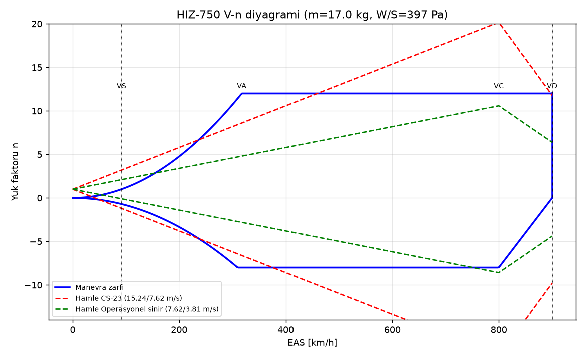
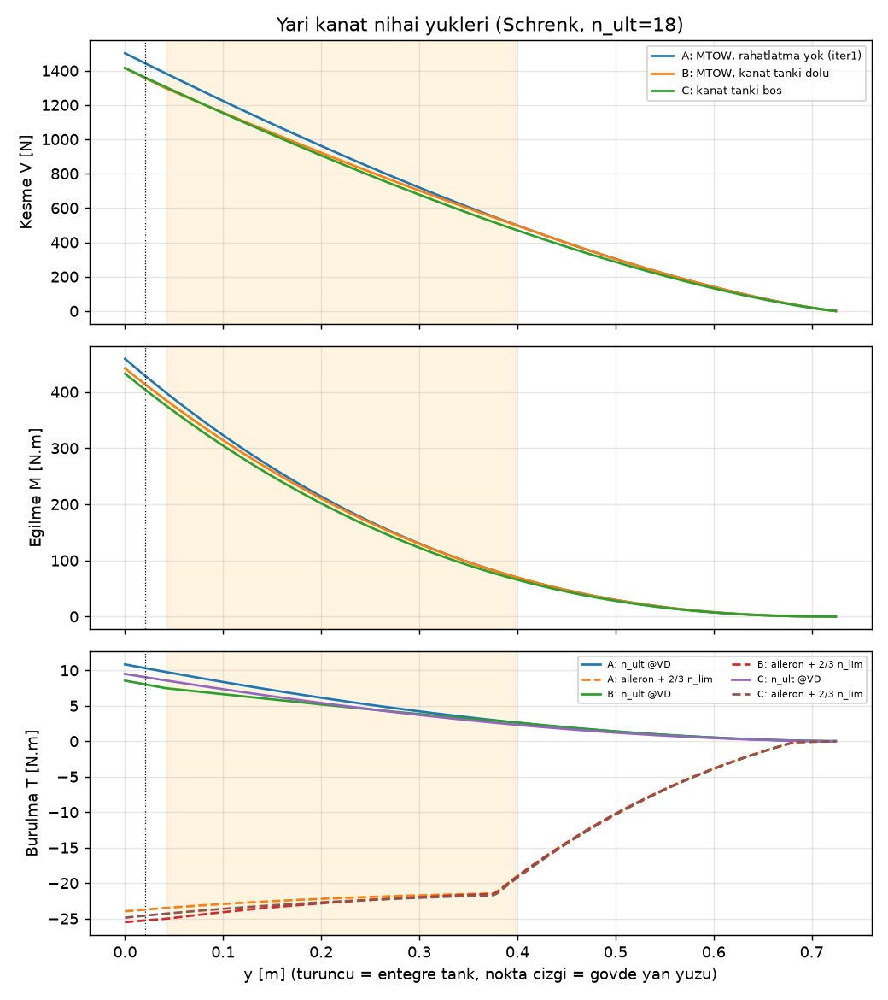
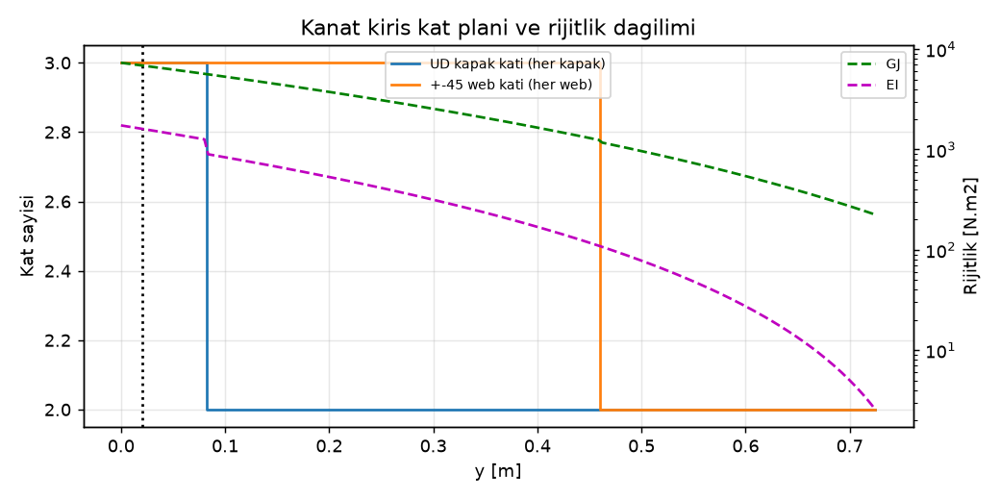
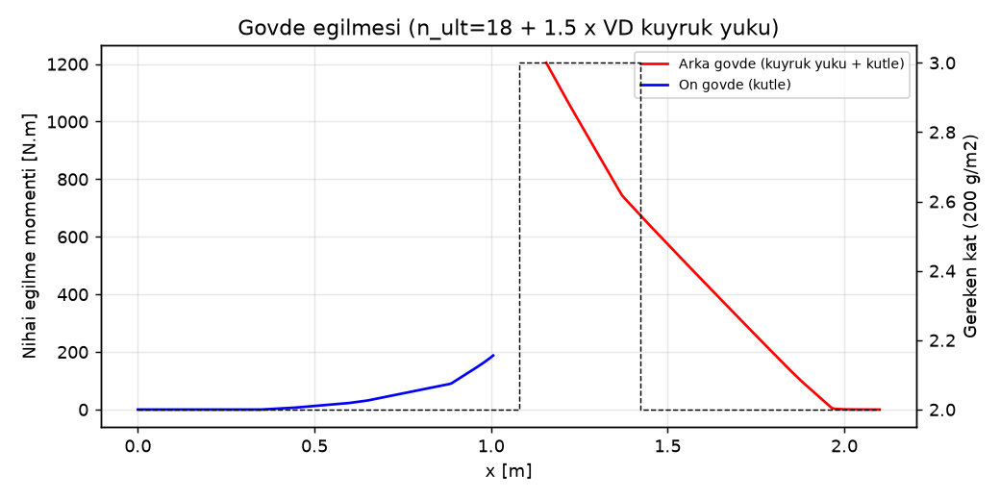
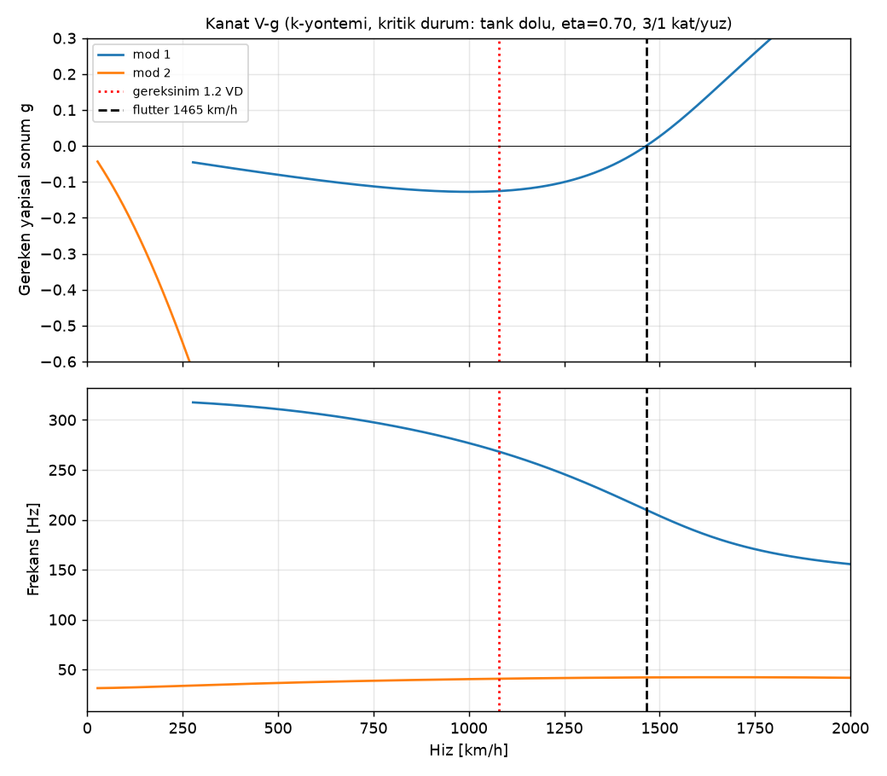
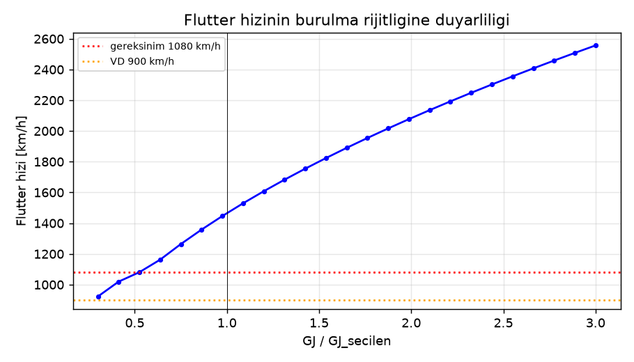

# 04 – Yapı, Flutter ve Kontrol Yüzeyleri

Kaynak script: [`structures/structures.py`](../structures/structures.py) (girdi `params.py`; çıktı `structures/out/`, tüm sayılar `structures/out/sonuclar.json`).
Tasarım kütlesi: MTOW **18,3 kg** (4,0 kg yakıt), W/S = 427 Pa.

## 1. Tasarım kriterleri

| Kriter | Değer |
|---|---|
| Limit yük faktörü | +12 / −6 g (bkz. öneri: −8 g) |
| Nihai emniyet katsayısı | 1,5 → nihai +18 g |
| V_C (operasyonel, ECU limitli) | 800 km/h |
| V_D (tasarım dalış) | 900 km/h |
| Flutter / diverjans gereksinimi | ≥ 1,2·V_D = 1080 km/h, ek model belirsizlik çarpanı 1,25 ile seçim (≥ 1350 km/h) |
| Hesap yoğunluğu | Deniz seviyesi ISA (flutter için en kritik) |

## 2. Malzeme ve izin değerleri

| Malzeme | Özellik | Değer |
|---|---|---|
| T700S/epoksi UD 200 g/m² (kiriş kapakları) | E₁ / Xt / Xc / t_kat | 125 GPa / 2100 / 1200 MPa / 0,20 mm |
| T300 3K dokuma 160 g/m², ±45 (kabuk, web) | E / G₄₅ / t_kat | 55 GPa / 25 GPa / 0,178 mm |
| 200 g/m² dokuma quasi-izotrop (gövde) | E_qi / t_kat | 45 GPa / 0,22 mm |
| Rohacell 51 IG-F | ρ / t | 52 kg/m³ / 2 mm |

**Düşürme faktörleri:** çevre (sıcak/nemli, egzoz yakını) 0,80 × imalat (vakum torba, el yatırma) 0,80 × istatistik (B-basis yaklaşımı) 0,85 = **0,544**.
Kapak izin gerilmesi = min(4000 µε × E₁, 0,544 × Xc) = **500 MPa** (birim şekil değiştirme sınırlı). Gövde: 4000 µε × 45 GPa = **180 MPa**.

## 3. V-n diyagramı

| Büyüklük | Değer |
|---|---|
| V_S (temiz, CLmax 1,0) | 95 km/h |
| V_A = V_S·√12 | 329 km/h |
| Kanat CLα (DATCOM, M 0,65) | 4,62 /rad |
| Hamle hafifletme faktörü K_g | 0,80 (μ_g = 26) |
| CS-23 hamlesi (15,24 m/s @ V_C) | **n = 18,9 → limit 12 g aşılıyor** |
| Operasyonel hamle (7,62 m/s @ V_C, 3,81 @ V_D) | n = +10,0 / −8,0 @ V_C; +6,0 @ V_D |

**Sonuç:** Düşük kanat yüklemesi ve çok yüksek hız nedeniyle, tam CS-23 hamlesi 12 g'yi aşıyor. Bu yüzden:
- Yüksek hız geçişleri yalnızca **sakin havada** yapılmalı: yer rüzgârı < 5 m/s, termik/türbülans yok, sabah saatleri. Bu bir operasyonel sınırlamadır.
- Operasyonel hamle negatifte −8 g veriyor. Kanat kirişi simetrik kat planlı olduğundan (alt ve üst kapak aynı), +18 g nihai için boyutlanan kanat −12 g nihai yükü de taşıyor. **params.py'de `N_NEG = -8.0` olarak güncellenmesi öneriliyor.**

## 4. Kanat açıklık yükleri (nihai, n = 18)

Schrenk dağılımı kullanıldı. Ataletsel yük hafifletmesi ihmal edildi (muhafazakâr).

| Konum | Kesme [N] | Eğilme [N·m] |
|---|---|---|
| Gövde ekseni (y = 0) | 1615 | 494 |
| Gövde yan yüzü (y = 0,083 m) | 1363 | 369 |

**Burulma** elastik ekseni 0,38c etrafında hesaplandı:
- Durum 1 (18 g, V_D): kökte 53 N·m.
- Durum 2 (2/3 n_lim + V_D'de 4° aileron, nihai): kökte 16 N·m.

Aileron ince profil katsayıları: c_lδ = 3,4 /rad, c_mδ = −0,57 /rad (×0,7 etkinlik).

## 5. Kanat yapısı

**Seçilen yapı:**
- **Kabuk:** tek hücreli tam kabuk sandviç. Dışta 2 kat ±45 160 g/m² karbon, ortada 2 mm Rohacell 51, içte 2 kat ±45 160 g/m² karbon. Kesme taşıyan toplam kalınlık 0,71 mm.
- **Kirişler:** iki kiriş, 0,20c ve 0,62c'de. Her kirişte UD karbon kapak ve ±45 karbon web.
- **Birleştirme:** iki karbon bıçak birleştirici (her kiriş hattında bir tane).

| y [m] | Veter [m] | Kutu yüksekliği [mm] | M_ult [N·m] | Kapak genişliği [mm] | UD kat (her kapak) | ±45 web katı | GJ [N·m²] |
|---|---|---|---|---|---|---|---|
| 0,000 | 0,429 | 21,1 | 494 | 50 | 3 | 4 | 6351 |
| 0,084 | 0,397 | 18,8 | 369 | 46 | 3 | 4 | 4861 |
| 0,153 | 0,370 | 16,9 | 282 | 43 | 2 | 4 | 3838 |
| 0,251 | 0,333 | 14,3 | 181 | 39 | 2 | 3 | 2668 |
| 0,353 | 0,293 | 11,7 | 102 | 34 | 2 | 3 | 1754 |
| 0,451 | 0,255 | 9,3 | 50 | 30 | 2 | 3 | 1111 |
| 0,553 | 0,216 | 6,9 | 17 | 25 | 2 | 2 | 644 |
| 0,652 | 0,178 | 4,6 | 3 | 21 | 2 | 2 | 346 |

- 2 kat UD minimum kalınlıktır (asgari kalınlık / hasar toleransı).
- Kapak katları kökten uca kademeli kesilmeli (ply drop), her kat 15–20 mm kaydırılarak.
- Web'ler kesme burkulmasına göre boyutlandı: τ_cr = 5·E·(t/h)².
- Kabuktaki azami burulma kesme gerilmesi 4,2 MPa; çok düşük, kabuk rijitlik (flutter) için boyutlanmıştır.

**Kanat kütlesi:** iki yarı kanat + birleştirici + kök kaburgaları = **1,49 kg**. params.py'deki 2,30 kg'ın **0,81 kg altında**. Fark, boya/dolgu ve mentese donanımı için pay olarak bırakılabilir ya da kütle bütçesinden düşülebilir. Öneri: `MASS_ITEMS` kanat 2,30 → **1,75 kg** (boya, kablo ve servo yuvası payıyla).

## 6. Gövde, motor yatağı, kanat bağlantısı

| Kontrol | Sonuç |
|---|---|
| Yatay kuyruk limit yükü (V_D, CL_t = 0,2) | 651 N |
| Arka gövde nihai eğilmesi (x = 1,27 m, kanat arka kirişi) | 982 N·m |
| Ön gövde nihai eğilmesi | 193 N·m |
| Gereken kabuk | En fazla **3 kat 200 g/m² dokuma (0,66 mm)**, x = 1,25–1,6 m arası. Kritik kesitte σ = 70 MPa, burkulma belirleyici (σ_cr = 0,3·E·t/R). Kalan bölgeler 2 kat. |
| Kapak/hatch açıklıkları | Açıklık çevresine +2 kat takviye, köşe yarıçapı ≥ 10 mm |
| Motor yatağı yükleri (nihai) | F_z = 715 N (18 g), F_y = 268 N (4,5 g × 1,5), F_x = 638 N (itki × 1,5), jiroskopik ≈ 5 N·m |
| Motor civataları (4 × M4, 12.9 çelik, 2 ray) | Her civata: kesme 350 N, çekme 173 N. M4 12.9 kapasitesi ~4,5 kN kesmede, yeterli. Ray ile firewall arası 3 mm karbon/kontrplak sandviç; termal kalkanlı. |
| Kanat-gövde bağlantısı | Gövde yanında M = 369 N·m. İki karbon UD bıçak birleştirici, h = 16 mm (kutu içine sığar), her biri **≥ 9 mm genişlik** → **12 × 16 mm** seçildi, pultruded karbon lama. |
| Arka pim / civata | Pim yükü 829 N. M5 8.8 kesme kapasitesi 9,4 kN. Gereken yatak kalınlığı ≥ 0,76 mm → kök kaburgasında **3 mm karbon takviye**. Kanat başına 2 × M5 civata (biri tutma, biri insidans pimi). |

## 7. Flutter ve diverjans

**Yöntem:**
- Theodorsen 2 serbestlik dereceli tipik kesit, k-yöntemi.
- Kesit, açıkta kalan yarı açıklığın %70'inde: y = 0,53 m, c = 0,224 m.
- Frekanslar kiriş modelinden (EI, GJ dağılımı) Rayleigh yöntemiyle; tek ankastre mod şekli.
- Sıkıştırılabilirlik Prandtl–Glauert (1/β) ile, iteratif.
- Kod doğrulaması: Hodges & Pierce örneğinde U_F = 2,184. Referans ≈ 2,17, uyumlu.

| Parametre | Değer |
|---|---|
| Kütle oranı μ | 14,3 |
| a (elastik eksen, yarı veter) | −0,24 (0,38c) |
| x_α (ağırlık merkezi, elastik eksenin arkasında) | 0,10 (0,43c) |
| r_α² | 0,39 |
| Eğilme frekansı f_h | 41 Hz |
| Burulma frekansı f_α | 320 Hz (Rayleigh üst sınır) |

**Kat seçimi çalışması:**

| Yüz başına kat | Kanat [kg] | f_h [Hz] | f_α [Hz] | V_flutter [km/h] | V_diverjans [km/h] |
|---|---|---|---|---|---|
| 1 | 1,11 | 50 | 280 | 1142 (pay yalnız %6) | 1395 |
| **2 (seçilen)** | **1,49** | 41 | 320 | **1495** | **1973** |
| 3 | 1,87 | 36 | 337 | 1769 | 2416 |
| 4 | 2,24 | 32 | 348 | 2005 | 2790 |

**Sonuçlar:**
- Flutter hızı **1495 km/h**, gereksinim 1080 km/h. Pay %38.
- Diverjans 1973 km/h. Bu değer oksuz kanat için muhafazakâr hesap; geri ok açısı (23,5°) diverjansı pratikte ortadan kaldırır.
- GJ %50 düşük çıksa bile flutter hızı yaklaşık 1100 km/h üzerinde kalıyor (duyarlılık grafiği).
- 1 kat/yüz seçeneği kâğıt üzerinde gereksinimi geçiyor ama Rayleigh frekansı üst sınır olduğu için reddedildi.

**Kontrol yüzeyi flutter'ı** (her yüzey **%100 statik balanslı** olmalı):

| Yüzey | Kütle [g] | Balans kütlesi [g] | Kol [mm] | Gereken dönme frekansı [Hz] | Gereken bağlantı rijitliği [N·m/rad] |
|---|---|---|---|---|---|
| Aileron (her biri) | 12 | 23 | 8 | ≥ 61 | ≥ 0,7 |
| Elevator (her biri) | 11 | 22 | 9 | ≥ 61 | ≥ 0,7 |
| Rudder | 13 | 27 | 11 | ≥ 61 | ≥ 1,5 |
| Flap (her biri) | 18 | (gerekmez, bkz. alt) | – | ≥ 61 | ≥ 3,6 |

- Balans kütlesi tungsten şerit olarak, mentese önündeki hücum kenarı burnuna gömülür. Kol mesafesi profil kalınlığı yüzünden küçük, bu yüzden balans kütlesi yüzey kütlesinin yaklaşık 2 katı. Toplam ilave yaklaşık 120 g.
- Gereken dönme frekansı, kanat eğilme frekansının 1,5 katı olarak alındı. %100 balans ile burulma–kontrol yüzeyi bağlaşımı kalkar.
- **Boşluk ≤ 0,1°:** rulmanlı rod-end, mentese hattında boşluksuz kevlar/pim mentese. Servo dişli boşluğu ölçülmeli.
- Flaplar yüksek hızda tam kapalı, mekanik dayanağa ön yüklü (preload) tutulur. Bu sağlandığında balans gerekmez.

## 8. Mentese momentleri ve servo seçimi

**Yöntem:**
- Glauert ince profil teorisi (sayısal Fourier çözümü) ile Ch_δ ve Ch_α.
- Gerçekçilik için ×0,7 (viskoz, boşluk ve 3 boyut etkisi), sıkıştırılabilirlik için ×1/β.
- Kol oranı: kontrol yüzeyi kolu / servo kolu = 1,3. Servo torku = 2 × mentese momenti / 1,3.
- Yüksek hız sapma limitleri:
  - aileron ±4°, elevator ±3°, rudder ±3°;
  - yerel α: kanatta 12 g yükü, kuyrukta 2,5°.
- V_A sapmaları: aileron 18°, elevator ve rudder 20°.

| Yüzey | Ch_δ | Ch_α [/rad] | c_f [mm] | S_f [cm²] | M_h @800 km/h [N·m] | M_h @V_D [N·m] | M_h @V_A [N·m] | Gereken servo [kg·cm] | Önerilen sınıf |
|---|---|---|---|---|---|---|---|---|---|
| Aileron | −0,92 | −0,47 | 41 | 124 | 1,14 | 1,40 | 0,72 | 21,9 | **≥ 35 kg·cm HV** |
| Elevator | −0,96 | −0,60 | 43 | 113 | 1,05 | 1,48 | 0,80 | 23,2 | **≥ 35 kg·cm HV** |
| Rudder | −0,97 | −0,63 | 56 | 148 | 1,81 | 2,56 | 1,39 | 40,2 | **≥ 45–60 kg·cm HV** |
| Flap (150 km/h, 30°) | −0,93 | −0,53 | 75 | 208 | – | – | 0,70 | 10,9 | ≥ 25 kg·cm |

**Öneri:** Lojistik sadeliği ve rijitlik (flutter) için tüm uçuş yüzeylerinde **aynı tip ≥ 45 kg·cm, 8,4 V, metal dişli, dijital, boşluksuz servo** (ör. 40–70 kg·cm sınıfı jet servoları). Rudder için 60 kg·cm sınıfı daha iyi.

## 9. Test planı

1. **Kupon testleri:** UD kapak ve ±45 kabuk laminesinden çekme/basma kuponları. E ve kopma birim uzaması doğrulanmalı; 4000 µε varsayımı kontrol edilir.
2. **Kanat statik yük testi (kum torbası):**
   - Kanat ters bağlanır, Schrenk dağılımına göre 6 bölgeye kum torbası konur.
   - Adımlar: %67 limit (8 g) → %100 limit (12 g, kalıcı deformasyon ve ses yok) → **%150 nihai (18 g: toplam 3,23 kN, yarım kanat başına 1,62 kN ≈ 165 kg kum)**, 3 s tutulur.
   - Uç sehim ölçümü yapılır, EI doğrulanır.
3. **Burulma rijitliği testi:** Uca bilinen burulma momenti uygulanır, lazer işaretçiyle açı ölçülür. GJ hesaplanan değerin ≥ %80'i olmalı.
4. **GVT (yer titreşim testi):**
   - Akıllı telefon ivmeölçeri veya MEMS sensörü ve vurma çekici ile yapılır; uçak lastik halatla askıda (serbest-serbest).
   - Ölçülecek: eğilme, burulma ve kontrol yüzeyi dönme frekansları.
   - Kabul kriteri: f_α / f_h ≥ 3; kontrol yüzeyi dönme frekansı ≥ 61 Hz.
5. **Kontrol yüzeyi balans kontrolü:** Yüzey mentese ekseninden askıya alınır ve yatay kalmalı (%100 balans). Boşluk ölçümü servo yükü altında komparatörle yapılır.
6. **Uçuş zarfı genişletme:**
   - Hız 400 → 500 → 600 → 700 → 750 → 800 km/h adımlarla artırılır.
   - Her adımda telemetrili ivmeölçer (kanat ucunda, ≥ 1 kHz örnekleme) kaydı alınır, kontrol yüzeyine darbe girişi verilir ve sönüm incelenir.
   - Sönüm azalıyorsa hız artırılmaz.

## 10. Sorunlar ve params.py önerileri

| # | Konu | Öneri |
|---|---|---|
| 1 | CS-23 hamlesinde n = 18,9 > 12 | Operasyonel sınır: sakin hava; dokümana uçuş sınırı olarak eklenmeli |
| 2 | Operasyonel negatif hamle −8 g | `N_NEG = -8.0` (simetrik kat planı ile kütle cezası yok) |
| 3 | Kanat kütlesi 1,49 kg (bütçe 2,30) | `MASS_ITEMS` kanat → **1,75 kg** (pay dahil); MTOW ≈ 17,75 kg. Bu değişiklik ağırlık merkezini ~5 mm öne alır. |
| 4 | Balans kütleleri ~120 g | Kütle bütçesine "kontrol yüzeyi balans" kalemi olarak 0,12 kg eklenmeli (x ≈ 1,45 m ortalama) |
| 5 | Kök kutu yüksekliği yalnız 19–21 mm | Birleştirici bıçak h = 16 mm; kök t/c %7'nin altına inilmemeli |
| 6 | Servo sınıfı | Systems kalemi "8 adet HV 40+ kg·cm" uygun; rudder için 60 kg·cm |
| 7 | Flutter modeli | Tipik kesit + Rayleigh tahmini; GVT ile doğrulanmadan 600 km/h üstüne çıkılmamalı |
