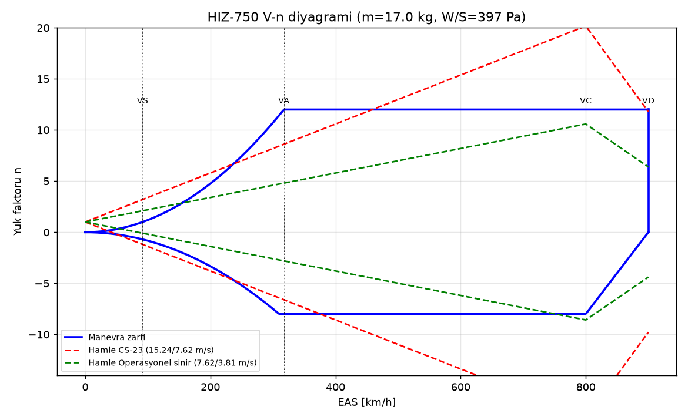
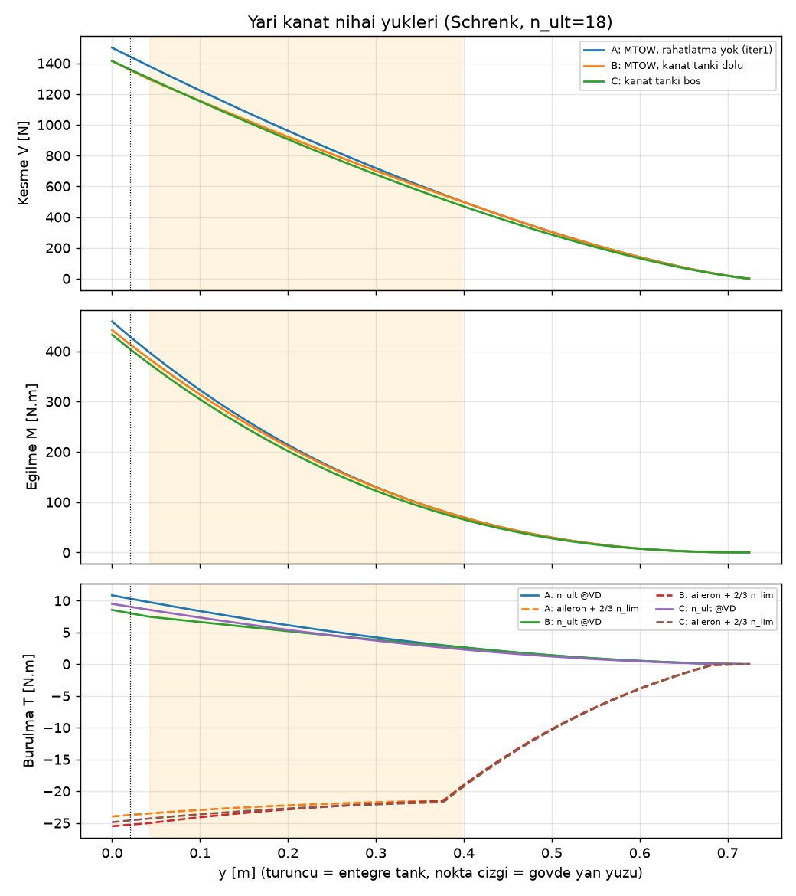
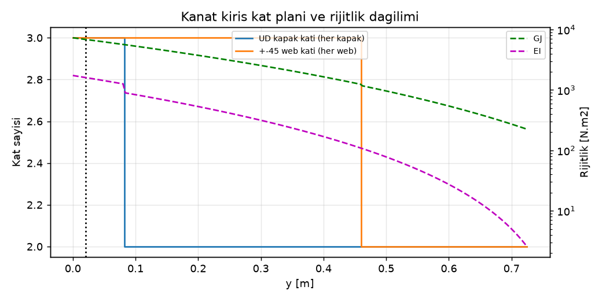
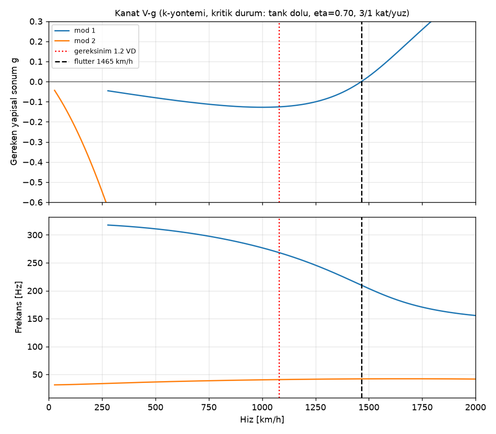
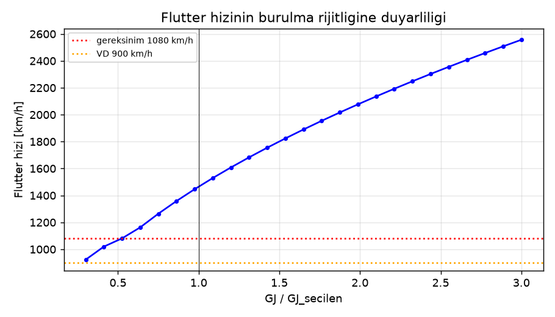
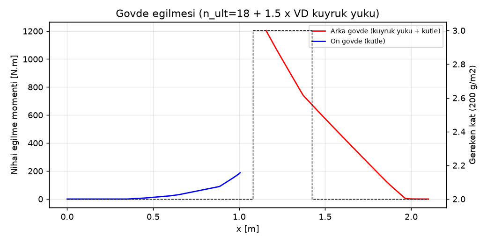

# 04 – Yapı, Flutter ve Kontrol Yüzeyleri (İterasyon 2)

> **İter2-son güncelleme (ana entegrasyon):** Son params düzeltmelerinden sonra script yeniden çalıştırıldı. Düzeltmeler: yakıt CG'si 0,987 m, tank dağılımı CAD'den, servo konumları bölündü. **Güncel değerler:** MTOW 16,81 kg, seçilen kat planıyla (2 kat/yüz) kanat 1,48 kg, **flutter 1356 km/h** (gereksinim 1080 km/h, pay %26), diverjans 2840 km/h. Aşağıdaki 1383 km/h değeri bu sürümden önceki koşuya aittir; güncel ham çıktı `structures/out/sonuclar.json`.

Bu belgenin dayandığı kaynaklar:
- Script: [`structures/structures.py`](../structures/structures.py). Girdisi `params.py`, çıktıları `structures/out/`, tüm sayısal sonuçlar `structures/out/sonuclar.json`.
- İterasyon 1 arşivi: `structures/structures_iter1.py`, `structures/out_iter1/`, `structures/04_yapi_flutter_iter1.md`.

Tasarım kütlesi: MTOW **16,77 kg**, W/S = 392 Pa. Yakıt 4,0 kg; dağılımı §5.4'te.

## 0. İterasyon 2 değişiklik özeti

| Konu | İter 1 | İter 2 | Etki |
|---|---|---|---|
| MTOW | 18,30 kg | 16,77 kg (iniş takımı kaldırıldı) | Kök momenti 494 → 443 N·m |
| N_NEG | −6 | −8 | Simetrik kat planı, kütle cezası yok |
| Arka kiriş | 0,62c | 0,55c | Kutu yüksekliği aynı (21,6 mm kök). Burulma hücresi küçüldü. |
| Burulma hücresi | Tüm profil (iyimser) | Hücum kenarı → arka kiriş, tek hücre + arka web | Kök GJ 6351 → 5055 N·m² |
| Elastik eksen | 0,38c | 0,30c | x_α 0,10 → 0,24 (flutter için kötü), diverjans çok daha iyi |
| Flutter (seçilen 2 kat/yüz) | 1495 km/h | **1383 km/h** (kritik durum: tank dolu, η = 0,70) | Gereksinim 1080 km/h; pay %28 |
| Diverjans | 1973 km/h | 2840 km/h | e = 0,05c |
| Entegre kanat tankı | – | Yeni. **Gerçek kapasite 0,39 L/yarı** (params: 0,9 L) | Bkz. §5 |
| İniş | Tekerlekli | Gövde altı kızak + kuyruk tamponu (yeni) | Bkz. §6 |
| Yatay kuyruk | Tek parça | İki yarı + boru bağlantı | Bkz. §7 |
| Rudder servo | 40 kg·cm | 53 kg·cm (S_v 0,05 → 0,06 m²) | **60 kg·cm sınıfı** |

## 1. Tasarım kriterleri

| Kriter | Değer |
|---|---|
| Limit yük faktörü | +12 / −8 g |
| Nihai emniyet katsayısı | 1,5 (nihai +18 / −12 g) |
| V_C (operasyonel, ECU limitli) | 800 km/h |
| V_D (tasarım dalış hızı) | 900 km/h |
| Flutter / diverjans gereksinimi | ≥ 1,2·V_D = 1080 km/h. Kat seçimi ek model çarpanı 1,25 ile yapıldı (≥ 1350 km/h). |
| Flutter hesabı yoğunluğu | Deniz seviyesi ISA |

## 2. Malzeme ve izin değerleri

| Malzeme | Kullanım yeri | Özellikler |
|---|---|---|
| T700S/epoksi UD 200 g/m² | Kiriş kapakları | E₁ 125 GPa, Xt 2100 MPa, Xc 1200 MPa, kat kalınlığı 0,20 mm |
| T300 3K dokuma 160 g/m², ±45 | Kabuk, web | E 55 GPa, G₄₅ 25 GPa, kat kalınlığı 0,178 mm |
| 200 g/m² dokuma, quasi-izotrop | Gövde, kızak çerçeveleri | E_qi 45 GPa, kat kalınlığı 0,22 mm |
| Rohacell 51 IG-F | Sandviç çekirdek | 52 kg/m³, 2 mm (tank kaburgası 3 mm) |
| Cam 48 g/m² + epoksi film | Tank iç kaplaması | ≈ 0,15 kg/m² |

**İzin değerleri:**
- Düşürme faktörü: 0,80 (çevre) × 0,80 (imalat) × 0,85 (istatistik) = 0,544.
- Kiriş kapağı izin gerilmesi **500 MPa**: 4000 µε birim şekil değiştirme sınırından gelir.
- Gövde izin gerilmesi **180 MPa**.
- Boru (kuyruk bağlantısı) izin gerilmesi 400 MPa.

## 3. V-n diyagramı

| Büyüklük | Değer |
|---|---|
| V_S (temiz, CLmax 1,0) | 91 km/h |
| V_A | 315 km/h |
| CLα | 4,62 /rad |
| K_g | 0,79 |
| CS-23 hamlesi (15,24 m/s) @ V_C | n = 20,4 → 12 g limiti **aşılıyor** |
| Operasyonel hamle (7,62 m/s) @ V_C | n = +10,7 / −8,7 |
| Operasyonel hamle (3,81 m/s) @ V_D | n = +6,5 |

**Operasyonel sınırlama:** Yüksek hız geçişleri yalnızca sakin havada yapılır (yer rüzgârı < 5 m/s, türbülans yok).

−8,7 g, −8 g limitini %9 aşıyor; ancak nihai yükte −13 g, +18 g'lik simetrik kiriş kapasitesinin içinde kalıyor. Bu durum uçuş kartında not edilmeli.

## 4. Kanat yükleri (nihai, n = 18)

Üç yükleme durumu hesaplandı. Boyutlandırma B ve C'nin zarfına göre yapıldı:

| Durum | M_kök [N·m] | M_gövde yanı [N·m] | V_kök [N] | T_kök [N·m] |
|---|---|---|---|---|
| A: MTOW, yakıt rahatlatması yok (referans) | 453 | 338 | 1480 | 24,2 |
| B: MTOW, kanat tankları dolu (2 × 0,31 kg) | 443 | 333 | 1425 | 25,2 |
| C: Kanat tankları boş (W − 0,62 kg) | 436 | 326 | 1425 | 24,8 |

- **Yakıt rahatlatması küçük (−%2):** tank gövdeye yakın (y = 0,08–0,29 m) ve gerçek kapasite düşük. B durumu belirleyici.
- **Burulma** elastik eksen 0,30c etrafında. En kritik durum "4° aileron @ V_D + 2/3 n_lim": 25 N·m nihai.
- Kaldırma artık elastik eksenin sadece 0,05c önünde. Bu yüzden saf g yükünden gelen burulma 9,7 N·m'ye düştü. Yakıt atalet yükü 0,375c'de etkiyor ve burnu aşağı çeviriyor.

## 5. Kanat yapısı ve entegre yakıt tankı

### 5.1 Kat planı (seçilen: yüz başına 2 kat ±45)

| y [m] | Veter [m] | Kutu yüksekliği [mm] | M_ult [N·m] | Kapak genişliği [mm] | UD kat | Web katı | GJ [N·m²] |
|---|---|---|---|---|---|---|---|
| 0,000 | 0,429 | 21,6 | 443 | 50 | 3 | 3 | 5055 |
| 0,084 | 0,397 | 19,1 | 333 | 46 | 2 | 3 | 3874 |
| 0,153 | 0,370 | 17,2 | 256 | 43 | 2 | 3 | 3062 |
| 0,251 | 0,333 | 14,5 | 165 | 39 | 2 | 3 | 2132 |
| 0,353 | 0,293 | 11,7 | 94 | 34 | 2 | 3 | 1404 |
| 0,451 | 0,255 | 9,2 | 46 | 30 | 2 | 2 | 862 |
| 0,553 | 0,216 | 6,7 | 16 | 25 | 2 | 2 | 501 |
| 0,652 | 0,178 | 4,4 | 2 | 21 | 2 | 2 | 270 |

Kutu yüksekliği artık iki kirişteki profil kalınlığının ortalamasından hesaplanıyor (64A tipi dağılım). Arka kirişin öne alınması kutuyu biraz yükseltti, ancak kabuk ve çekirdek düşülünce net yükseklik iter 1 ile aynı kaldı.

**Kanat kütlesi: 1,47 kg.** Bu değere tank kaburgaları, sızdırmazlık kaplaması ve donanım (86 g) dahil. params.py'deki 1,75 kg bütçenin 0,28 kg altında; aradaki pay boya, kablo ve servo yuvalarına yeter.

### 5.2 Entegre tank: kapasite (kritik bulgu)

Kirişler arası net iç kesit hesaplandı: kutu alanından kapaklar, web'ler ve %5 bölme payı düşüldü. Tank gövde yan yüzünden (y = 0,083 m) η = 0,40'a (y = 0,29 m) kadar uzanıyor.

| Tankın dış sınırı η₁ | İç hacim / yarı kanat |
|---|---|
| **0,40 (params)** | **0,39 L (0,31 kg)** |
| 0,50 | 0,48 L |
| 0,60 | 0,54 L |
| 0,70 | 0,59 L |

**0,9 L/yarı kapasite fiziksel olarak mümkün değil.** Profil %7 kalınlıkta ve kutu yalnız 0,35c genişliğinde; η = 0,70'e uzatılsa bile 0,59 L. Öneri:
- Kanat tankı η 0,06–0,40, **2 × 0,39 L = 0,78 L (0,62 kg)**.
- Gövde tankı **3,38 kg (4,2 L)**, x ≈ 0,97 m. Toplam yakıt ağırlık merkezi params'taki x = 1,00 m'de kalacak şekilde hesaplandı.
- Daha fazla kanat yakıtı istenirse η₁ 0,50'ye uzatılabilir (+0,09 L). Ancak aileron servo yuvası ve flutter kesiti (η 0,70) yakın; önerilmez.

### 5.3 Tank yapısı ve sızdırmazlık gereksinimleri

**Tasarım basıncı:** iç basınç durumlarının en büyüğü (limit) 10 kPa, nihai 15 kPa.

| Basınç kaynağı | Limit basınç |
|---|---|
| Dikey 18 g sütunu | 2,3 kPa |
| Yuvarlanma 10 rad/s, açıklık boyunca | 3,1 kPa |
| Kızak inişi 5 g, boyuna | 4,9 kPa |
| Havalandırma tıkanması / buhar basıncı | 10 kPa |

**Yapısal kontroller:**

| Kontrol | Sonuç |
|---|---|
| Kabuk paneli (sandviç, iki bölme) | Yüz gerilmesi 26 MPa, çekirdek kesmesi 0,40 MPa (Rohacell 51 izin değeri ≈ 0,8 MPa). Uygun. |
| Tank kaburgaları (iki kapalı kaburga + orta bölme) | 3 mm Rohacell, her yüzde 2 kat ±45. Gerilme 0,8 MPa; kaburga aslında burulma ve kesme taşıyıcısı olarak boyutlanır. |
| Yanal dengesizlik (bir tank boş) | 0,57 N·m. 750 km/h'te ihmal edilebilir; 95 km/h inişte ~1° aileron trimi gerektirir. |

**İmalat ve sızdırmazlık:**
1. Tank bölgesinde iç yüz kaplaması: 1 kat 48 g/m² cam + kerosene dayanıklı epoksi flow-coat (ör. Araldite LY5052 veya yakıt tankı epoksisi).
2. Kaburga ve kiriş birleşimleri yakıt dayanımlı dolgu ile fileto yapılır (epoksi + pamuk flok). Tüm köşeler yuvarlatılmalı (R ≥ 3 mm).
3. Kanattaki çıkış ve havalandırma nipelleri alüminyum flanşla ve iki taraftan yapıştırılarak takılır. Çıkış arka-iç köşede, havalandırma ön-dış köşede olmalı.
4. Her iki kanat tankı, tek yönlü valflerle gövdedeki hopper'a eşit beslenir (T-bağlantı). Tankların birlikte boşalması dengesizliği sınırlar.
5. **Sızdırmazlık testi:** 15 kPa (0,15 bar, nihai basınç) hava, 30 dk, sabunlu su ile kontrol + manometrede düşüş < %5. **20 kPa'yı aşmayın**, kabuk paneli zarar görür.
6. Kerosene kanat birleştirici bıçaklarına ve kök pimlerine ulaşmamalı. Kök kaburgası (y = 0,083 m) tank duvarıdır ve birleştirici kutusu tankın dışında kalmalı.

### 5.4 Yakıt dağılımı (params'a öneri)

| Tank | Kütle | x [m] |
|---|---|---|
| Gövde ana tankı + hopper | 3,38 kg | 0,97 |
| Kanat entegre tankları (2×) | 2 × 0,31 kg | 1,15 |
| **Toplam** | **4,00 kg** | **1,00** |

## 6. Flutter ve diverjans

**Yöntem:**
- Theodorsen 2 serbestlik dereceli tipik kesit, k-yöntemi.
- Kod doğrulaması: Hodges & Pierce örneğinde U_F = 2,184, referans ≈ 2,17.
- Frekanslar Rayleigh yöntemiyle hesaplandı; yakıt rijit kütle kabul edildi.
- İki kesit incelendi: η = 0,70 (tank dışı) ve η = 0,25 (tank içi). Her biri tank dolu ve boş olarak hesaplandı.

| Kat/yüz | Kanat [kg] | f_h [Hz] | f_α [Hz] | V_F dolu η0,70 | V_F boş η0,70 | V_F dolu η0,25 | V_F boş η0,25 | V_div [km/h] |
|---|---|---|---|---|---|---|---|---|
| 1 | 1,10 | 48 | 248 | **1081** | – | – | – | 2044 |
| **2** | **1,47** | 38 | 281/286 | **1383** | 1405 | 2112 | 1871 | 2840 |
| 3 | 1,85 | 32 | 293 | 1617 | – | – | – | 3421 |
| 4 | 2,23 | 29 | 298 | 1806 | – | – | – | 3888 |

Seçilen kat planında (2 kat/yüz) kesit parametreleri η = 0,70'te μ = 14,2, x_α = 0,24, r_α² = 0,39.

**Sonuçlar:**
- Kritik durum **tank dolu, η = 0,70**: 1383 km/h. Pay %28 (iter 1'de %38).
  - Pay azalmasının ana sebebi: elastik eksen 0,30c'ye geldi ve yapısal ağırlık merkezi (0,42c) ile arası açıldı (x_α 0,10 → 0,24).
  - Dolu tank kanat kökünde burulma ataletini artırıyor ve f_α'yı 286 → 281 Hz düşürüyor. Etkisi −22 km/h, küçük.
- Tank içi kesit (η = 0,25) kritik değil: yüksek μ ve kısa veter.
- 1 kat/yüz seçeneği artık gereksinimin sınırında (1081 km/h). **2 kat/yüz zorunlu.**
- Diverjans 2840 km/h; geri ok açısı ile pratikte söz konusu değil.
- **İyileştirme önerisi (isteğe bağlı):** kanat ucu hücum kenarına (η 0,85–1,0) yarı kanat başına 15–20 g kütle koyup x_α'yı düşürmek. Bunun yerine kabuk ağırlığını öne çekmek, yani firar kenarı bölgesini (0,55c sonrası) 1 kat/yüz yapmak daha iyi: hem hafifletir hem x_α'yı azaltır. CAD/imalat aşamasında değerlendirilmeli.

**Kontrol yüzeyleri:** Tamamı %100 statik balanslı olacak. Gereken dönme frekansı ≥ 57 Hz (kanat eğilme frekansının 1,5 katı); boşluk ≤ 0,1°.

| Yüzey | Kütle [g] | Balans kütlesi [g] | Gereken bağlantı rijitliği [N·m/rad] |
|---|---|---|---|
| Aileron (her biri) | 12 | 23 | ≥ 0,6 |
| Elevator (her biri) | 11 | 22 | ≥ 0,7 |
| Rudder | 16 | 31 | ≥ 1,9 |

Flaplar yüksek hızda dayanağa ön yüklü tutulur, balans gerekmez. Toplam balans kütlesi 2·23 + 2·22 + 31 = 121 g; params'taki 0,12 kg ile uyumlu.

## 7. Gövde altı kızakla iniş (yeni)

**Varsayımlar:**
- İniş kütlesi 13,17 kg (boş + %10 yakıt).
- Teker koyma hızı 95 km/h (CL = 0,72, flap 30°). Dikey batma hızı 1,5 m/s.
- Kaldırma = ağırlık kabulü (CS-23.473): yalnız dikey kinetik enerji emilir, **E = 14,8 J**.
- Enerji emme verimi η = 0,5.

| Zemin / kızak | Strok | n_iniş (limit) |
|---|---|---|
| Sert pist, 10 mm köpük kızak | 10 mm | **22,9 g, kabul edilemez** |
| **Kısa çim + 10 mm köpük (tasarım durumu)** | 25 mm | **9,2 g** |
| Çim + 20 mm EPP ped | 45 mm | 5,1 g |

**Sonuç:** İniş **yalnız çim pistte** yapılabilir. Tasarım yükü 9,2 g limit (F = 1185 N), nihai F = 1778 N.

| Kontrol | Sonuç |
|---|---|
| Kızak kirişi (40 × 10 mm) | Üst/alt 1 mm UD karbon + Kevlar yan duvarlar + Rohacell çekirdek. 3 çerçeve, açıklık 0,34 m. σ = 466 MPa / 500 izin değeri: **sınırda**. Öneri: 4 çerçeve (açıklık 0,23 m) → σ ≈ 310 MPa. |
| Gövde çerçeveleri (x = 0,62 / 0,96 / 1,30 m, + 1,13 m önerilen) | Halka momenti 0,08·F·R. 3 mm karbon/Rohacell sandviç, radyal derinlik 15 mm: σ = 104 MPa (izin değeri 180). Uygun. |
| Alt kabuk kesmesi | 2 kat 200 g/m² (0,44 mm): τ = 15,6 MPa. Uygun. |
| Lokal temas basıncı | 131 kPa. Kızak dağıtır, kabuk doğrudan temas etmez. |
| Sürtünme / kayma | μ = 0,5 (çim), kayma mesafesi ≈ 71 m. 6 adet M3 civata, her biri ~0,5 kN kesme. Uygun. |
| Kızak kütlesi | ~205 g (params'taki 0,25 kg kalem dolly kilidi dahil, uyumlu) |

**Önerilen kızak yapısı:**
- Kevlar dış sarım (aşınma ve darbe), karbon UD üst/alt kapak, Rohacell 51 çekirdek.
- **Değiştirilebilir aşınma plakası:** 1,5 mm G10 veya 2 mm UHMW-PE, havşa başlı M3 civatalar ve kızak içinde gömülü somun yuvaları. Her 5–10 inişte kontrol edilir.
- Kızak gövdeye 4 çerçevede bağlanır. Çerçevelerde kızak bağlantısı için 3 mm karbon takviye.
- Kızak ön ucu 20° rampa ile kalkık olmalı, çim tutmasın. Hava alığı üstte olduğundan çim/taş yutma riski düşük.

**⚠ Kuyruk çarpma sorunu:**
- Kızak arka ucundan (x = 1,30 m) egzoz konisi alt kenarına çizilen doğrunun açısı yalnızca **2,6°**.
- Teker koyma için gereken hücum açısı flaplı bile ~5–8°. **Uçak önce kuyrukla yere değer.**
- Çözüm: x ≈ 1,90 m'de (yatay kuyruk bağlantı çerçevesi) **kuyruk tamponu**: 15 mm yükseklik, değiştirilebilir Kevlar/UHMW blok.
  - Limit tasarım yükü ≈ 0,4 × 1185 N ≈ 475 N.
  - Çerçeveyi yatay kuyruk boru yatağıyla paylaşır.
- Alternatif: ana kızağı x ≈ 1,55 m'ye uzatmak. Motor bölgesinin altından geçer; bölge ısı kalkanlı olmalı.

**Kalkış arabası (dolly):** T/W 2,5 → kilit pimlerinde 425 N × 1,5. Kızak üzerindeki kilit yuvası 2 × M4 ve 3 mm takviye ile yeterli.

## 8. Gövde, motor yatağı, kanat bağlantısı

| Kontrol | Sonuç |
|---|---|
| Arka gövde nihai eğilmesi | 1168 N·m, x = 1,16 m (arka kiriş). Kanat öne geldiği için motor artık kanat arkasında: iter 1'de 982 N·m'ydi. |
| Gereken kabuk | En fazla **3 kat 200 g/m²**, x = 1,15–1,6 m arası. Diğer bölgeler 2 kat. |
| Ön gövde | 136 N·m. 2 kat yeterli. |
| Motor yatağı | F_z = 715 N, F_y = 268 N, F_x = 638 N (hepsi nihai). 4 × M4 12.9; her civata kesme 350 N, çekme 173 N. Uygun. |
| Kanat-gövde birleştirici | M_gövde yanı = 333 N·m. 2 karbon bıçak h = 16 mm (kutu yüksekliği 19,1 mm), gereken genişlik ≥ 7,8 mm → **12 × 16 mm**. |
| Kök pimi | Yük 836 N. M5 8.8 kesme kapasitesi 9,4 kN. Gereken yatak kalınlığı ≥ 0,77 mm → 3 mm takviye. |

## 9. İki parçalı yatay kuyruk kök bağlantısı (yeni)

**Yükler:**
- Yarım kuyruk limit yükü 325 N (V_D, CL_t = 0,2), nihai 488 N.
- Basınç merkezi açıkta kalan yarı açıklığın %43'ünde (kökten 0,10 m).

| Büyüklük | Değer |
|---|---|
| Kök eğilme momenti (nihai) | 48 N·m |
| Kök burulması (ana boru ekseni 0,30·c_r; aero + elevator menteşe momenti, nihai) | 33 N·m |
| Ana boru seçimi | **D14 × 2,0 karbon boru: σ = 241 MPa**, 117 g/m. D12 × 2,0 sınırda (353 MPa). Egzoz ısısı nedeniyle Tg ≥ 120 °C reçine veya titanyum. |
| Gövde içi boru yatağı | Çift yatak: 100 mm geçme boyunda yatak kuvveti 687 N. Kuyruk kök kaburgasında 2 mm karbon + alüminyum burç. |
| İnsidans/burulma pimi | 4 mm çelik pim, ana borudan 0,45·c_r arkada. Yük 355 N (kapasite 6 kN). Gereken yatak kalınlığı ≥ 0,41 mm → 2 mm kök kaburgası takviyesi. |
| Kilitleme | Her yarı M3 tutucu civata ile. Uçuş öncesi kontrol listesine eklenmeli. |

Boru egzoz borusunun üstünden geçer. Boru yüzeyinde sıcaklık > 80 °C olabilir; alüminyum folyo + seramik keçe kalkan gerekli.

## 10. Menteşe momentleri ve servolar

Yöntem iter 1 ile aynı: ince profil teorisi × 0,7 / β, kol oranı 1,3, emniyet katsayısı 2.

| Yüzey | M_h @800 km/h | M_h @V_D | M_h @V_A | Gereken servo | Seçilecek servo sınıfı |
|---|---|---|---|---|---|
| Aileron | 1,12 N·m | 1,39 N·m | 0,66 N·m | 21,9 kg·cm | 45 kg·cm (ortak tip) |
| Elevator | 1,05 | 1,48 | 0,73 | 23,2 | 45 |
| Rudder (S_v 0,06 m²) | 2,40 | 3,39 | 1,67 | **53,2** | **60** |
| Flap (150 km/h, 30°) | – | – | 0,69 | 10,8 | 45 (ortak tip) |

## 11. Test planı

1. **Kupon testleri:**
   - UD ve ±45 laminelerde E ve kopma birim uzaması.
   - Tank kaplamalı numunelerde 2 hafta kerosene daldırma sonrası kayma mukavemeti (ILSS) düşüşü < %10 olmalı.
2. **Tank sızdırmazlık testi:** 15 kPa, 30 dk, sabun + manometre. Ardından yakıtla 24 saat bekletme testi.
3. **Kanat statik yük testi (kum torbası, Schrenk dağılımı):**
   - Adımlar: %67 → %100 limit → **%150 nihai**.
   - Nihai yükte toplam 18 × 16,77 × 9,81 = 2,96 kN; yarım kanat başına 1,48 kN ≈ 151 kg kum.
   - Tank bölgesine eşdeğer yakıt kütlesi (0,31 kg × 18 g) çıkarılarak yüklenir.
4. **Burulma testi:** Ölçülen GJ, hesaplanan değerin ≥ %80'i olmalı. Kök GJ 5055 N·m².
5. **GVT (serbest-serbest askı):** Tank dolu ve boş ölçülür. Kabul kriterleri:
   - f_h ≈ 38 Hz, f_α ≥ 225 Hz (hesaplananın %80'i);
   - kontrol yüzeyi dönme frekansı ≥ 57 Hz.
6. **Kızak düşürme testi:**
   - Uçak iniş kütlesinde (veya kütle eşdeğer gövde parçası) 115 mm'den (1,5 m/s) çime düşürülür.
   - İvmeölçer ile n ≤ 9 g doğrulanır; çerçeve ve aşınma plakası kontrol edilir.
7. **Yatay kuyruk kök testi:** Her yarıya 488 N nihai yük (basınç merkezinde), 3 s. Boru yatağında kalıcı boşluk olmamalı.
8. **Uçuş zarfı genişletme:**
   - Hız 400 → 800 km/h, her adımda +50 km/h.
   - Kanat ucu ivmeölçeri ≥ 1 kHz örnekleme. Her adımda darbe girişi verilir ve sönüm incelenir.
   - GVT yapılmadan 600 km/h üstü yasak.

## 12. Açık sorunlar ve params.py önerileri

| # | Konu | Öneri |
|---|---|---|
| 1 | Kanat tankı kapasitesi 0,39 L/yarı (params 0,9 L) | `FUEL.tanks.wing_integral_L_each = 0.39`, `fuselage_L = 4.2` (gövde tankı 3,38 kg, x ≈ 0,97 m) |
| 2 | Kuyruk çarpma açısı 2,6° | x ≈ 1,90 m'de kuyruk tamponu ekle: `GEAR` ve `MASS_ITEMS` içine 0,04 kg, x = 1,90 |
| 3 | Sert pistte 23 g iniş | Operasyonel sınır: yalnız çim pist. Kızak içine değiştirilebilir 10–20 mm EPP ped. |
| 4 | Kızak kirişi sınırda (466/500 MPa) | 4 çerçeve: x = 0,62 / 0,85 / 1,08 / 1,30 m (veya kızak h = 12 mm) |
| 5 | Flutter payı %28 (x_α = 0,24) | 2 kat/yüz zorunlu. Arka kiriş sonrası kabuğu 1 kat/yüz yaparak x_α düşürülmeli (CAD aşaması). |
| 6 | Operasyonel negatif hamle −8,7 g | Uçuş kartı notu; yapı yeterli |
| 7 | Rudder servo 53 kg·cm | 60 kg·cm sınıfı (params ile uyumlu) |
| 8 | Yatay kuyruk boru seçimi | D14 × 2 karbon (yüksek Tg) veya Ti; yaklaşık 70 g (0,6 m) |
| 9 | Kanat kütlesi 1,47 kg (bütçe 1,75) | Bütçe korunabilir (pay 0,28 kg) |
